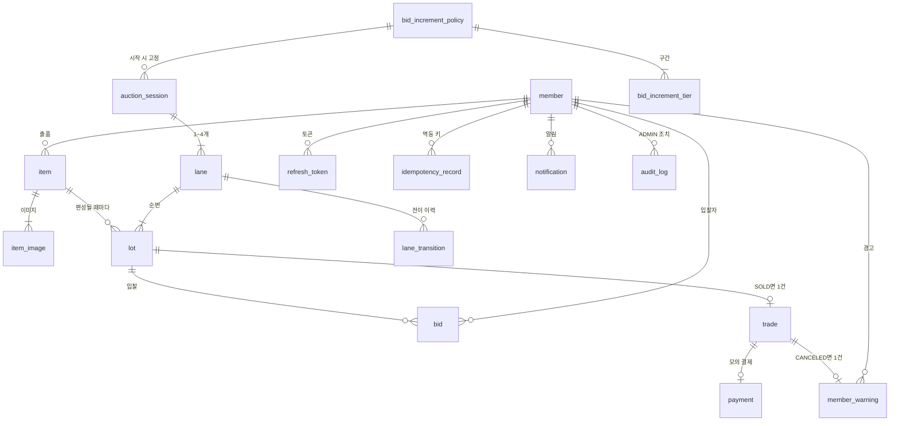
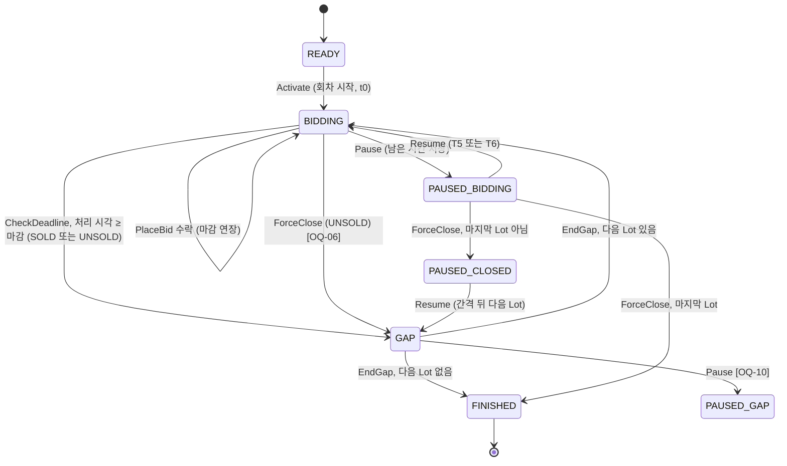
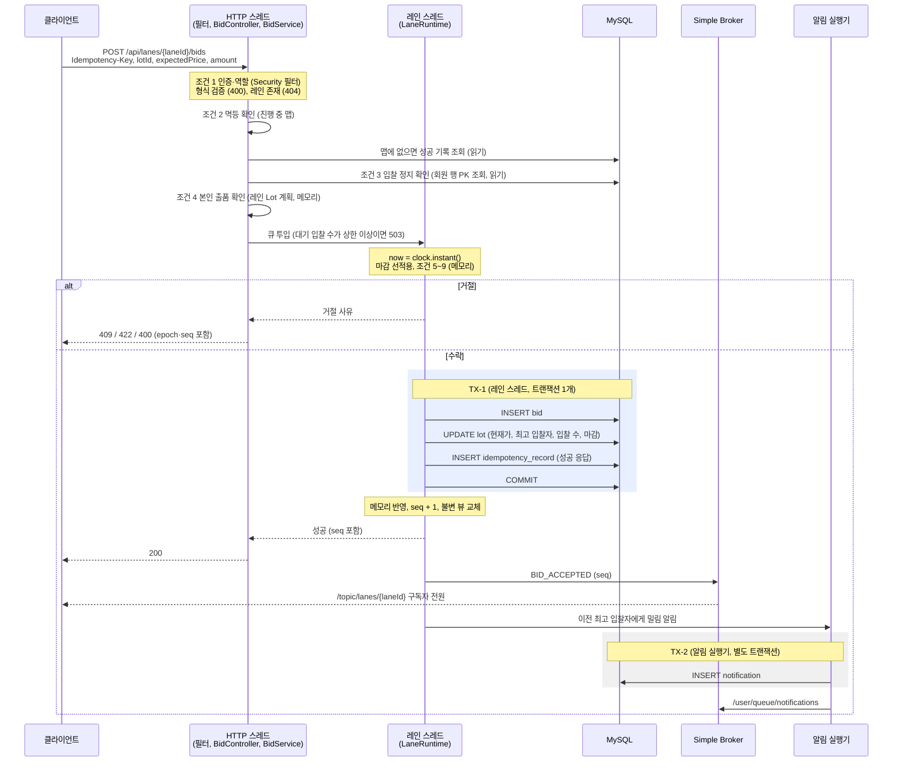
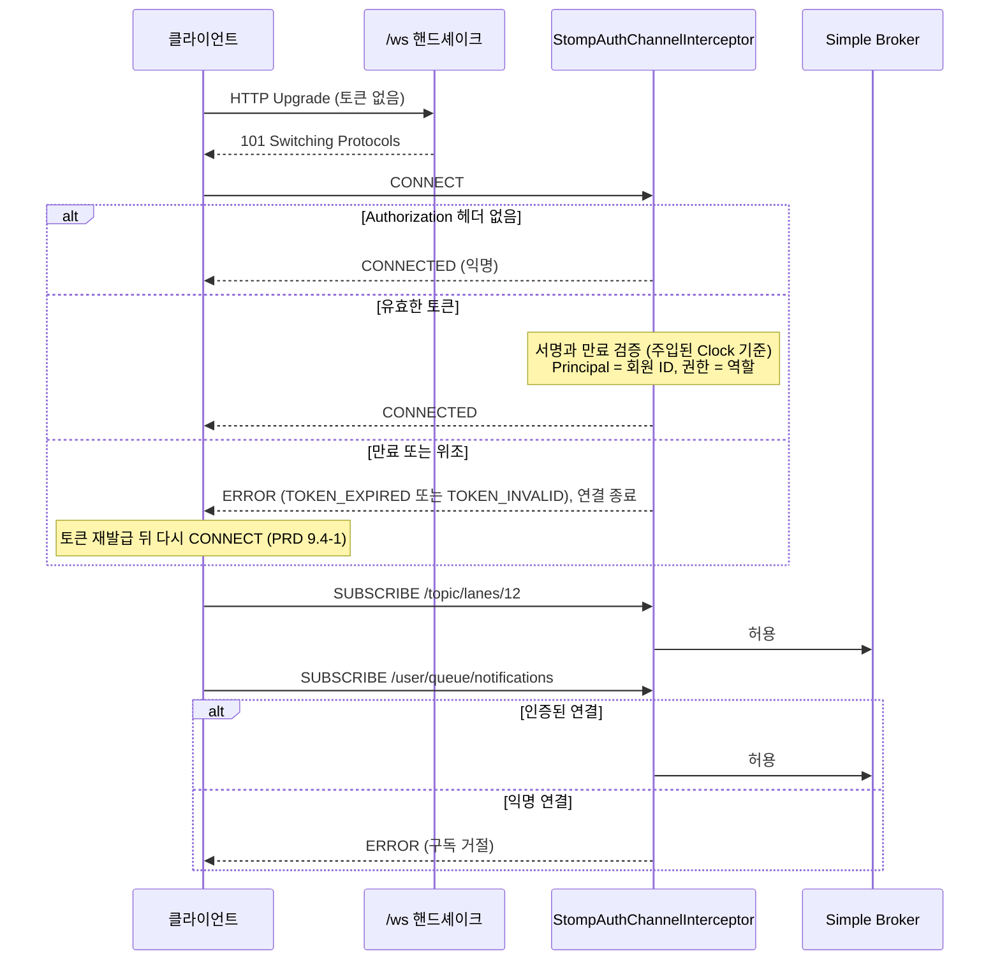

# Four-Lane Auction — 아키텍처

| 항목 | 내용 |
|---|---|
| 버전 | 0.1 (초안) |
| 작성일 | 2026-10-23 |
| 근거 문서 | [PRD.md](PRD.md) 0.3, [CHALLENGES.md](CHALLENGES.md) 0.1, [IDEA.md](IDEA.md) |
| 상태 | 초안. 1주차 계약(OpenAPI, STOMP 메시지 스키마)과 스키마의 바탕이 된다. CHALLENGES에서 아직 정하지 않은 과제는 여기서도 정하지 않고, 어느 후보를 고르든 바뀌지 않는 경계만 고정한다 |

---

## 0. 이 문서를 읽는 법

**표기**

| 표기 | 뜻 |
|---|---|
| `기본안` | PRD·IDEA가 이미 전제로 둔 방식. CHALLENGES 후보 표에서 `PRD 전제`로 표시된 것이다. 측정 결과에 따라 바뀔 수 있다 |
| `잠정안` | PRD에 전제가 없어서, 흐름을 끝까지 그리려고 이 문서가 CHALLENGES 후보 중 하나를 임시로 고른 것. 해당 과제의 재현 테스트·측정으로 확정하고, 바뀌면 이 문서를 고친다. 목록은 [부록 A](#부록-a-미결-과제와-이-문서의-잠정안) |
| `(제안)` | PRD에도 CHALLENGES에도 없는 설계 값이나 선택. 리뷰나 측정을 거쳐 확정한다 |
| `[OQ-nn]` | PRD 10장의 미결 질문. 이 문서도 정하지 않고 자리만 남긴다 |
| `[CH-nn]` | CHALLENGES의 기술 과제 |
| 절 번호 | `PRD 6.3`처럼 문서 이름을 붙인 번호는 그 문서의 절이고, 번호만 쓴 것(`6.3`)은 이 문서의 절이다. 표에 "PRD" 열이 있으면 그 열의 번호는 PRD의 절이다. `C1`~`C5`, `T0`~`T7`, `M-nn`, `AC-nn-n`은 PRD의 식별자다 |

**원칙**

- PRD에 없는 기능은 넣지 않는다. 설계하다 PRD에서 빈칸을 찾으면 설계로 채우지 않고 [부록 B](#부록-b-설계하며-찾은-prd의-빈칸)에 질문으로 남긴다.
- 기술은 PRD 규칙에서 필요가 생길 때만 쓴다. 확정 스택의 Redis("필요 시")는 MVP 구성에 없다. Redis가 들어오는 조건은 10장에 적었다.
- 아직 정하지 않은 과제의 해결 방식은 고르지 않는다. 대신 어느 후보를 골라도 유지되는 것(포트 인터페이스, 트랜잭션 경계, 메시지 계약)을 고정한다. 그래야 실험 ①·②에서 후보를 바꿔 끼울 수 있다.

**고정하는 것과 열어두는 것**

| 구분 | 내용 | 이유 |
|---|---|---|
| 1주차에 고정 | REST 경로와 HTTP 상태, STOMP 목적지, 레인 이벤트 봉투(`epoch`, `seq`, `occurredAt`, `serverTime`), 스냅샷 필드, 시각 형식, 테이블과 제약 | 프론트와 백엔드를 병렬로 개발하므로 계약을 먼저 고정한다 (IDEA 9.1 리스크 1). 계약을 고정한 뒤에는 필드를 추가하기 어렵다 (OQ-34의 근거와 같다) |
| 측정·테스트를 거쳐 결정 | 동시성 제어(CH-04), 멱등 저장(CH-06), 타이머(CH-03), 브로드캐스트 튜닝·페이로드(CH-07), 복구 방식(CH-09) | CHALLENGES 원칙. 이 문서에서는 잠정안으로 그린다 |

---

## 1. 시스템 구성도

### 1.1 전체 구성 (MVP: 단일 인스턴스)

```
┌──────────────────────────── Browser : React SPA ─────────────────────────────┐
│  REST client (TanStack Query)                 STOMP client (@stomp/stompjs)  │
└──────────────┬───────────────────────────────────────────────┬───────────────┘
               │ (1) HTTPS /api/**                             │ (2) WSS /ws
               ▼                                               ▼
┌─────────────────────── Spring Boot app : 1 instance (MVP) ───────────────────┐
│                                                                              │
│  Security filter chain (JWT)                  STOMP inbound channel          │
│        │                                      + StompAuthChannelInterceptor  │
│        ▼                                                                     │
│  Controllers ──► Application services                                        │
│                     │          │ (3) PlaceBid / Pause / Resume / ForceClose  │
│                     │          ▼                                             │
│                     │  ┌─────────────────── Lane engine ──────────────────┐  │
│                     │  │ LaneRegistry ──► LaneRuntime x N                 │  │
│                     │  │   inbox (FIFO) ──► single writer                 │  │
│                     │  │   LaneStateMachine, TimerScheduler               │  │
│                     │  │ SessionAutoStarter                               │  │
│                     │  └──────┬──────────────────────────────┬────────────┘  │
│                     │         │ (4) LaneStore: 1 TX          │ (5) publish   │
│                     ▼         ▼                              ▼               │
│      JPA / QueryDSL repositories                 Simple Broker               │
│  Jobs: payment expiry, idempotency TTL             /topic/lanes/{laneId}     │
│  Clock (single bean, ms precision)                 /user/queue/notifications │
│  Micrometer ──► /actuator/prometheus (management port)                       │
└──────────┬──────────────────────────────┬──────────────────────┬─────────────┘
           ▼                              ▼                      ▼
    MySQL 8.4 (Flyway)          Image files (local volume)    Prometheus ──► Grafana
```

| 번호 | 경로 | 내용 |
|---|---|---|
| (1) | REST | 입찰, 조회, 스냅샷, 운영자 명령, 이미지 업로드 |
| (2) | STOMP | 레인 토픽 구독(익명 허용)과 개인 큐 구독(인증 필요). 메시지는 서버 → 클라이언트 방향으로만 흐르고, (5)에서 발행한 이벤트가 이 연결로 내려간다 |
| (3) | 큐 투입 | 입찰과 운영자 명령은 HTTP 스레드가 레인 큐에 넣고 결과를 기다린다 |
| (4) | 영속화 | 상태가 바뀌는 처리마다 트랜잭션 1개. 커밋한 뒤에만 메모리에 반영한다 |
| (5) | 발행 | 커밋한 레인 이벤트를 레인 토픽으로 보낸다 |

### 1.2 구성 요소와 책임

| 구성 요소 | 책임 | 상태를 어디에 두는가 |
|---|---|---|
| React SPA | 회차 목록, 멀티레인 관전, 입찰 버튼, 출품·거래·알림, 운영자 화면. REST 조회는 TanStack Query로 하고, 실시간은 탭당 STOMP 연결 1개로 받는다 | 레인 상태는 TanStack Query 캐시에 두고 STOMP 이벤트로 갱신한다 (7.6) |
| Security 필터 체인 | REST 요청마다 Access Token을 검증하고 URL 단위로 역할을 검사한다 | 없음 (JWT는 무상태) |
| 애플리케이션 서비스 | 유스케이스와 트랜잭션 경계. 입찰과 운영자 명령은 레인 큐로 넘긴다 | 없음 |
| 레인 엔진 | 레인마다 직렬 큐와 단일 작성자를 두고 입찰, 타이머, 운영자 명령을 처리한다. Lot 진행과 마감 판정 | 레인 상태는 메모리(캐시)에 두고, 원본은 DB다 (PRD 9.4) |
| Simple Broker | 레인 토픽과 개인 큐로 팬아웃 | 구독 목록 (메모리) |
| 작업(Job) | 결제 기한 만료 처리, 만료된 멱등 기록 정리 | 없음 (DB 조건부 갱신) |
| MySQL | 모든 원본 데이터. 스키마는 Flyway가 관리한다 | — |
| 이미지 저장소 | 출품 이미지 파일. `ImageStorage` 포트 뒤에 로컬 디스크 구현을 둔다 | 로컬 볼륨 (다중 서버로 가면 S3로 교체, C-04) |
| Prometheus, Grafana | M-18 메트릭 수집과 대시보드 | — |

### 1.3 기술 스택과 버전

| 영역 | 선택 | 메모 |
|---|---|---|
| 언어 | Java 21 | `sealed interface`, `record`, `switch` 패턴 매칭을 엔진의 명령·이벤트 타입에 쓴다 |
| 프레임워크 | Spring Boot 4.x (작성 시점 최신 안정 라인은 4.1. 1주차에 프로젝트를 만들 때 패치 버전까지 고정) | Spring Framework 7, Hibernate 7, Jackson 3 기준이다. 3.x 시절 자료와 설정 클래스·속성 이름이 다른 곳이 있다 |
| 빌드 | Gradle (Kotlin DSL) (제안) | 멀티 모듈 `engine` / `app` (3.1) |
| 영속 | Spring Data JPA, QueryDSL | QueryDSL은 OpenFeign 포크(`io.github.openfeign.querydsl`)를 쓴다. 원본 프로젝트는 유지보수가 느려졌고 Spring Data 문서도 포크를 안내한다. Hibernate 7과 호환되는지는 1주차에 스모크 테스트로 확인한다 |
| DB | MySQL 8.4 LTS (제안) | `CHECK` 제약을 강제하고(8.0.16부터), `DATETIME(3)`을 쓴다 |
| 마이그레이션 | Flyway | MySQL 지원 모듈(`flyway-mysql`)이 따로 필요하다 |
| 인증 | Spring Security + JWT | JWT 발급·검증은 Spring Security의 `spring-security-oauth2-jose`(Nimbus)로 한다 (제안). 별도 JWT 라이브러리 없이 만료 검증기(`JwtTimestampValidator`)에 주입한 `Clock`을 넣을 수 있다 (9장 R10) |
| 실시간 | Spring WebSocket + STOMP, Simple Broker | SockJS는 쓰지 않는다 (제안). k6와 브라우저 모두 순수 WebSocket을 쓴다 |
| API 문서 | springdoc-openapi (Boot 4 대응 라인) | REST만 문서화한다. STOMP 메시지는 이 문서 7장과 1주차 메시지 스키마 문서에 둔다 |
| 테스트 | JUnit 5 (Jupiter), Testcontainers (MySQL) | H2는 쓰지 않는다 (CHALLENGES 2장: InnoDB 락 동작이 다르다) |
| 관측 | Micrometer, Prometheus, Grafana | PRD 9.5 |
| 프론트 | React, Vite, TypeScript, Tailwind CSS, TanStack Query, @stomp/stompjs | |
| 인프라 | Docker, docker-compose, GitHub Actions | |
| Redis | MVP에는 없다 | 10장의 도입 조건을 만족할 때만 쓴다 |

### 1.4 배포 단위

- docker-compose 서비스: `app`, `mysql`, `prometheus`, `grafana`. 부하 발생기(k6)는 다른 머신에 둔다 (PRD 9.1).
- 개발 중에는 Vite 개발 서버의 프록시가 `/api`, `/ws`를 백엔드로 넘긴다. 브라우저에는 같은 출처로 보이므로 CORS 설정이 필요 없다.
- 배포 때 SPA 정적 파일을 어디서 서빙하고 TLS를 어디서 끝낼지는 7주차 EC2 환경을 구성할 때 정한다. 후보는 두 가지다. (a) 앱이 프론트 빌드 결과를 정적 리소스로 함께 서빙하고 TLS도 앱이 맡는다. 구성 요소가 늘지 않는다. (b) 리버스 프록시 컨테이너를 앞에 둔다. 정적 파일과 인증서 관리가 편하다. 대신 WebSocket 연결 5,000개가 프록시도 지나가므로 프록시의 연결 한도도 CH-07 튜닝 대상이 된다. 어느 쪽이든 브라우저에는 한 출처로 보이게 한다.
- GitHub Actions: 백엔드 빌드·테스트(Testcontainers MySQL), 프론트 타입 검사·린트·빌드, 이미지 빌드. 정적 검사(9장 시간 출처 규칙, 3.3 의존 규칙)도 이 단계에서 돈다.

---

## 2. 통신 방식

### 2.1 기본안: 입찰은 REST, 실시간 반영은 STOMP

| 채널 | 방향 | 용도 |
|---|---|---|
| REST `POST /api/lanes/{laneId}/bids` | 클라이언트 → 서버, 요청-응답 | 입찰 |
| REST `GET /api/sessions/{sessionId}`, `GET /api/lanes/{laneId}/snapshot` | 요청-응답 | 첫 화면 로드, 재동기화 |
| STOMP `/topic/lanes/{laneId}` | 서버 → 클라이언트 | 레인 이벤트 브로드캐스트 |
| STOMP `/user/queue/notifications` | 서버 → 클라이언트 | 개인 알림 (S-01) |

STOMP 연결에서는 서버 → 클라이언트 메시지만 흐른다. 클라이언트가 보내는 STOMP `SEND`는 모두 거절한다 (8장).

**기본안을 쓰는 이유 (PRD 근거)**

1. 입찰 계약이 이미 HTTP 모양이다. M-09가 엔드포인트, `Idempotency-Key` 헤더, 의미별 HTTP 상태(400/401/403/404/409/422/503)를 정했다 (PRD 6.3).
2. 요청마다 토큰을 검증한다. OQ-39는 "연결 중에 Access Token이 만료되어도 연결은 끊지 않는다"를 "입찰은 REST라 요청마다 검증된다"는 근거로 정했다. 입찰이 STOMP로 들어오면 이 근거가 사라진다.
3. 요청과 결과의 짝을 HTTP가 맞춰 준다. 응답을 받지 못한 입찰을 재전송하는 절차(PRD 9.4-5)도 HTTP 재시도 그대로다.
4. 과부하(`503 LANE_OVERLOADED`, OQ-31)를 관전 연결과 분리해서 다룬다. 입찰이 몰려도 STOMP 수신 채널이 막히지 않는다.
5. 측정이 표준적이다. 입찰 응답 p99(PRD 9.1)를 k6 HTTP 시나리오와 서버 메트릭으로 바로 잴 수 있다 (OQ-30).

### 2.2 대안: 입찰도 STOMP로 받기

```
SEND
destination:/app/lanes/{laneId}/bids
idempotency-key:<키>
receipt:<상관 ID>

{"lotId": 345, "expectedPrice": 50000, "amount": 60000}

→ 결과는 /user/queue/bid-results 로 따로 받는다: {"correlationId": ..., "code": ..., ...}
```

### 2.3 비교

| 기준 | 기본안: REST 입찰 | 대안: STOMP 입찰 |
|---|---|---|
| PRD 계약 | M-09와 PRD 6.3 그대로 | PRD를 바꿔야 한다. HTTP 상태 대신 결과 메시지에 코드를 담으므로 PRD 6.3 표의 HTTP 열이 의미를 잃는다 |
| 요청-응답 짝 | HTTP가 보장한다 | `receipt`나 상관 ID를 직접 설계해야 한다. 결과는 다른 목적지로 오므로 클라이언트에 대기 목록과 시간 제한 로직이 필요하다 |
| 인증 | 요청마다 Access Token을 검증한다 | CONNECT 때만 검증한다. 연결 중 토큰이 만료되어도 연결을 유지하기로 했으므로(OQ-39), 토큰이 만료된 사용자도 계속 입찰할 수 있다. 막으려면 SEND마다 토큰을 실어 다시 검증해야 한다 |
| 응답 유실과 재전송 | 같은 키로 재전송한다 (PRD 9.4-5) | 연결이 끊기면 결과 메시지도 사라진다. 재연결한 뒤 같은 키로 다시 SEND한다. 멱등 규칙은 같지만 "연결 끊김 = 결과 유실"이 정상 경로가 된다 |
| 과부하 (OQ-31) | `503`으로 바로 응답한다. 요청 스레드와 레인 큐 상한으로 격리한다 | `clientInboundChannel` 스레드 풀을 관전자의 SUBSCRIBE·하트비트 처리와 함께 쓴다. 입찰이 몰리면 관전 연결 처리까지 늦어진다. 503에 해당하는 거절 메시지를 따로 정의해야 한다 |
| 지연 | 요청마다 HTTP 헤더 파싱과 필터 체인 비용이 든다. keep-alive라면 연결 수립 비용은 없다 | 이미 열린 연결로 프레임 하나를 보낸다. 요청당 비용이 작다 |
| 응답과 브로드캐스트의 순서 | 채널이 둘이라 어느 쪽이 먼저 올지 모른다. `seq`로 해결한다 (2.5) | 같은 연결이므로 순서를 맞추기 쉽다. 단, 송신 채널의 세션별 순서 보장 설정이 필요하다 (CH-07) |
| 측정 | k6 HTTP로 p99를 바로 잰다. 서버 메트릭도 표준이다 | k6에서 STOMP 프레임을 직접 만들고 상관 ID로 지연을 계산해야 한다 |
| 문서와 테스트 | springdoc OpenAPI, MockMvc, 계약 테스트 | OpenAPI로 표현되지 않는다. 메시지 문서를 따로 쓰고 `WebSocketStompClient`로 테스트한다 |
| 다중 서버 | 로드 밸런서가 아무 서버로 보낸다. 레인 담당 서버로 전달해야 한다 (10장) | 연결이 붙은 서버로 들어온다. 마찬가지로 담당 서버로 전달해야 한다. 차이가 없다 |
| 예상 병목과의 관계 | 입찰 목표는 초당 1,000건이다. 예상 병목은 팬아웃(초당 수십만 프레임) 쪽이다 (CH-07, CH-12) | 입찰 경로를 빠르게 해도 예상 병목에는 영향이 없다 |

### 2.4 결론

기본안을 유지한다. 대안으로 줄어드는 것은 입찰 1건당 HTTP 처리 비용인데, 목표 부하에서 예상 병목은 입찰 경로가 아니라 팬아웃이다. 반면 대안을 쓰려면 PRD 계약(M-09, 6.3, OQ-39)을 바꿔야 한다.

**대안으로 바꾸는 조건**: 입찰 응답 p99 100ms(PRD 9.1)를 맞추지 못하고, 그 원인이 HTTP 처리(헤더 파싱, 필터 체인, 연결 관리)로 측정될 때. 그때도 HTTP 계층 튜닝을 먼저 해 본다.

### 2.5 두 채널 사이의 도착 순서

입찰 응답(REST)과 그 입찰의 브로드캐스트(STOMP)는 다른 연결로 오므로 어느 쪽이 먼저 도착할지 모른다. 그래서 두 채널의 역할을 나눈다.

- **레인 화면 상태(현재가, 마감 시각 등)는 브로드캐스트와 스냅샷으로만 바꾼다.** 입찰 응답으로는 바꾸지 않는다. 화면 상태의 출처가 하나라서 시퀀스 규칙(7.4)이 깨지지 않는다.
- **입찰 응답은 "내 입찰"의 결과만 바꾼다.** 성공 응답에는 이 입찰이 만든 `BID_ACCEPTED` 이벤트의 `seq`를 넣는다 (제안).
- 클라이언트는 "내가 최고 입찰자"를 이렇게 판정한다.
  - `BID_ACCEPTED(seq)`를 반영할 때마다 레인별로 `lastBidSeq = seq`를 기록한다.
  - 성공 응답(`seq = S`)을 받았을 때, 아직 `S`까지 반영하지 못했으면 "내가 최고 입찰자"로 표시한다. 이미 반영했으면 `lastBidSeq == S`일 때만 표시한다.
  - 그 뒤 같은 Lot에 `seq > S`인 `BID_ACCEPTED`가 오면 표시를 지운다. 최고 입찰자는 연속으로 입찰할 수 없으므로 그 입찰은 언제나 다른 사람의 것이다 (PRD 6.3).
  - 스냅샷을 다시 받으면 스냅샷의 `me.isHighestBidder`로 덮어쓴다.
- 409 응답에도 서버의 현재 `epoch`·`seq`를 넣는다 (제안). 초당 1,000건 중 대부분이 409라서, 409를 받을 때마다 스냅샷을 다시 부르면 스냅샷 요청이 입찰 수만큼 생긴다. 클라이언트는 409를 받아도 스냅샷을 부르지 않고 응답의 `seq`까지 브로드캐스트가 도착하기를 기다린다. 그 사이 갭이 보이면 7.6의 재동기화가 처리한다.

### 2.6 참고: SSE

STOMP 연결의 방향이 서버 → 클라이언트뿐이므로 SSE로도 같은 일을 할 수 있다. CHALLENGES CH-07에 열어 둔 질문이다. 확정 스택은 WebSocket + STOMP이고, 근거는 연결 하나로 레인 토픽 여러 개와 개인 큐를 구독·해지할 수 있다는 점과 Spring의 사용자 목적지(`/user/...`) 지원이다. 이 근거를 측정 리포트에 짧게 남긴다.

### 2.7 REST 엔드포인트 초안

PRD 기능에 대응하는 것만 둔다. 요청·응답 형식은 1주차 OpenAPI에서 정한다.

| 영역 | 메서드와 경로 | 권한 | 근거 |
|---|---|---|---|
| 인증 | `POST /api/auth/signup` | 비로그인 | M-01. 역할은 언제나 `USER`다 (AC-01-4) |
| | `POST /api/auth/login` | 비로그인 | M-01 |
| | `POST /api/auth/refresh` | Refresh Token | M-01 |
| 출품 | `POST /api/items` (multipart) | USER | M-02 |
| | `GET /api/me/items` | USER | U-02 |
| | `POST /api/items/{itemId}/relist` | USER (본인) | S-05 |
| 검수 | `GET /api/admin/items?reviewStatus=` | ADMIN | M-03, A-01, A-03 (승인된 출품물 목록) |
| | `POST /api/admin/items/{itemId}/approve`, `.../reject` | ADMIN | M-03 |
| 회차 (공개) | `GET /api/sessions?status=` | 모두 | P-01 |
| | `GET /api/sessions/{sessionId}` | 모두 | P-03 (레인 스냅샷 묶음, 예정 회차의 편성 미리보기) |
| | `GET /api/lanes/{laneId}/snapshot` | 모두 | M-11 재동기화 |
| | `GET /api/lots/{lotId}` | 모두 | P-03 Lot 상세 모달 |
| | `GET /api/images/{storageKey}` | 모두 | M-02 이미지 표시 |
| 회차 (운영) | `POST /api/admin/sessions` | ADMIN | M-04 |
| | `PATCH /api/admin/sessions/{sessionId}` | ADMIN | AC-04-4 (예정 시각 변경), 시간 파라미터 [OQ-14] |
| | `PUT /api/admin/sessions/{sessionId}/lanes/{laneNo}/lots` | ADMIN | M-05. 레인 하나의 Lot 순서 목록 전체를 바꾼다 |
| | `POST /api/admin/sessions/{sessionId}/start` | ADMIN | M-06 "지금 시작" |
| | `POST /api/admin/sessions/{sessionId}/pause`, `.../resume` | ADMIN | M-13 회차 일괄 |
| | `POST /api/admin/lanes/{laneId}/pause`, `.../resume` | ADMIN | M-13 레인 단위 |
| | `POST /api/admin/lots/{lotId}/force-close` | ADMIN | M-14 |
| 호가 정책 | `GET /api/admin/bid-policies`, `POST /api/admin/bid-policies` | ADMIN | S-04 |
| 입찰 | `POST /api/lanes/{laneId}/bids` | USER | M-09 |
| | `GET /api/me/bids` | USER | U-03, M-15 |
| 거래 | `GET /api/me/trades` | USER | U-04 |
| | `POST /api/trades/{tradeId}/payment` (`Idempotency-Key`) | USER (낙찰자) | M-16 |
| 알림 | `GET /api/me/notifications`, `POST /api/me/notifications/{id}/read` | USER | S-01, U-05 |
| 감사 로그 | `GET /api/admin/audit-logs` | ADMIN | C-05 (Could. 기록 자체는 S-03) |

---

## 3. 백엔드 패키지 구조

### 3.1 모듈 (제안)

| 모듈 | 내용 | 의존 |
|---|---|---|
| `engine` | 레인 엔진, 회차 자동 시작 판단, 호가 정책 계산. 순수 Java | `java.*`만. Spring, JPA, Jackson이 클래스패스에 없다 |
| `app` | Spring Boot 애플리케이션. 웹, 보안, 영속화, STOMP, 작업 | `engine` |

PRD 9.7은 레인 엔진과 회차 자동 시작을 Spring에 의존하지 않는 순수 도메인 코드로 쓰라고 한다. 모듈을 나누면 이 규칙을 리뷰가 아니라 컴파일러가 지킨다. AI 에이전트가 엔진 코드에 `@Component`나 JPA 애노테이션을 넣으면 빌드가 실패한다.

### 3.2 패키지 트리

패키지 루트 `com.fourlane`은 자리 표시 이름이다 (제안).

```
backend/
├── settings.gradle.kts                     include("engine", "app")
├── engine/src/main/java/com/fourlane/engine/
│   ├── lane/
│   │   ├── LaneRuntime                     큐 + 단일 작성자 루프 (실행)
│   │   ├── LaneStateMachine                명령 처리 판단 (상태 머신)
│   │   ├── LaneState                       레인의 메모리 상태. 레인 스레드만 읽고 쓴다
│   │   ├── LaneView                        불변 스냅샷. 스냅샷 API와 브로드캐스트의 원천
│   │   ├── LotPlan                         레인의 Lot 순서. 회차 시작 뒤 바뀌지 않는다
│   │   ├── LaneCommand                     sealed: Activate, PlaceBid, CheckDeadline, EndGap, Pause, Resume, ForceClose
│   │   ├── LaneEvent                       sealed: LotStarted, BidAccepted, LotClosed, LanePaused, LaneResumed, LaneFinished
│   │   └── BidRejection                    입찰 조건 5~9의 거절 사유
│   ├── session/
│   │   ├── SessionAutoStarter              예정 시각 타이머 등록·재등록 (M-06)
│   │   └── SessionStartRule                시작 조건 (모든 레인에 Lot이 1개 이상)
│   ├── policy/
│   │   ├── BidIncrementPolicy              Strategy 인터페이스 (M-08)
│   │   └── TieredBidIncrementPolicy        구간별 호가 단위
│   └── port/
│       ├── LaneStore                       상태 전이의 영속화. 전이 1번 = 트랜잭션 1개
│       ├── LaneEventPublisher              커밋된 이벤트 발행
│       ├── LaneNotifier                    개인 알림 요청 (S-01)
│       └── TimerScheduler                  "이 시각에 이 명령을 레인 큐에 넣어라"
└── app/src/main/java/com/fourlane/
    ├── global/
    │   ├── config/                         Clock 빈, Jackson(시각 형식), JPA, 실행기 설정
    │   ├── security/                       SecurityFilterChain, JWT 발급·검증, 현재 사용자
    │   ├── error/                          ErrorCode, ApiException, 전역 예외 처리, 에러 응답
    │   ├── idempotency/                    멱등 저장소 (입찰·결제 공용, CH-06)
    │   └── metrics/                        M-18 메트릭 정의
    ├── auth/                               회원가입·로그인·재발급, RefreshToken
    ├── member/                             Member, MemberWarning, 입찰 정지 판정
    ├── item/                               출품·검수·재출품, ItemImage, ImageStorage(로컬 구현)
    ├── auction/
    │   ├── session/                        회차 생성·수정·편성·시작 (SessionStarter)
    │   ├── control/                        정지·재개·강제 종료 명령을 레인 큐로
    │   ├── policy/                         호가 정책 버전 관리. 엔티티를 engine.policy로 변환
    │   └── runtime/                        LaneRegistry, JpaLaneStore, 타이머 구현, 재시작 복구
    ├── bid/                                입찰 API, 큐 밖 검증(조건 1~4), 내 입찰 내역
    ├── trade/                              거래, 모의 결제, 결제 기한 만료 작업, PaymentGateway(가짜 구현)
    ├── realtime/                           STOMP 설정, 인증 인터셉터, LaneEventPublisher 구현, 스냅샷 API
    ├── notification/                       알림함, LaneNotifier 구현, 개인 큐 전송
    └── audit/                              운영자 감사 로그 (S-03)
```

`app`의 도메인 패키지 안은 같은 층으로 나눈다.

| 층 | 내용 |
|---|---|
| `api` | 컨트롤러, 요청·응답 DTO. 공개 DTO는 여기서만 만든다 |
| `application` | 유스케이스와 트랜잭션 경계 |
| `domain` | 엔티티, 리포지토리 인터페이스, 도메인 규칙 |
| `infra` | QueryDSL 조회 구현, 외부 어댑터(이미지 저장소, 결제) |

### 3.3 의존 규칙

1. `engine`은 `java.*`에만 의존한다. 모듈 경계로 강제한다.
2. 층의 방향은 `api → application → domain ← infra`다. 컨트롤러는 엔티티를 반환하지 않는다. 엔티티나 엔진 상태를 그대로 직렬화하지 않으므로 최저 낙찰가가 응답에 섞일 길이 없다 (PRD 9.6).
3. 엔티티 연관관계(`@ManyToOne` 등)는 같은 도메인 패키지 안에서만 둔다. 다른 도메인은 ID 값으로 참조한다. 예: `Trade.lotId`는 `Long`이다.
4. 쓰기는 자기 도메인 테이블에만 한다. 예외는 PRD가 원자성을 요구하는 레인 전이 하나다. 마감과 거래 생성은 한 트랜잭션이어야 하므로(CH-09 시나리오 1), `auction.runtime`의 `JpaLaneStore`가 트랜잭션 안에서 `trade`의 생성 메서드를 부른다. 호출 방향은 `auction → trade`이고 반대 방향은 없다.
5. 조회 전용 QueryDSL 쿼리(내 입찰 내역, 내 거래)는 화면에 필요한 만큼 다른 도메인 테이블을 조인해도 된다. 결과는 읽기 전용 DTO로만 나간다.
6. 도메인 패키지끼리 순환 의존하지 않는다. 허용 방향: `bid → auction`, `auction → trade, notification, audit`, `trade → member, notification`, `realtime → auction.runtime`(스냅샷 조회). 모든 패키지는 `global`을 쓸 수 있다.
7. 위 규칙과 9장의 시간 출처 규칙은 CI 정적 검사로 확인한다. 도구는 CH-01에 적은 "ArchUnit 규칙 또는 빌드 단계의 검색" 중에서 고른다.

### 3.4 포트 (교체 지점)

| 포트 | 정의 위치 | MVP 구현 | 테스트 구현 | 교체 후보 |
|---|---|---|---|---|
| `Clock` (`java.time`) | — | `Clock.tick(Clock.systemUTC(), Duration.ofMillis(1))` (9장 R1·R2) | 손으로 움직이는 가짜 시계 | — |
| `TimerScheduler` | engine.port | 단일 스레드 `ScheduledExecutorService`. 시각이 되면 명령을 레인 큐에 넣기만 한다 | `FakeScheduler` (시간을 돌리면 그 사이 예약을 시각 순서대로 실행) | 타이머 방식은 CH-03 |
| `LaneStore` | engine.port | `JpaLaneStore` (JPA + `TransactionTemplate`) | 메모리 구현, 장애 주입 데코레이터 (CH-05) | 실험 ①의 DB 락 후보는 이 경계 뒤에서 구현한다. Redis 구현은 C-02 |
| `LaneEventPublisher` | engine.port | `SimpMessagingTemplate`으로 레인 토픽에 발행 | 기록용 구현 | 다중 서버 팬아웃 (10장) |
| `LaneNotifier` | engine.port | 알림 실행기로 넘긴다 (S-01) | 기록용 구현 | — |
| `BidIncrementPolicy` | engine.policy | DB의 정책 버전으로 만든 구간 구현 (M-08) | 같은 구현 | — |
| `IdempotencyStore` | app.global.idempotency | 잠정안 (6.6) | — | CH-06 후보 A·B·C |
| `ImageStorage` | app.item | 로컬 디스크 | 임시 디렉터리 | S3 어댑터 (C-04) |
| `PaymentGateway` | app.trade | 가짜 결제 (항상 승인) | 같은 구현 | 실제 PG는 범위 밖 (PRD 5장) |

---

## 4. 데이터 모델

### 4.1 관계



- **Item과 Lot을 나눈다** (IDEA 1장). Lot은 "특정 회차·레인·순번에 편성된 경매 1건"이다. 재출품(S-05)하면 같은 Item이 검수 대기로 돌아가고, 다시 편성될 때 새 Lot이 생긴다. 기존 Lot은 이력으로 남는다.
- **Lot은 편성할 때 시작가와 최저 낙찰가를 복사한다.** 재출품 때 가격을 바꿀 수 있는지([OQ-28])와 관계없이 지난 경매 기록이 바뀌지 않는다. INV-1(첫 금액 = 시작가 + 호가 단위)도 Lot의 값만으로 검사한다.

### 4.2 공통 규칙

- 엔진은 InnoDB, 문자셋은 `utf8mb4`, 정렬은 `utf8mb4_0900_ai_ci`(MySQL 8 기본)를 쓴다.
- PK는 `BIGINT AUTO_INCREMENT`. 공개 메시지에는 회원 ID를 넣지 않는다 (PRD 9.6). `laneId`와 `lotId`는 PRD 계약상 공개된다.
- 금액은 `BIGINT`(원 단위)로 저장한다.
- 시각은 모두 `DATETIME(3)`, UTC다 (OQ-42). `DEFAULT CURRENT_TIMESTAMP`, `ON UPDATE CURRENT_TIMESTAMP`, `NOW()`는 쓰지 않는다. `created_at`과 `updated_at`도 애플리케이션이 주입된 `Clock`으로 채운다.
- 기간 파라미터는 `*_ms INT`(밀리초)로 저장한다.
- 상태 값은 `VARCHAR` + `CHECK`로 두고 JPA `@Enumerated(EnumType.STRING)`과 맞춘다.
- `CHECK` 제약은 도메인 규칙의 마지막 방어선이다. 검증은 애플리케이션이 먼저 한다. 그래야 사용자에게 의미 있는 에러 코드를 돌려줄 수 있다.
- 외래 키를 건다. 다만 InnoDB는 자식 행을 넣을 때 부모 행에 공유 락을 잡으므로, `bid`를 넣으면 `lot` 행에 공유 락이 걸린다. 레인 단일 작성자인 기본안에서는 같은 `lot` 행을 두고 다투는 트랜잭션이 없어 문제가 되지 않지만, 실험 ①의 DB 락 후보에서는 이 락도 측정 대상이다.
- 기본값(15초 등)은 DB `DEFAULT`가 아니라 애플리케이션 설정에서 채운다. 기본값이 두 곳에 있지 않게 하기 위해서다.
- 문자열 길이는 (제안)이다. PRD에 상한이 없다 (부록 B).
- JPA는 `ddl-auto=validate`로 둔다. 스키마는 Flyway가 관리한다.

### 4.3 마이그레이션 파일

| 파일 | 내용 | 필요 시점 (IDEA 10장) |
|---|---|---|
| `V1__member_auth.sql` | `member`, `refresh_token` | 1주차 |
| `V2__item.sql` | `item`, `item_image` | 1주차 |
| `V3__bid_policy.sql` | 호가 정책과 기본 정책 v1 시드 | 2주차 |
| `V4__auction.sql` | `auction_session`, `lane`, `lot`, `lane_transition` | 2~3주차 |
| `V5__bid.sql` | `bid`, `idempotency_record` | 4주차 |
| `V6__audit_log.sql` | `audit_log` (S-03) | 5주차 |
| `V7__trade.sql` | `trade`, `payment`, `member_warning` | 6주차 |
| `V8__notification.sql` | `notification` (S-01) | 6주차 |

- 이미 적용한 파일은 고치지 않는다. 바꿀 것이 생기면 새 버전 파일로 낸다.
- **ADMIN 계정**은 마이그레이션이나 시드 데이터로만 만든다 (AC-01-4). 비밀번호 해시를 저장소에 커밋하지 않도록, 계정 행은 배포 환경 값(이메일, 비밀번호 해시)을 받아 넣는다. 방식(Flyway placeholder, Java 마이그레이션)은 1주차에 정한다. 로컬 개발용 계정은 로컬 프로필에서만 도는 별도 위치에 둔다.
- 시연·부하 테스트용 대량 데이터(회원, 출품물)는 마이그레이션에 넣지 않는다 [OQ-27].

### 4.4 SQL

#### V1__member_auth.sql

```sql
CREATE TABLE member (
    id                BIGINT       NOT NULL AUTO_INCREMENT,
    email             VARCHAR(255) NOT NULL,
    password_hash     VARCHAR(100) NOT NULL,          -- BCrypt
    nickname          VARCHAR(30)  NOT NULL,          -- 공개 메시지에는 마스킹해서만 나간다 (OQ-24)
    role              VARCHAR(10)  NOT NULL,          -- 역할은 하나만. USER 또는 ADMIN
    bid_suspended_at  DATETIME(3)  NULL,              -- 입찰 정지 (S-02). 해제 규칙은 OQ-26
    created_at        DATETIME(3)  NOT NULL,
    updated_at        DATETIME(3)  NOT NULL,
    PRIMARY KEY (id),
    UNIQUE KEY uk_member_email (email),
    CONSTRAINT ck_member_role CHECK (role IN ('USER', 'ADMIN'))
) ENGINE = InnoDB DEFAULT CHARSET = utf8mb4 COLLATE = utf8mb4_0900_ai_ci;

CREATE TABLE refresh_token (
    id          BIGINT      NOT NULL AUTO_INCREMENT,
    member_id   BIGINT      NOT NULL,
    token_hash  CHAR(64)    NOT NULL,                 -- SHA-256 hex. 원문은 저장하지 않는다 (11장)
    expires_at  DATETIME(3) NOT NULL,
    revoked_at  DATETIME(3) NULL,                     -- 재발급(회전) 또는 재사용 감지로 폐기한 시각
    created_at  DATETIME(3) NOT NULL,
    PRIMARY KEY (id),
    UNIQUE KEY uk_refresh_token_hash (token_hash),
    KEY idx_refresh_token_member (member_id),
    CONSTRAINT fk_refresh_token_member FOREIGN KEY (member_id) REFERENCES member (id)
) ENGINE = InnoDB DEFAULT CHARSET = utf8mb4 COLLATE = utf8mb4_0900_ai_ci;
```

#### V2__item.sql

```sql
CREATE TABLE item (
    id             BIGINT       NOT NULL AUTO_INCREMENT,
    seller_id      BIGINT       NOT NULL,
    name           VARCHAR(100) NOT NULL,
    description    TEXT         NULL,
    start_price    BIGINT       NOT NULL,
    reserve_price  BIGINT       NOT NULL,             -- 입력하지 않으면 start_price와 같은 값 (OQ-21). 공개 DTO에 없다
    review_status  VARCHAR(20)  NOT NULL,
    reject_reason  VARCHAR(500) NULL,                 -- U-02에 반려 사유 표시
    reviewed_at    DATETIME(3)  NULL,
    created_at     DATETIME(3)  NOT NULL,
    updated_at     DATETIME(3)  NOT NULL,
    PRIMARY KEY (id),
    KEY idx_item_seller (seller_id, id),
    KEY idx_item_review_status (review_status, id),
    CONSTRAINT fk_item_seller FOREIGN KEY (seller_id) REFERENCES member (id),
    CONSTRAINT ck_item_start_price CHECK (start_price > 0 AND start_price % 1000 = 0),
    CONSTRAINT ck_item_reserve_price CHECK (reserve_price >= start_price AND reserve_price % 1000 = 0),
    CONSTRAINT ck_item_review_status CHECK (review_status IN ('PENDING_REVIEW', 'APPROVED', 'REJECTED'))
) ENGINE = InnoDB DEFAULT CHARSET = utf8mb4 COLLATE = utf8mb4_0900_ai_ci;

CREATE TABLE item_image (
    id            BIGINT       NOT NULL AUTO_INCREMENT,
    item_id       BIGINT       NOT NULL,
    sort_order    TINYINT      NOT NULL,              -- 0이 레인 패널에 보이는 대표 이미지
    storage_key   VARCHAR(200) NOT NULL,              -- 서버가 만든 무작위 키. 사용자 파일명은 쓰지 않는다
    content_type  VARCHAR(50)  NOT NULL,
    size_bytes    INT          NOT NULL,
    created_at    DATETIME(3)  NOT NULL,
    PRIMARY KEY (id),
    UNIQUE KEY uk_item_image_order (item_id, sort_order),
    UNIQUE KEY uk_item_image_key (storage_key),
    CONSTRAINT fk_item_image_item FOREIGN KEY (item_id) REFERENCES item (id),
    CONSTRAINT ck_item_image_order CHECK (sort_order >= 0)
) ENGINE = InnoDB DEFAULT CHARSET = utf8mb4 COLLATE = utf8mb4_0900_ai_ci;
```

- 출품물 상태는 검수 상태(검수 대기, 승인, 반려)만 둔다. 경매 결과는 그 Item의 Lot들에서 읽는다. 같은 Item을 동시에 여러 Lot에 편성하는 것을 막을지는 [OQ-28]이다 (4.6).

#### V3__bid_policy.sql

```sql
CREATE TABLE bid_increment_policy (
    id          BIGINT      NOT NULL AUTO_INCREMENT,
    version     INT         NOT NULL,
    created_by  BIGINT      NULL,                     -- 시드로 넣은 v1은 NULL
    created_at  DATETIME(3) NOT NULL,
    PRIMARY KEY (id),
    UNIQUE KEY uk_bid_policy_version (version),
    CONSTRAINT fk_bid_policy_creator FOREIGN KEY (created_by) REFERENCES member (id)
) ENGINE = InnoDB DEFAULT CHARSET = utf8mb4 COLLATE = utf8mb4_0900_ai_ci;

CREATE TABLE bid_increment_tier (
    policy_id  BIGINT NOT NULL,
    min_price  BIGINT NOT NULL,                       -- 현재가가 이 값 이상이면 적용 (구간 하한, 포함)
    increment  BIGINT NOT NULL,
    PRIMARY KEY (policy_id, min_price),
    CONSTRAINT fk_bid_tier_policy FOREIGN KEY (policy_id) REFERENCES bid_increment_policy (id),
    CONSTRAINT ck_bid_tier_min CHECK (min_price >= 0),
    CONSTRAINT ck_bid_tier_increment CHECK (increment > 0 AND increment % 1000 = 0)  -- 모든 가격이 1,000원 단위로 유지된다 (PRD 6.3)
) ENGINE = InnoDB DEFAULT CHARSET = utf8mb4 COLLATE = utf8mb4_0900_ai_ci;

-- 기본 정책 v1 (PRD 6.3 가격 규칙)
INSERT INTO bid_increment_policy (id, version, created_by, created_at)
VALUES (1, 1, NULL, '2026-10-23 00:00:00.000');

INSERT INTO bid_increment_tier (policy_id, min_price, increment)
VALUES (1, 0, 1000),
       (1, 10000, 10000),
       (1, 100000, 25000);
```

- 정책 버전 행은 추가만 하고 고치지 않는다. 그래서 회차가 `bid_policy_id`로 버전을 가리키는 것만으로 스냅샷 고정이 된다 (M-08, AC-08-2).
- 새 버전에는 `min_price = 0`인 구간이 반드시 있어야 한다. 애플리케이션이 등록할 때 검증한다.

#### V4__auction.sql

```sql
CREATE TABLE auction_session (
    id                  BIGINT      NOT NULL AUTO_INCREMENT,
    status              VARCHAR(20) NOT NULL,
    lane_count          TINYINT     NOT NULL,
    scheduled_start_at  DATETIME(3) NOT NULL,         -- 필수 (OQ-03)
    first_bid_wait_ms   INT         NOT NULL,         -- 기본 15000
    soft_close_ms       INT         NOT NULL,         -- 기본 10000
    lot_gap_ms          INT         NOT NULL,         -- 기본 5000
    resume_min_ms       INT         NOT NULL,         -- 재개 시 최소 보장 시간, 기본 10000
    bid_policy_id       BIGINT      NULL,             -- 회차 시작 순간 고정. SCHEDULED 동안은 NULL
    started_at          DATETIME(3) NULL,
    finished_at         DATETIME(3) NULL,
    created_at          DATETIME(3) NOT NULL,
    updated_at          DATETIME(3) NOT NULL,
    PRIMARY KEY (id),
    KEY idx_session_status_start (status, scheduled_start_at),
    CONSTRAINT fk_session_policy FOREIGN KEY (bid_policy_id) REFERENCES bid_increment_policy (id),
    CONSTRAINT ck_session_status CHECK (status IN ('SCHEDULED', 'RUNNING', 'FINISHED')),
    CONSTRAINT ck_session_lane_count CHECK (lane_count BETWEEN 1 AND 4),
    CONSTRAINT ck_session_params CHECK (first_bid_wait_ms > 0 AND soft_close_ms > 0
                                        AND lot_gap_ms > 0 AND resume_min_ms > 0),  -- 허용 범위는 OQ-14
    CONSTRAINT ck_session_policy_fixed CHECK (status = 'SCHEDULED' OR bid_policy_id IS NOT NULL)
) ENGINE = InnoDB DEFAULT CHARSET = utf8mb4 COLLATE = utf8mb4_0900_ai_ci;

CREATE TABLE lane (
    id           BIGINT      NOT NULL AUTO_INCREMENT,
    session_id   BIGINT      NOT NULL,
    lane_no      TINYINT     NOT NULL,
    status       VARCHAR(20) NOT NULL,
    finished_at  DATETIME(3) NULL,
    created_at   DATETIME(3) NOT NULL,
    updated_at   DATETIME(3) NOT NULL,
    PRIMARY KEY (id),
    UNIQUE KEY uk_lane_session_no (session_id, lane_no),
    KEY idx_lane_status (status),                     -- 재시작 복구 대상 조회
    CONSTRAINT fk_lane_session FOREIGN KEY (session_id) REFERENCES auction_session (id),
    CONSTRAINT ck_lane_no CHECK (lane_no BETWEEN 1 AND 4),
    CONSTRAINT ck_lane_status CHECK (status IN ('READY', 'RUNNING', 'PAUSED', 'FINISHED'))
) ENGINE = InnoDB DEFAULT CHARSET = utf8mb4 COLLATE = utf8mb4_0900_ai_ci;

CREATE TABLE lot (
    id                  BIGINT      NOT NULL AUTO_INCREMENT,
    lane_id             BIGINT      NOT NULL,
    item_id             BIGINT      NOT NULL,
    seq_no              INT         NOT NULL,         -- 레인 안의 순번, 1부터
    status              VARCHAR(20) NOT NULL,
    start_price         BIGINT      NOT NULL,         -- 편성할 때 item에서 복사
    reserve_price       BIGINT      NOT NULL,         -- 편성할 때 복사. 공개 DTO에 없다
    current_price       BIGINT      NOT NULL,         -- 입찰 전에는 start_price
    highest_bidder_id   BIGINT      NULL,
    bid_count           INT         NOT NULL,
    bidding_started_at  DATETIME(3) NULL,             -- t0. INV-4 재계산의 시작점
    deadline_at         DATETIME(3) NULL,             -- BIDDING 동안의 현재 마감 시각
    closed_at           DATETIME(3) NULL,             -- SOLD 또는 UNSOLD가 된 시각 (T4 간격의 기준)
    unsold_reason       VARCHAR(20) NULL,             -- INV-5: 유찰 사유는 셋 중 하나
    created_at          DATETIME(3) NOT NULL,
    updated_at          DATETIME(3) NOT NULL,
    PRIMARY KEY (id),
    UNIQUE KEY uk_lot_lane_seq (lane_id, seq_no),
    KEY idx_lot_item (item_id),
    CONSTRAINT fk_lot_lane FOREIGN KEY (lane_id) REFERENCES lane (id),
    CONSTRAINT fk_lot_item FOREIGN KEY (item_id) REFERENCES item (id),
    CONSTRAINT fk_lot_highest_bidder FOREIGN KEY (highest_bidder_id) REFERENCES member (id),
    CONSTRAINT ck_lot_status CHECK (status IN ('PENDING', 'BIDDING', 'SOLD', 'UNSOLD')),
    CONSTRAINT ck_lot_seq_no CHECK (seq_no >= 1),
    CONSTRAINT ck_lot_prices CHECK (start_price > 0 AND start_price % 1000 = 0
                                    AND reserve_price >= start_price AND current_price >= start_price),
    CONSTRAINT ck_lot_unsold_reason CHECK (
        (status = 'UNSOLD' AND unsold_reason IN ('NO_BID', 'RESERVE_NOT_MET', 'FORCE_CLOSED'))
        OR (status <> 'UNSOLD' AND unsold_reason IS NULL)),
    CONSTRAINT ck_lot_sold_winner CHECK (status <> 'SOLD' OR highest_bidder_id IS NOT NULL),
    CONSTRAINT ck_lot_started CHECK (status = 'PENDING' OR bidding_started_at IS NOT NULL),
    CONSTRAINT ck_lot_closed CHECK (status NOT IN ('SOLD', 'UNSOLD') OR closed_at IS NOT NULL)
) ENGINE = InnoDB DEFAULT CHARSET = utf8mb4 COLLATE = utf8mb4_0900_ai_ci;

-- 레인 상태 전이 이력 (추가 전용). INV-4 재계산에 필요하다.
-- 정지·재개 이력을 감사 로그(S-03, Should)에만 맡기면 감사 로그가 일정에서 빠질 때 검증이 멈춘다 (CHALLENGES 2장).
CREATE TABLE lane_transition (
    id            BIGINT      NOT NULL AUTO_INCREMENT,
    lane_id       BIGINT      NOT NULL,
    lot_id        BIGINT      NULL,                   -- 전이 순간의 현재 Lot (간격 중이면 직전 Lot)
    to_status     VARCHAR(20) NOT NULL,
    cause         VARCHAR(30) NOT NULL,
    remaining_ms  INT         NULL,                   -- PAUSED로 갈 때 저장한 남은 시간 (T5)
    occurred_at   DATETIME(3) NOT NULL,
    PRIMARY KEY (id),
    KEY idx_lane_transition_lane (lane_id, occurred_at),
    CONSTRAINT fk_lane_transition_lane FOREIGN KEY (lane_id) REFERENCES lane (id),
    CONSTRAINT fk_lane_transition_lot FOREIGN KEY (lot_id) REFERENCES lot (id),
    CONSTRAINT ck_lane_transition_status CHECK (to_status IN ('RUNNING', 'PAUSED', 'FINISHED')),
    CONSTRAINT ck_lane_transition_cause CHECK (cause IN (
        'SESSION_START',     -- 회차 시작
        'OPERATOR',          -- 운영자 레인 정지·재개
        'SESSION_BULK',      -- 회차 일괄 정지·재개 (OQ-13 판단에 필요해 구분한다)
        'RECOVERY',          -- 서버 재시작 복구
        'LAST_LOT_DONE',     -- 마지막 Lot 종료 + 간격
        'FORCE_CLOSE_LAST'   -- 정지 중 마지막 Lot 강제 종료
    ))
) ENGINE = InnoDB DEFAULT CHARSET = utf8mb4 COLLATE = utf8mb4_0900_ai_ci;
```

- `lot`의 `current_price`, `highest_bidder_id`, `bid_count`, `deadline_at`은 입찰 이력에서 계산할 수 있는 값을 Lot 행에 함께 둔 것이다. 수락된 입찰마다 입찰 INSERT와 같은 트랜잭션의 UPDATE 1번으로 갱신한다. 이 값들을 두는 이유는 세 가지다. (1) 재시작 복구(M-17)가 Lot 행만 읽어서 끝난다. (2) 실험 ①의 DB 락 후보(CH-04 A·B)는 이 행을 조건부로 갱신해야 같은 조건에서 비교된다. (3) 재계산 스크립트가 저장된 값과 다시 계산한 값을 비교해 볼 수 있다.
- 편성(M-05)은 `SCHEDULED` 동안에만 바뀐다. 그 동안 Lot에는 입찰도 이력도 없으므로, 레인의 Lot 목록을 지우고 새 순서로 다시 넣는다. `uk_lot_lane_seq`와 충돌하지 않는다.

#### V5__bid.sql

```sql
CREATE TABLE bid (
    id           BIGINT      NOT NULL AUTO_INCREMENT,
    lot_id       BIGINT      NOT NULL,
    bidder_id    BIGINT      NOT NULL,
    amount       BIGINT      NOT NULL,
    accepted_at  DATETIME(3) NOT NULL,                -- 레인 큐가 처리한 시각 (C3). INV-4
    PRIMARY KEY (id),
    UNIQUE KEY uk_bid_lot_amount (lot_id, amount),    -- INV-2의 마지막 방어선 (CH-04). Lot 안의 금액은 엄격히 증가한다
    KEY idx_bid_bidder (bidder_id, lot_id, amount),   -- 내 입찰 내역 (U-03): Lot별 내 최고 입찰가
    CONSTRAINT fk_bid_lot FOREIGN KEY (lot_id) REFERENCES lot (id),
    CONSTRAINT fk_bid_bidder FOREIGN KEY (bidder_id) REFERENCES member (id),
    CONSTRAINT ck_bid_amount CHECK (amount > 0)
) ENGINE = InnoDB DEFAULT CHARSET = utf8mb4 COLLATE = utf8mb4_0900_ai_ci;

-- 처리 결과를 재생하기 위한 멱등 기록. 입찰과 결제가 함께 쓴다.
-- 잠정안에서는 성공 응답만 저장한다 (6.6). 거절은 메모리에만 둔다 (OQ-33).
CREATE TABLE idempotency_record (
    id               BIGINT      NOT NULL AUTO_INCREMENT,
    member_id        BIGINT      NOT NULL,
    idem_key         VARCHAR(64) NOT NULL,
    request_type     VARCHAR(20) NOT NULL,
    request_hash     CHAR(64)    NOT NULL,            -- 경로 변수(laneId 등)와 본문을 정규화한 SHA-256
    response_status  SMALLINT    NOT NULL,
    response_body    JSON        NOT NULL,            -- 처음 응답을 그대로 재생한다 (AC-09-4)
    created_at       DATETIME(3) NOT NULL,
    expires_at       DATETIME(3) NOT NULL,            -- created_at + 24시간
    PRIMARY KEY (id),
    UNIQUE KEY uk_idem_member_key (member_id, idem_key),  -- 키는 회원 단위로 유일하다 (PRD 6.3 조건 2)
    KEY idx_idem_expires (expires_at),                    -- 만료 정리 작업
    CONSTRAINT fk_idem_member FOREIGN KEY (member_id) REFERENCES member (id),
    CONSTRAINT ck_idem_request_type CHECK (request_type IN ('BID', 'PAYMENT'))
) ENGINE = InnoDB DEFAULT CHARSET = utf8mb4 COLLATE = utf8mb4_0900_ai_ci;
```

- 조회할 때는 `expires_at > 현재 시각`인 행만 유효하다. 만료됐지만 아직 정리되지 않은 행과 같은 키로 새 요청이 오면, 같은 트랜잭션에서 그 행을 지우고 새로 넣는다.

#### V6__audit_log.sql

```sql
CREATE TABLE audit_log (
    id           BIGINT      NOT NULL AUTO_INCREMENT,
    admin_id     BIGINT      NOT NULL,
    action       VARCHAR(40) NOT NULL,                -- ITEM_APPROVE, SESSION_START, LANE_PAUSE, LOT_FORCE_CLOSE 등
    target_type  VARCHAR(20) NOT NULL,                -- ITEM, SESSION, LANE, LOT, BID_POLICY
    target_id    BIGINT      NOT NULL,
    detail       JSON        NULL,
    occurred_at  DATETIME(3) NOT NULL,
    PRIMARY KEY (id),
    KEY idx_audit_target (target_type, target_id),
    KEY idx_audit_time (occurred_at),
    CONSTRAINT fk_audit_admin FOREIGN KEY (admin_id) REFERENCES member (id)
) ENGINE = InnoDB DEFAULT CHARSET = utf8mb4 COLLATE = utf8mb4_0900_ai_ci;
```

#### V7__trade.sql

```sql
CREATE TABLE trade (
    id              BIGINT      NOT NULL AUTO_INCREMENT,
    lot_id          BIGINT      NOT NULL,
    buyer_id        BIGINT      NOT NULL,
    price           BIGINT      NOT NULL,
    status          VARCHAR(20) NOT NULL,
    payment_due_at  DATETIME(3) NOT NULL,             -- 낙찰 시각 + 결제 기한 (기본 24시간)
    completed_at    DATETIME(3) NULL,
    canceled_at     DATETIME(3) NULL,
    created_at      DATETIME(3) NOT NULL,
    updated_at      DATETIME(3) NOT NULL,
    PRIMARY KEY (id),
    UNIQUE KEY uk_trade_lot (lot_id),                 -- SOLD Lot마다 거래 정확히 1건 (INV-6, AC-10-6)
    KEY idx_trade_buyer (buyer_id, id),
    KEY idx_trade_status_due (status, payment_due_at),  -- 결제 기한 만료 대상 조회
    CONSTRAINT fk_trade_lot FOREIGN KEY (lot_id) REFERENCES lot (id),
    CONSTRAINT fk_trade_buyer FOREIGN KEY (buyer_id) REFERENCES member (id),
    CONSTRAINT ck_trade_status CHECK (status IN ('AWAITING_PAYMENT', 'COMPLETED', 'CANCELED'))
) ENGINE = InnoDB DEFAULT CHARSET = utf8mb4 COLLATE = utf8mb4_0900_ai_ci;

CREATE TABLE payment (
    id            BIGINT       NOT NULL AUTO_INCREMENT,
    trade_id      BIGINT       NOT NULL,
    amount        BIGINT       NOT NULL,
    provider      VARCHAR(20)  NOT NULL,              -- FAKE
    provider_ref  VARCHAR(100) NOT NULL,              -- 가짜 결제 모듈이 돌려준 거래 번호
    paid_at       DATETIME(3)  NOT NULL,
    PRIMARY KEY (id),
    UNIQUE KEY uk_payment_trade (trade_id),           -- COMPLETED ⇔ 결제 기록 1건 (CH-10)
    CONSTRAINT fk_payment_trade FOREIGN KEY (trade_id) REFERENCES trade (id)
) ENGINE = InnoDB DEFAULT CHARSET = utf8mb4 COLLATE = utf8mb4_0900_ai_ci;

CREATE TABLE member_warning (
    id          BIGINT      NOT NULL AUTO_INCREMENT,
    member_id   BIGINT      NOT NULL,
    trade_id    BIGINT      NOT NULL,
    created_at  DATETIME(3) NOT NULL,
    PRIMARY KEY (id),
    UNIQUE KEY uk_warning_trade (trade_id),           -- 거래 1건당 경고 최대 1회 (CH-10 시나리오 2)
    KEY idx_warning_member (member_id),
    CONSTRAINT fk_warning_member FOREIGN KEY (member_id) REFERENCES member (id),
    CONSTRAINT fk_warning_trade FOREIGN KEY (trade_id) REFERENCES trade (id)
) ENGINE = InnoDB DEFAULT CHARSET = utf8mb4 COLLATE = utf8mb4_0900_ai_ci;
```

- 결제 기한 길이는 회차가 아니라 애플리케이션 설정으로 두고, 거래가 생길 때 `payment_due_at`으로 확정한다. PRD 6.4 표와 A1의 서술이 다르게 읽혀 부록 B에 올렸다.
- 경고 수는 `member_warning`의 행 수다. 거래마다 유니크라서 만료 처리가 두 번 돌아도 경고는 한 번만 쌓인다.
- 결제와 기한 만료의 경합 처리(CH-10 후보 A·B·C)는 정하지 않았다. 어느 후보든 두 유니크 제약(`uk_payment_trade`, `uk_warning_trade`)이 마지막 방어선이 된다.

#### V8__notification.sql

```sql
CREATE TABLE notification (
    id          BIGINT      NOT NULL AUTO_INCREMENT,
    member_id   BIGINT      NOT NULL,
    type        VARCHAR(30) NOT NULL,
    payload     JSON        NOT NULL,                 -- 알림을 눌렀을 때 이동에 필요한 ID (lotId, tradeId, itemId). PRD 8.2
    read_at     DATETIME(3) NULL,
    created_at  DATETIME(3) NOT NULL,
    PRIMARY KEY (id),
    KEY idx_notification_member (member_id, id),
    CONSTRAINT fk_notification_member FOREIGN KEY (member_id) REFERENCES member (id),
    CONSTRAINT ck_notification_type CHECK (type IN (
        'OUTBID',             -- 상위 입찰에 밀림
        'WON',                -- 낙찰
        'LOT_UNSOLD',         -- 유찰 (판매자)
        'PAYMENT_DUE_SOON',   -- 결제 기한 임박
        'TRADE_CANCELED',     -- 거래 취소
        'REVIEW_RESULT'       -- 검수 결과
    ))
) ENGINE = InnoDB DEFAULT CHARSET = utf8mb4 COLLATE = utf8mb4_0900_ai_ci;
```

### 4.5 쿼리와 인덱스

| 쿼리 | 인덱스 |
|---|---|
| 로그인 | `uk_member_email` |
| 토큰 재발급 | `uk_refresh_token_hash` |
| 내 출품 목록 (U-02) | `idx_item_seller` |
| 검수 대기 목록, 편성 가능 목록 (A-01, A-03) | `idx_item_review_status` |
| 홈 회차 목록, 자동 시작 대상 (P-01, M-06) | `idx_session_status_start` |
| 재시작 복구 대상 레인 (M-17) | `idx_lane_status` |
| 레인의 Lot 순서 (편성, 진행, 복구) | `uk_lot_lane_seq` |
| Item의 Lot 이력 (재출품, 내 출품 결과) | `idx_lot_item` |
| 내 입찰 내역 (U-03) | `idx_bid_bidder` |
| 정합성 재계산: Lot별 입찰을 수락 순서로 (INV-1~5) | `uk_bid_lot_amount` (금액이 엄격히 증가하므로 금액 순 = 수락 순) |
| 정합성 재계산: 정지·재개 이력 (INV-4) | `idx_lane_transition_lane` |
| 멱등 기록 조회, 만료 정리 | `uk_idem_member_key`, `idx_idem_expires` |
| 내 거래 (U-04) | `idx_trade_buyer` |
| 결제 기한 만료 대상 | `idx_trade_status_due` |
| 경고 수 (S-02) | `idx_warning_member` |
| 알림함 (U-05) | `idx_notification_member` |
| 감사 로그 (C-05) | `idx_audit_target`, `idx_audit_time` |

### 4.6 스키마에 남긴 미결 지점

| 지점 | 지금 스키마 | 결정되면 |
|---|---|---|
| 같은 Item을 동시에 여러 Lot에 편성 [OQ-28] | 막지 않는다 | 막기로 하면 편성 트랜잭션에서 검사한다. MySQL에는 부분 유니크 인덱스가 없어서, DB로 막으려면 생성 컬럼 + 유니크로 흉내 내야 한다 |
| 재출품할 때 가격 변경 [OQ-28] | Lot이 편성 때 가격을 복사하므로 어느 쪽이든 경매 기록은 그대로다 | 바꿀 수 있게 하면 Item 가격 수정만 생긴다 |
| 거절 응답의 저장 [CH-06] | `idempotency_record`에는 성공만 담는다 | 후보 A를 고르면 거절도 같은 테이블에 담는다. 보관량 문제는 6.6 |
| 레인 런타임 테이블 [CH-09 후보 B] | 없다. `lane.status`와 `lot`의 컬럼으로 복구한다 | 후보 B를 고르면 `lane`에 컬럼을 더하거나 별도 테이블을 만든다 |
| 결제 기한 임박 알림의 중복 방지 [S-01] | 없다 | 임박 기준(부록 B)이 정해지면 `trade`에 알림 시각 컬럼을 더한다 |
| 입찰 정지 해제 [OQ-26] | `member.bid_suspended_at`만 있다 | 정지 기간이 생기면 해제 시각 컬럼을 더한다 |

---

## 5. 레인 진행 엔진

### 5.1 구조

엔진은 두 역할로 나뉜다.

- **판단 (`LaneStateMachine`)**: 현재 상태, 명령, 처리 시각을 받아서 새 상태와 할 일(영속화할 변경, 응답, 발행할 이벤트, 예약할 타이머, 알림)을 정한다. 시간은 인자로만 받는다.
- **실행 (`LaneRuntime`)**: 큐에서 명령을 하나씩 꺼내 처리 시각을 정하고, 판단을 부르고, 할 일을 정해진 순서대로 실행한다.

판단이 할 일 목록을 돌려주는지(CH-01 후보 A2), 포트를 직접 부르는지(A1)는 CH-01에서 정한다. 아래 흐름은 어느 쪽이든 같다.

```
 producers                            LaneRuntime (one per lane)
                                      ┌─────────────────────────────────────────────┐
 HTTP thread: PlaceBid ─── offer ───► │ inbox: FIFO                                 │
 HTTP thread: Pause/Resume/ForceClose►│   bids: bounded (503) / others: unbounded   │
 Timer thread: CheckDeadline/EndGap ─►│                                             │
 SessionStarter: Activate ──────────► │ single writer loop:                         │
                                      │   now = clock.instant()                     │
                                      │   d = stateMachine.handle(state, cmd, now)  │
                                      │   1. store.persist(d)     (1 TX) ─────────────► MySQL
                                      │   2. state = d.next; view = new LaneView    │
                                      │   3. reply(future) ───────────────────────────► HTTP thread
                                      │   4. publisher.publish(event, ++seq) ─────────► Simple Broker
                                      │   5. timer.schedule(at, cmd) ─────────────────► Timer thread
                                      │   6. notifier.enqueue(...) ───────────────────► Notification executor
                                      └─────────────────────────────────────────────┘
```

**실행 순서는 고정이다.** ① 영속화(트랜잭션 1개) → ② 메모리 반영과 뷰 교체 → ③ 응답 → ④ 발행 → ⑤ 타이머 예약 → ⑥ 알림 넘김. ①이 실패하면 ②~⑥을 하지 않는다 (6.4). 이 순서가 PRD 6.3의 "DB 커밋 → 현재가 갱신 → 성공 응답 → 브로드캐스트"와 PRD 9.4의 "메모리는 캐시, 원본은 DB"를 코드 구조로 만든다.

### 5.2 큐 규칙

- 레인마다 단일 작성자 `기본안` (PRD C2). `LaneState`는 레인 스레드만 읽고 쓴다. 다른 스레드는 불변 `LaneView`만 읽는다.
- 처리 시각은 명령을 꺼낸 직후 `clock.instant()`를 한 번 읽은 값이다. 그 명령 안의 모든 판단(마감 비교, 수락 시각, 새 마감 계산)에 같은 값을 쓴다 (C3).
- **상한은 입찰에만 건다** (OQ-31). 대기 중인 입찰 수가 상한 이상이면 넣지 않고 `503`을 돌려준다. 타이머, 운영자, 회차 명령은 상한과 관계없이 넣는다. 모두 같은 큐에 넣으므로 순서(C2)는 지켜진다. 입찰이 큐를 채운 상태에서 정지 명령이 `503`을 받으면 안 되기 때문이다.
- 레인 스레드의 구현(전용 스레드 / 레인별 순서를 보장하는 공유 실행기 / 가상 스레드)은 CH-04에서 고른다. 레인이 최대 4개라 스레드 개수는 문제가 아니다.
- 레인이 `FINISHED`가 되면 스레드, 큐, 타이머를 정리하고 마지막 뷰만 레지스트리에 남긴다 (CH-02 시나리오 6).

### 5.3 명령과 이벤트

| 명령 | 보내는 쪽 | 처리 조건 (큐 안, 처리 시각 기준) | 상태 변화 | 같은 트랜잭션에 쓰는 것 | 커밋 뒤 |
|---|---|---|---|---|---|
| `Activate(t0)` | `SessionStarter` (회차 시작 커밋 뒤) | 레인이 READY | 1번 Lot BIDDING, 마감 = t0 + 15초 | 없음 (회차 시작 트랜잭션에서 이미 커밋) | `LOT_STARTED`, 마감 확인 예약 |
| `PlaceBid` | `BidService` | PRD 6.3 조건 5~9 | 현재가, 최고 입찰자, 입찰 수, 마감 갱신 | `bid` INSERT, `lot` UPDATE, 멱등 성공 기록 | 응답, `BID_ACCEPTED`, 밀림 알림 |
| `CheckDeadline(lotId)` | 타이머 | 그 Lot이 BIDDING이고 처리 시각 ≥ 마감. 아니면 새 마감에 다시 예약 | Lot SOLD/UNSOLD, 레인은 간격 단계로 | `lot` UPDATE, SOLD면 `trade` INSERT | `LOT_CLOSED`, 낙찰·유찰 알림, 간격 종료 예약 |
| `EndGap(lotId)` | 타이머 | 레인이 RUNNING이고 간격 단계, 처리 시각 ≥ 종료 시각 + 5초 | 다음 Lot BIDDING, 또는 레인 FINISHED | `lot` UPDATE, 또는 `lane` UPDATE + 전이 이력 + 회차 종료 집계 | `LOT_STARTED` 또는 `LANE_FINISHED` |
| `Pause(cause)` | 운영자 API, 회차 일괄 정지 | 레인이 RUNNING | PAUSED, 남은 시간 저장 (T5) | `lane` UPDATE, 전이 이력, 감사 로그 | `LANE_PAUSED` |
| `Resume(cause)` | 운영자 API, 회차 일괄 재개 | 레인이 PAUSED | RUNNING. 마감 재계산 (T5, T6) | `lane`·`lot` UPDATE, 전이 이력, 감사 로그 | `LANE_RESUMED`, 확인 예약 |
| `ForceClose(lotId)` | 운영자 API | 대상이 BIDDING Lot (그 밖은 [OQ-41]) | Lot UNSOLD(`FORCE_CLOSED`). 5.5.8 | `lot` UPDATE, 마지막 Lot이면 `lane` UPDATE, 감사 로그 | `LOT_CLOSED`, 필요하면 `LANE_FINISHED` |

- 명령 타입은 `sealed interface LaneCommand`, 이벤트 타입은 `sealed interface LaneEvent`다 (Java 21). `switch`가 모든 경우를 다루지 않으면 컴파일 오류가 나므로, 명령을 추가할 때 처리를 빠뜨리지 않는다.
- 허용되지 않은 전이(예: FINISHED 레인에 재개)는 상태를 바꾸지 않고 거절로 응답한다. 운영자 API 에러 코드는 1주차 OpenAPI에서 정한다 (PRD 6.1).

### 5.4 레인 런타임 단계

DB의 레인 상태는 4개(`READY`, `RUNNING`, `PAUSED`, `FINISHED`)지만, 엔진 안에서는 `RUNNING`을 입찰 단계와 간격 단계로 나눠 다룬다.



| 런타임 단계 | DB `lane.status` | 현재 Lot | 입찰이 오면 |
|---|---|---|---|
| `READY` | READY | 1번 Lot이 PENDING | `LANE_NOT_RUNNING` |
| `BIDDING` | RUNNING | BIDDING | 조건 5~9 검사 |
| `GAP` | RUNNING | 직전 Lot이 SOLD/UNSOLD, 다음 Lot은 PENDING | `LOT_NOT_BIDDING` |
| `PAUSED_BIDDING`, `PAUSED_CLOSED`, `PAUSED_GAP` | PAUSED | BIDDING 또는 종료됨 | `LANE_NOT_RUNNING` |
| `FINISHED` | FINISHED | 모두 종료됨 | `LANE_NOT_RUNNING` |

- `PAUSED_GAP`에서 재개하면 어떻게 되는지는 [OQ-10]이 정한다. 그때까지 전이 표의 빈칸으로 둔다 (CH-02 재현 방법: 빈칸은 PRD 질문).
- 재시작 복구로 `PAUSED`가 된 레인이 간격 중이었을 때의 처리는 [OQ-11]이다.

**`LaneState`가 가진 값**

| 묶음 | 값 |
|---|---|
| 계획 | `LotPlan` 목록(lotId, 판매자 ID, 시작가, 최저 낙찰가, 이름, 대표 이미지 키), 현재 위치 |
| 현재 Lot | 현재가, 최고 입찰자 ID, 마스킹 닉네임, 입찰 수, 마감 시각 |
| 정지 | 저장한 남은 시간, 정지 원인(레인 / 회차 일괄 / 복구. [OQ-13]이 어느 쪽으로 정해지든 구분할 수 있게), 복구로 정지됐는지(T6 적용 여부) |
| 간격 | 직전 Lot이 끝난 시각 |
| 회차 값 | 시간 파라미터 4개, 고정된 `BidIncrementPolicy` |
| 발행 | `seq` (epoch는 프로세스 공통) |

### 5.5 동작 흐름

#### 5.5.1 회차 시작 (레인 큐 밖)

회차 시작은 모든 레인을 한꺼번에 바꾸므로 어느 레인 큐에도 속하지 않는다 (CH-02).

1. 자동 시작 타이머(5.7)와 운영자의 "지금 시작"은 모두 `SessionStarter.start(sessionId, trigger)` 하나로 들어온다.
2. `t0 = clock.instant()`를 한 번 읽는다. 최신 정책 버전 ID를 읽는다.
3. 트랜잭션 TX-S (잠정안, CH-02 후보 B1):

   ```sql
   UPDATE auction_session
      SET status = 'RUNNING', started_at = :t0, bid_policy_id = :latestPolicyId, updated_at = :t0
    WHERE id = :sessionId
      AND status = 'SCHEDULED'
      AND NOT EXISTS (SELECT 1 FROM lane l
                       WHERE l.session_id = :sessionId
                         AND NOT EXISTS (SELECT 1 FROM lot o WHERE o.lane_id = l.id));
   -- 영향받은 행이 0이면: 이미 시작했거나 시작 조건(모든 레인에 Lot ≥ 1)을 만족하지 못함.
   --   수동 시작이면 거절, 자동 시작이면 SCHEDULED로 남긴다 (AC-06-3).
   UPDATE lane SET status = 'RUNNING', updated_at = :t0 WHERE session_id = :sessionId;
   UPDATE lot  SET status = 'BIDDING', bidding_started_at = :t0, deadline_at = :t0 + 첫 입찰 대기, updated_at = :t0
    WHERE lane_id IN (:laneIds) AND seq_no = 1;
   INSERT INTO lane_transition (...)  -- 레인마다 1행, cause = 'SESSION_START'
   INSERT INTO audit_log (...)        -- 운영자 수동 시작일 때 (S-03)
   COMMIT;
   ```

4. 커밋한 뒤 레인마다 `LaneRuntime`을 만들어 레지스트리에 넣고 `Activate(t0)`를 넣는다. 레인 스레드는 1번 Lot을 메모리에서 BIDDING으로 올리고, `LOT_STARTED`(seq 1)를 발행하고, `t0 + 15초`에 마감 확인을 예약한다.

- 한 트랜잭션이라 "일부 레인만 RUNNING"인 회차가 DB에 남지 않는다 (CH-09 시나리오 2).
- 자동 시작과 수동 시작이 겹쳐도 조건부 갱신의 영향받은 행이 1인 쪽만 진행한다 (CH-02 시나리오 1).
- 편성 변경 트랜잭션도 맨 먼저 같은 회차 행을 `status = 'SCHEDULED'` 조건으로 갱신한다. 그러면 편성과 시작이 회차 행 락에서 줄을 서고, 시작 조건은 커밋된 편성을 기준으로 검사된다. 시작한 뒤의 편성 변경은 영향받은 행이 0이므로 거절된다 (CH-02 시나리오 2, AC-05-3).
- 모든 레인의 1번 Lot이 같은 `t0`를 가진다 (AC-06-1). 레인 스레드가 `Activate`를 처리하는 시각이 조금씩 달라도 마감은 `t0` 기준의 절대 시각이다.

#### 5.5.2 Lot 시작

- 회차 시작 때는 5.5.1이, 그 뒤로는 `EndGap`(5.5.5)이 다음 Lot을 연다.
- `EndGap`으로 열 때 Lot의 `t0`는 그 명령의 처리 시각이다 (T1: "Lot이 BIDDING에 들어간 서버 시각"). 간격 타이머가 늦게 울리면 다음 Lot도 그만큼 늦게 시작할 뿐, 시간 규칙은 깨지지 않는다.
- 트랜잭션: `UPDATE lot SET status = 'BIDDING', bidding_started_at = :t0, deadline_at = :t0 + 15초 WHERE id = :lotId AND status = 'PENDING'`.
- 커밋 뒤: `LOT_STARTED` 발행(정적 정보 `lotInfo` 포함, 7.3), `t0 + 15초`에 `CheckDeadline` 예약.

#### 5.5.3 입찰 수락과 마감 연장

6장에서 단계별로 다룬다. 엔진 쪽 요점만 적는다.

- 수락하면 `마감 = max(지금 마감, 처리 시각 + 10초)` (T2, OQ-08). 마감은 앞당겨지지 않는다.
- 잠정안 타이머(CH-03 후보 B)에서는 마감이 늘어나도 기존 타이머를 취소하지 않는다. 원래 시각에 울린 확인 이벤트가 "아직 마감 전"을 보고 새 마감 시각에 다시 예약한다.

#### 5.5.4 마감 확인과 마감 판정

잠정안 (CH-03 후보 B): **타이머는 언제 확인할지만 정하고, 마감되었는지는 큐가 처리하는 순간의 시각으로 판단한다** (C3).

`CheckDeadline(lotId)`를 처리할 때:

1. 레인이 입찰 단계가 아니거나 `lotId`가 현재 Lot이 아니면 무시한다 (낡은 확인. 정지 중이면 여기서 끝난다).
2. 처리 시각 < 마감 시각이면 새 마감 시각에 다시 예약하고 끝낸다 (입찰로 연장된 경우).
3. 처리 시각 ≥ 마감 시각이면 판정한다.

   | 조건 | 결과 |
   |---|---|
   | 입찰 수 = 0 | `UNSOLD` (`NO_BID`) |
   | 현재가 ≥ 최저 낙찰가 | `SOLD` |
   | 그 밖 | `UNSOLD` (`RESERVE_NOT_MET`) |

4. 트랜잭션 TX-C: `UPDATE lot SET status = ?, closed_at = :now, unsold_reason = ? WHERE id = :lotId AND status = 'BIDDING'`. SOLD면 같은 트랜잭션에서 `INSERT INTO trade (...)`(결제 대기). 마감과 거래 생성이 한 트랜잭션이라 "거래 없는 SOLD"가 DB에 남지 않는다 (CH-09 시나리오 1). `trade.lot_id` 유니크가 중복 낙찰(AC-10-6)의 마지막 방어선이다.
5. 커밋 뒤: 간격 단계로 바꾸고, `LOT_CLOSED`를 발행하고, 알림(낙찰자에게 "낙찰", 유찰이면 판매자에게 "유찰")을 넘기고, `종료 시각 + 5초`에 `EndGap`을 예약한다.

**마감 선적용** (잠정안): 어떤 명령이든 처리하기 전에, 처리 시각이 이미 마감 시각을 지났는데 Lot이 아직 BIDDING이면 3~5의 마감 판정부터 한다. 입찰에는 C3가 이미 이렇게 정했다 (마감 뒤의 입찰은 `LOT_NOT_BIDDING`). 운영자 명령(정지, 강제 종료)에도 같은 규칙을 적용하면 타이머 지연이 결과를 바꾸지 않고, INV-4 재계산과 엔진의 판정이 갈리지 않는다. PRD에 명시가 없어 부록 B에 올렸다.

#### 5.5.5 간격과 다음 Lot, 레인 종료

`EndGap(lotId)`를 처리할 때:

- 레인이 RUNNING이 아니면(간격 중 정지) 무시한다. 재개 뒤의 간격 처리는 [OQ-10].
- 다음 Lot이 있으면 5.5.2로 연다.
- 다음 Lot이 없으면 레인을 끝낸다. 트랜잭션 TX-F: 레인 `FINISHED` + 전이 이력(`LAST_LOT_DONE`) + 회차 종료 집계(5.5.6). 커밋 뒤 `LANE_FINISHED` 발행, 레인 자원 정리 (5.2).

#### 5.5.6 회차 종료 집계

레인 2와 레인 4가 같은 순간에 끝나도 회차 종료는 정확히 한 번 일어나야 한다 (CH-02 시나리오 4).

잠정안 (CH-02 후보 B2): 레인 종료 트랜잭션은 **회차 행을 먼저 잠근다**.

```sql
SELECT id FROM auction_session WHERE id = :sessionId FOR UPDATE;   -- 레인 종료끼리 여기서 줄을 선다
UPDATE lane SET status = 'FINISHED', finished_at = :now, updated_at = :now
 WHERE id = :laneId AND status IN ('RUNNING', 'PAUSED');
INSERT INTO lane_transition (...);
UPDATE auction_session SET status = 'FINISHED', finished_at = :now, updated_at = :now
 WHERE id = :sessionId AND status = 'RUNNING'
   AND NOT EXISTS (SELECT 1 FROM lane WHERE session_id = :sessionId AND status <> 'FINISHED');
COMMIT;
```

- 회차 행을 먼저 잠그지 않고 마지막 조건부 갱신만 쓰면(후보 B1), 동시에 끝나는 두 트랜잭션이 서로의 레인 행을 읽으려다 교착 상태에 빠질 수 있다. 이 경우 InnoDB가 한쪽을 롤백하므로 레인 종료 자체를 다시 시도해야 한다. 레인 종료는 회차당 최대 4번이라 회차 행 락의 비용은 무시할 수 있다.
- 동시 종료 1,000회 반복 테스트(CH-02)로 확정한다.
- 회차 종료는 따로 발행하지 않는다. 클라이언트는 모든 레인의 `LANE_FINISHED`로 알 수 있고, 홈 목록은 REST로 읽는다.

#### 5.5.7 정지와 재개

- **정지** (`Pause`): 처리 시각 `tp`에 `남은 시간 = 마감 − tp`를 저장한다 (T5). 트랜잭션: `lane` PAUSED, 전이 이력(`remaining_ms`, 원인), 감사 로그. 커밋 뒤 `LANE_PAUSED` 발행. 이미 예약된 확인 이벤트는 정지 상태를 보고 무시된다 (5.5.4의 1).
- **재개** (`Resume`): 처리 시각 `tr`에 마감을 다시 잡는다.

  | 상황 | 새 마감 | 근거 |
  |---|---|---|
  | 운영자 정지 뒤 재개 | `tr + max(남은 시간, 10초)` | T5, AC-13-1·2 |
  | 재시작 복구 뒤 재개 | `tr + 10초` | T6, AC-17-2. 입찰 0건 Lot과 간격 중이던 레인은 [OQ-11] |
  | 정지 중 강제 종료 뒤 재개 | 간격(5초) 뒤 다음 Lot | AC-14-3 |

  트랜잭션: `lane` RUNNING, `lot.deadline_at`, 전이 이력, 감사 로그. 커밋 뒤 `LANE_RESUMED` 발행, 새 마감에 확인 예약.
- **회차 일괄 정지·재개**: 서비스가 대상 레인(정지: RUNNING, 재개: PAUSED)마다 같은 명령을 각 레인 큐에 넣는다. 레인마다 남은 시간을 따로 저장하고 복원한다 (T7, AC-13-3). 개별로 정지해 둔 레인을 일괄 재개에 포함할지는 [OQ-13]이다. 정지 원인을 저장해 두므로 어느 쪽으로 정해져도 구현할 수 있다.

#### 5.5.8 강제 종료

| 레인 상태 | 결과 | 근거 |
|---|---|---|
| RUNNING (입찰 단계) | Lot UNSOLD(`FORCE_CLOSED`). 거래는 생기지 않는다. 다음 Lot이 간격 뒤 자동으로 시작하는지는 [OQ-06] | AC-14-1, AC-14-5 |
| PAUSED, 마지막 Lot이 아님 | Lot UNSOLD. 레인은 PAUSED를 유지. 재개하면 간격 뒤 다음 Lot | AC-14-3 |
| PAUSED, 마지막 Lot | Lot UNSOLD. 레인은 바로 FINISHED (`FORCE_CLOSE_LAST`, 5.5.6의 집계 포함) | AC-14-4 |
| 간격 중, 또는 대상이 PENDING Lot | [OQ-41] | |

- 강제 종료 명령도 같은 큐에 들어가므로, 먼저 들어간 강제 종료 뒤의 입찰은 거절된다 (AC-14-2).
- 마감 시각이 이미 지난 Lot에 강제 종료가 처리되면 마감 선적용(5.5.4)이 먼저 적용되어 시간 마감 결과가 남는다. PRD에 명시가 없어 부록 B에 올렸다.

#### 5.5.9 재시작 복구

부팅할 때 웹 서버가 요청을 받기 전에 아래 순서로 실행한다 (제안).

1. 새 `epoch`를 만든다 (7.4).
2. 트랜잭션: `RUNNING`인 레인을 모두 `PAUSED`로 바꾸고 전이 이력(`RECOVERY`)을 남긴다.
3. 진행 중인 회차의 레인마다 DB에서 상태를 읽는다: 레인 상태, Lot 계획(순번, 판매자, 가격, 이름, 대표 이미지), 현재 BIDDING Lot과 그 Lot의 `current_price`, `highest_bidder_id`(닉네임 포함), `bid_count`. BIDDING Lot이 없으면 간격 중이던 레인이다 [OQ-11].
4. `LaneRuntime`을 PAUSED 상태로 만든다. **타이머는 예약하지 않는다.** 꺼져 있는 동안 지나간 마감 때문에 부팅하자마자 모든 Lot이 마감되는 일을 막는다 (CH-09 시나리오 3).
5. 레인마다 `seq`는 0에서 시작한다. 복구 정지는 발행하지 않는다. epoch가 바뀌었으므로 클라이언트는 스냅샷부터 다시 받는다 (AC-11-5).
6. 자동 시작 타이머를 등록한다. 예정 시각이 이미 지난 회차는 등록하지 않는다 (AC-06-4, 5.7).
7. 결제 기한 만료 작업을 한 번 바로 돌린다. 꺼져 있는 동안 지난 기한은 반드시 처리해야 한다 (CH-09 시나리오 5). "놓친 시각"이라도 회차 시작은 따라잡지 않고 결제 만료는 따라잡는다.

- 모든 전이가 트랜잭션 1개라서, 복구가 처리해야 할 "반쯤 된 상태"(거래 없는 SOLD, 일부 레인만 RUNNING인 회차)가 생기지 않는다. 복구는 "RUNNING을 PAUSED로 바꾸고 읽는다"뿐이다 (CH-09 후보 A, 잠정안).
- 정상 종료 때도 같은 경로를 쓸지(crash-only), 큐를 비우는 경로를 따로 둘지는 CH-09에서 정한다.

### 5.6 엔진 불변식

CH-02의 무작위 이벤트 시퀀스 테스트와 CH-03의 시간 테스트가 매 단계 검사하는 항목이다.

| ID | 불변식 |
|---|---|
| E1 | 레인마다 BIDDING Lot은 최대 1개다 |
| E2 | 마감은 앞당겨지지 않는다. PAUSED 동안은 바뀌지 않는다 |
| E3 | 수락된 입찰의 처리 시각은 그 직전의 마감 시각보다 앞선다 (INV-4) |
| E4 | 메모리 상태는 커밋이 성공한 뒤에만 바뀐다 |
| E5 | `seq`는 이벤트를 발행할 때마다 정확히 1 증가한다. 거절은 `seq`를 바꾸지 않는다 |
| E6 | Lot마다 SOLD는 한 번, 거래는 1건이다 |
| E7 | PAUSED 레인에서는 타이머가 상태를 바꾸지 않는다 |
| E8 | FINISHED 레인의 Lot은 모두 SOLD 또는 UNSOLD다 |

### 5.7 회차 자동 시작

- 판단은 `engine.session.SessionAutoStarter`가 한다. 순수 Java이고 `Clock`과 `TimerScheduler`를 주입받는다 (PRD 9.7). Spring 쪽은 부팅할 때, 회차를 만들 때, 예정 시각을 바꿀 때 이것을 부르기만 한다.
- 잠정안 (CH-02 (다)): 회차마다 예정 시각에 타이머를 하나 건다.
  - 부팅할 때는 `SCHEDULED`이고 예정 시각이 부팅 시각보다 뒤인 회차만 등록한다. "부팅 시각 이전의 예정 시각 = 놓친 것"이라는 기준은 [OQ-38]의 후보 중 하나다.
  - 예정 시각을 바꾸면(AC-04-4) 그 회차의 세대 번호를 올리고 새 시각에 다시 등록한다. 낡은 타이머는 세대가 맞지 않아 무시된다. CH-03 후보 B와 같은 원리다.
  - 타이머가 울리면 `SessionStarter.start(id, AUTO)`를 부른다. 실제로 시작할지는 5.5.1의 조건부 갱신이 정한다. 그래서 수동 시작과 겹쳐도 한 번만 시작한다.
- 타이머는 단조 시계로 기다리고 판단은 `Clock`으로 하므로, 서버 시계가 점프하면 둘이 어긋난다 [OQ-35].

---

## 6. 입찰 처리 흐름

### 6.1 순서도



### 6.2 단계

| 단계 | 스레드 | 처리 | 실패 응답 | DB |
|---|---|---|---|---|
| 1 | HTTP (Security 필터) | Access Token 검증(서명, 만료는 주입된 `Clock` 기준), 역할이 `USER`인지 | `401 UNAUTHENTICATED`, `403 FORBIDDEN` | 없음 |
| — | HTTP | 형식 검증 (필수값, 키 길이·문자) | `400 INVALID_REQUEST` | 없음 |
| — | HTTP | `laneId`로 레지스트리에서 `LaneRuntime`을 찾는다. 없으면 DB에서 레인이 있는지만 확인한다 | `404 LANE_NOT_FOUND` | 레지스트리에 없을 때만 읽기 |
| 2 | HTTP | 멱등 확인 (6.6). 진행 중인 같은 키가 있으면 그 결과를 기다려 같은 응답을 준다. 맵에 없으면 DB의 성공 기록을 조회해 있으면 재생한다. 본문 해시가 다르면 거절한다 | `422 IDEMPOTENCY_KEY_REUSED` | 읽기 1회 |
| 3 | HTTP | 입찰 정지 여부. 같은 조회로 닉네임도 얻는다 (수락되면 마스킹해 발행한다) | `403 BIDDER_SUSPENDED` | 읽기 1회 |
| 4 | HTTP | 요청한 `lotId`의 판매자가 요청자인지. 레인의 Lot 계획(메모리, 시작 뒤 불변)에서 본다. 계획에 없는 `lotId`면 여기서는 통과하고 6에서 거절된다 | `403 SELF_BID_FORBIDDEN` | 레인이 실행 중이 아닐 때만 읽기 |
| 4와 5 사이 | HTTP | 레인 큐 투입. 대기 입찰 수 ≥ 상한이면 넣지 않는다. 멱등 진행 중 맵에서 키를 지운다 (기록하지 않음) | `503 LANE_OVERLOADED` | 없음 |
| 5~9 | 레인 | 처리 시각을 정하고 마감 선적용(5.5.4) 뒤 PRD 6.3 순서대로 검사한다 | `422 LANE_NOT_RUNNING`, `422 LOT_NOT_BIDDING`, `409 LOT_MISMATCH`, `409 PRICE_CHANGED`, `400 INVALID_BID_AMOUNT`, `409 ALREADY_HIGHEST_BIDDER` | 없음 |
| 수락 | 레인 | 새 상태 계산: 현재가 = `amount`, 최고 입찰자, 입찰 수 + 1, 마감 = max(마감, 처리 시각 + 10초) | — | TX-1 |
| 커밋 뒤 | 레인 | 메모리 반영 → `seq` + 1 → 뷰 교체 → 응답 완료 → 발행 → 알림 넘김 | — | 없음 |
| 응답 | HTTP | 결과를 받아 응답한다. 거절 결과는 멱등 진행 중 맵에 짧게 남긴다 (6.6) | — | 없음 |

- PRD 6.3 표에서 `INVALID_REQUEST`와 `LANE_NOT_FOUND`의 순서는 "—"(정하지 않음)다. Spring Security 필터가 컨트롤러보다 먼저 돌기 때문에 실제 순서는 "1 → 형식(400) → 레인 존재(404) → 2"가 된다. 이 순서로 계약에 적는다 (제안).
- 레인 상태와 관련된 조건(5~9)은 모두 메모리에서 검사한다. **409와 422 거절은 레인 큐 안에서 DB를 거치지 않는다** (CH-04 후보 C의 장점).

### 6.3 트랜잭션 경계

| 경계 | 위치 | 내용 | 규칙 |
|---|---|---|---|
| 큐 밖 | HTTP 스레드 | 읽기 전용 점 조회 2회(멱등 성공 기록, 회원). 트랜잭션을 열지 않는다 | `spring.jpa.open-in-view=false`. 이 설정이 켜져 있으면 HTTP 스레드가 레인 결과를 기다리는 동안 DB 연결을 쥐고 있을 수 있다 |
| TX-1 | 레인 스레드 | `bid` INSERT + `lot` UPDATE + `idempotency_record` INSERT, 커밋 | `@Transactional` 프록시가 아니라 `TransactionTemplate`으로 연다. 스레드를 넘나드는 경계가 코드에 그대로 보인다. 같은 Lot 행을 다투는 트랜잭션은 없다(단일 작성자, 운영자 명령도 같은 큐) |
| 커밋 뒤 | 레인 스레드 | 메모리 반영, 응답, 발행, 타이머 예약 | 트랜잭션 밖이다. 성공 응답은 커밋 뒤에만 나간다 (B3, AC-09-10) |
| TX-2 | 알림 실행기 | `notification` INSERT, 개인 큐 전송 | 잠정안 (CH-05 (다)): 입찰과 다른 트랜잭션이다. 알림이 실패해도 입찰 결과에는 영향이 없다. 커밋 직후 서버가 죽으면 알림이 사라질 수 있다. 알림은 Should 기능이고, 얼마나 유실해도 되는지는 아직 정하지 않았다 |

- 거절 경로의 DB 비용은 큐 밖의 점 조회 2회다. 이 때문에 "409는 DB를 거치지 않는다"는 장점이 그만큼 줄어든다. 실험 ①에서 함께 잰다. 줄여야 한다는 것이 측정되면 (a) 부팅할 때 최근 24시간의 성공 기록을 메모리에 올리거나 (b) 입찰 정지 상태를 메모리에 둔다. 둘 다 서버 1대를 전제로 하므로 측정으로 필요가 확인될 때만 한다.
- DB 연결: 커밋하는 동안 레인 스레드마다 연결 1개, HTTP 스레드는 점 조회 동안만 연결을 쓴다. HikariCP 풀 크기는 측정으로 정한다 (CH-04 시나리오 5).

### 6.4 커밋이 실패하면

잠정안 (CH-05 후보 A1):

1. TX-1이 예외로 끝나면, 롤백이든 결과를 모르는 실패든 메모리는 바꾸지 않는다.
2. 레인 스레드가 그 레인의 상태를 DB에서 다시 읽어 메모리를 재구성한다 (현재 Lot, 현재가, 최고 입찰자, 입찰 수, 마감 시각). 재구성하는 동안 뒤의 명령은 큐에서 기다린다.
3. 요청에는 `500`으로 응답하고, 멱등 진행 중 맵에서 그 키를 지운다.
4. 클라이언트는 이것을 "응답을 받지 못한 입찰"로 다루고 10초 안에 같은 키로 다시 보낸다 (PRD 9.4-5). 커밋이 실제로 되었다면 멱등 성공 기록도 같은 트랜잭션에 들어갔으므로 재전송은 처음 성공 응답을 받는다. 커밋이 되지 않았다면 새로 평가된다.

- "결과를 모르는 커밋"(CH-05 시나리오 2)이 재구성과 같은 키 재전송으로 수렴한다.
- 마감 같은 다른 전이가 실패해도 같은 방식으로 재구성하고, 확인 이벤트를 다시 예약한다.
- 재구성 대신 레인을 자동으로 정지할지는 [OQ-32] (CH-05 후보 A2)다.
- 입찰 API의 5xx는 PRD 6.3 표에 없다 (부록 B).

### 6.5 응답 형식 초안

성공 (`200`, 제안):

```json
{
  "bidId": 90817,
  "laneId": 12,
  "lotId": 345,
  "amount": 60000,
  "acceptedAt": "2026-10-23T11:00:03.120Z",
  "deadlineAt": "2026-10-23T11:00:13.120Z",
  "epoch": "9c41e07a5b3d2f18",
  "seq": 58,
  "serverTime": "2026-10-23T11:00:03.121Z"
}
```

같은 키와 같은 본문으로 재전송하면 저장해 둔 이 본문을 그대로 돌려준다 (`serverTime` 포함).

거절 (형식은 1주차 OpenAPI에서 확정):

```json
{
  "code": "PRICE_CHANGED",
  "message": "현재가가 바뀌었습니다.",
  "serverTime": "2026-10-23T11:00:03.125Z",
  "lane": { "epoch": "9c41e07a5b3d2f18", "seq": 59 }
}
```

`lane`은 레인 상태 때문에 거절된 경우(409, 그리고 422의 `LANE_NOT_RUNNING`·`LOT_NOT_BIDDING`)에만 넣는다 (2.5).

### 6.6 멱등 처리

**잠정안** (CH-06 후보 C에 성공 기록 영속화를 더한 것):

- HTTP 계층에 `(회원 ID, 키) → 처리 중인 결과(future)` 맵을 둔다. 같은 키가 동시에 오면 첫 요청만 큐로 가고, 나머지는 같은 결과를 기다린다 (PRD 조건 2: "나머지 요청은 처음 요청의 결과를 받는다").
- 성공: 응답 본문을 `idempotency_record`에 입찰과 같은 TX-1로 쓴다. 서버가 재시작되어도 재생된다 (AC-09-4).
- 거절: 메모리 맵에만 남긴다. 재시작하면 사라지고, 그 뒤 재전송은 새로 평가된다 (OQ-33, AC-09-12).
- `503`: 맵에서 지운다. 기록하지 않는다 (OQ-31).
- 맵에 없는 키는 `idempotency_record`를 조회한다. 재시작 뒤 성공을 재생하기 위해서다. 그래서 처음 보는 키도 조회가 1회 생긴다 (6.3).

**어느 후보를 고르든 지켜야 하는 제약**

1. **조건 2는 큐에 들어가기 전에 판정해야 한다.** PRD 순서에서 멱등 확인(2)은 큐 상한 검사(4와 5 사이)보다 앞이다. 큐 안에서만 멱등을 확인하면(후보 B), 성공했던 입찰을 재전송했는데 마침 큐가 차 있으면 `503`을 받는다. 처음 성공 응답을 받아야 맞다.
2. **성공 기록은 입찰과 같은 트랜잭션에 쓴다.** 따로 쓰면 "입찰은 커밋됐는데 키가 없음"(재전송하면 다시 처리됨)이나 그 반대가 생긴다 (CH-06 시나리오 3).
3. **거절 기록의 보관 기간.** PRD는 키를 24시간 보관한다고 했다. 거절까지 24시간 메모리에 두면, 초당 1,000건 부하에서는 하루 최대 8,640만 건이 쌓인다 (CH-06 시나리오 5). 클라이언트는 처음 요청 뒤 10초 안에만 재전송하므로(OQ-33), 거절 기록은 짧게(예: 1분) 두어도 재전송 규칙의 목적을 지킨다. 성공 기록만 24시간 둔다. PRD 문구와 달라지므로 부록 B에 올렸다.
4. 요청 해시는 경로의 `laneId`까지 포함한다. `laneId`만 다른 요청도 `IDEMPOTENCY_KEY_REUSED`다 (CH-06 재현 방법).

### 6.7 계측 지점 (M-18)

| 메트릭 | 측정 구간 | 태그 |
|---|---|---|
| 입찰 처리 시간 (Timer, 히스토그램) | HTTP 요청 수신 → 응답 | `laneNo`, 결과 코드 |
| 레인 처리 시간 (Timer, 히스토그램) | 큐에서 꺼냄 → 응답 완료. 검증, 커밋, 발행 단계를 나눠서 잰다 (CH-05) | `laneNo`, 단계 |
| 레인 큐 적체량 (Gauge) | 대기 중인 입찰 수 | `laneNo` |
| 브로드캐스트 넘김 시간 (Timer) | 커밋 → 브로커에 넘김. 관전자 수신까지의 지연은 클라이언트가 `occurredAt`으로 잰다 (PRD 9.1) | `laneNo` |
| WebSocket 연결 수 (Gauge) | 현재 연결 | 인증 여부 |

- 태그에는 `laneId`가 아니라 `laneNo`(1~4)를 쓴다. `laneId`는 회차마다 새로 생기므로 시계열이 끝없이 늘어난다 (CH-11 시나리오 5). 같은 시각에 진행 중인 회차가 여럿이면 `laneNo`가 겹친다. PRD 시연 시나리오는 회차 하나를 전제로 한다.
- 백분위수는 애플리케이션에서 계산하지 않고 히스토그램으로 내보낸다. 여러 레인이나 인스턴스를 합칠 수 있어야 하기 때문이다 (CH-11).

---

## 7. 실시간 이벤트 구조

### 7.1 엔드포인트와 목적지

- WebSocket 엔드포인트: `/ws` (SockJS 없음, 제안).
- 브로커 목적지 접두사: `/topic`, `/queue`. 사용자 목적지 접두사: `/user`. 클라이언트 → 서버 목적지는 없다.

| 목적지 | 구독 | 내용 |
|---|---|---|
| `/topic/lanes/{laneId}` | 누구나 (익명 포함) | 레인 이벤트 (7.3) |
| `/user/queue/notifications` | 인증된 연결만 | 개인 알림 (7.9) |

회차 단위 토픽은 두지 않는다. 회차 시작은 각 레인의 첫 `LOT_STARTED`로, 회차 종료는 모든 레인의 `LANE_FINISHED`로 알 수 있다. 관전 화면은 예정 회차에서도 레인 토픽을 미리 구독해 두므로 시작 순간을 받는다.

### 7.2 메시지 봉투

모든 레인 이벤트의 모양이다.

```json
{
  "type": "BID_ACCEPTED",
  "laneId": 12,
  "epoch": "9c41e07a5b3d2f18",
  "seq": 58,
  "occurredAt": "2026-10-23T11:00:03.120Z",
  "serverTime": "2026-10-23T11:00:03.122Z",
  "state": {
    "laneStatus": "RUNNING",
    "position": 3,
    "remainingLots": 9,
    "lot": {
      "lotId": 345,
      "status": "BIDDING",
      "currentPrice": 60000,
      "nextPrice": 70000,
      "bidCount": 2,
      "deadlineAt": "2026-10-23T11:00:13.120Z",
      "pausedRemainingMs": null,
      "highestBidder": "송**",
      "reserveNotMet": true
    }
  }
}
```

| 필드 | 뜻 |
|---|---|
| `type` | 이벤트 종류 (7.3) |
| `epoch` | 서버가 부팅할 때마다 바뀌는 값. 클라이언트는 같은지만 비교하고 값의 의미는 해석하지 않는다 (OQ-34) |
| `seq` | 레인별로 epoch 안에서 1씩 증가하는 번호 (7.4) |
| `occurredAt` | 이 상태 변화가 DB에 커밋된 시각. 브로드캐스트 지연(커밋 → 관전자 수신, PRD 9.1)을 재는 기준이다 (CH-11 시나리오 4) |
| `serverTime` | 메시지를 만든 서버 시각. 클라이언트 시계 오차를 추정하는 데 쓴다 (7.7) |
| `state` | 이 이벤트를 반영한 뒤의 레인 동적 상태 전체. 메시지 하나만 받아도 동적 상태는 맞다 |
| `state.position`, `state.remainingLots` | "현재 N번째 / 남은 Lot 수" (T3) |
| `state.lot.nextPrice` | 다음 호가. 서버가 회차에 고정된 정책으로 계산한다. 클라이언트는 호가 정책을 몰라도 되고 이 값을 `amount`에 그대로 넣는다. `INVALID_BID_AMOUNT`가 생길 길을 줄인다 |
| `state.lot.bidCount` | 0이면 첫 입찰 대기 단계다 (OQ-01) |
| `state.lot.deadlineAt` | 입찰 단계의 마감 시각 (절대 시각) |
| `state.lot.pausedRemainingMs` | 정지 중일 때 저장한 남은 시간 (T5) |
| `state.lot.highestBidder` | 마스킹한 닉네임. 회원 ID는 없다 (PRD 9.6) |
| `state.lot.reserveNotMet` | "최저가 미달" 배지. 값을 정하는 조건은 [OQ-22]다. 최저 낙찰가 값은 어디에도 없다 |

- 이름, 이미지 같은 Lot의 정적 정보는 매 메시지에 싣지 않고 `LOT_STARTED`와 스냅샷에만 싣는다 (잠정안, CH-07 후보 B의 일부). `LOT_STARTED`를 놓친 클라이언트는 `seq` 갭으로 감지해 스냅샷을 받으므로 정적 정보를 놓친 채로 남지 않는다.
- 숫자 필드 이름을 줄이는 것 같은 추가 페이로드 축소는 실험 ②에서 측정한 뒤에 한다.

### 7.3 이벤트 종류

| `type` | 발생 | `state` 외 추가 필드 | PRD |
|---|---|---|---|
| `LOT_STARTED` | 회차 시작 때 레인별 1번 Lot, 간격 뒤 다음 Lot | `lotInfo`: lotId, 이름, 대표 이미지 URL, 시작가 | T0, T1, T4 |
| `BID_ACCEPTED` | 입찰 수락 | 없음 | 6.3, T2 |
| `LOT_CLOSED` | 마감 판정, 강제 종료 | `result`: lotId, `SOLD`/`UNSOLD`, 최종가, 낙찰자(마스킹). 다음 Lot이 있으면 `nextLotInfo`(간격 중 미리보기) | M-10, M-14, T4 |
| `LANE_PAUSED` | 정지 (레인 단위, 회차 일괄) | 없음 (`state.lot.pausedRemainingMs`) | M-13, T5 |
| `LANE_RESUMED` | 재개 | 없음 (`state.lot.deadlineAt`이 새 마감) | T5, T6 |
| `LANE_FINISHED` | 마지막 Lot 뒤 간격 종료, 정지 중 마지막 Lot 강제 종료 | 없음 | 6.1 |

- 유찰 사유(입찰 없음 / 최저가 미달 / 강제 종료)는 공개 메시지에 넣지 않는다. 입찰자에게 무엇을 보여줄지는 [OQ-25]다.
- 재시작 복구로 생긴 정지는 발행하지 않는다 (5.5.9).
- 거절된 입찰은 발행하지 않고 `seq`도 바꾸지 않는다 (AC-09-3).

### 7.4 seq와 epoch

- `epoch`: 부팅할 때 한 번 만드는 무작위 값 (예: 8바이트 난수의 16진수). 모든 레인이 같은 값을 쓴다. 시각이 아니라 난수로 만드는 이유는 빠르게 재시작해도 겹치지 않게 하기 위해서다.
- `seq`: 레인 런타임이 만들어질 때 0이고, 레인 이벤트를 발행할 때마다 1 증가한다. 첫 이벤트가 1이다.
- `seq`는 레인 스레드만 올린다. 단일 작성자이므로 서버가 매기는 번호에는 갭이 생길 수 없다. 클라이언트가 보는 갭은 전달 경로(브로커, 네트워크, 재연결)에서만 생긴다.
- 발행은 커밋한 뒤에만 한다. 롤백된 변화에는 `seq`가 붙지 않는다.
- 같은 세션으로 가는 메시지도 송신 채널이 스레드 풀이라 순서가 뒤바뀔 수 있다 (CH-07 시나리오 3). 잠정안은 세션별 발행 순서 보장(`setPreservePublishOrder`, CH-07 후보 A)을 켠다. 처리량에 미치는 영향은 실험 ②에서 잰다.
- 병합(conflation)을 하면 이 규칙이 바뀐다 [OQ-40].

### 7.5 스냅샷 API

```
GET /api/lanes/{laneId}/snapshot
```

```json
{
  "laneId": 12,
  "epoch": "9c41e07a5b3d2f18",
  "seq": 58,
  "serverTime": "2026-10-23T11:00:04.010Z",
  "state": { "...": "7.2와 같은 모양" },
  "lotInfo": { "lotId": 345, "name": "필름 카메라", "imageUrl": "/api/images/9f3c...", "startPrice": 50000 },
  "nextLotInfo": null,
  "me": { "isHighestBidder": false }
}
```

| AC-11-4가 요구하는 값 | 필드 |
|---|---|
| 레인 상태 | `state.laneStatus` |
| 현재 Lot, 현재가, 다음 호가, 입찰 수, 마감 시각 | `state.lot.*` |
| 서버 시각 | `serverTime` |
| 최고 입찰자의 마스킹 닉네임 | `state.lot.highestBidder` |
| 진행 순번과 남은 Lot 수 | `state.position`, `state.remainingLots` |
| 마지막 시퀀스 번호와 epoch | `seq`, `epoch` |
| (로그인 시) 본인이 최고 입찰자인지 | `me.isHighestBidder` |

- **일관성**: 레인 스레드는 커밋할 때마다 불변 `LaneView`(동적 상태 + `seq`)를 새로 만들어 참조를 바꾼다. 스냅샷 API는 그 참조 하나만 읽으므로 현재가와 `seq`가 언제나 같은 시점의 값이다 (CH-08 시나리오 2). `serverTime`만 응답하는 시각으로 넣는다. 잠정안 (CH-08 (다)).
- **비용**: 실행 중인 레인의 스냅샷은 DB를 읽지 않는다. 재연결 폭주(CH-08 시나리오 4) 때 DB가 먼저 무너지지 않게 하기 위해서다. `me.isHighestBidder`는 뷰에 들어 있는 최고 입찰자 ID(공개 직렬화에는 없다)를 요청자 ID와 비교해 만든다.
- 실행 중이 아닌 레인(READY, 그리고 재시작으로 런타임이 없는 FINISHED)은 DB에서 만들고 `seq`는 0이다.

**회차 상세** `GET /api/sessions/{sessionId}`: 관전 화면을 처음 열 때 쓴다. 회차 정보, 레인별 스냅샷(위와 같은 모양), 예정 회차면 레인별 편성 미리보기(P-03), 로그인 시 `me.myLotIds`(이 회차에서 내가 출품한 Lot 목록. 입찰 버튼 비활성화, AC-12-4)를 담는다. 레인 4개의 스냅샷을 요청 1개로 받으므로 재연결 폭주 때 요청 수가 1/4로 준다.

### 7.6 클라이언트 동기화 절차

PRD 9.4의 절차를 그대로 옮긴 것이다 (CH-08 후보 A2).

```
connect():
  STOMP CONNECT (로그인 상태면 Authorization 헤더, 8장)
  레인마다 SUBSCRIBE /topic/lanes/{laneId}     // 이때부터 받은 메시지는 버퍼에 쌓는다
  GET /api/sessions/{sessionId}                // 레인 스냅샷 묶음
  레인마다:
    lane = snapshot
    버퍼의 메시지 중 epoch == lane.epoch 이고 seq > lane.seq 인 것을 seq 순서로 apply
  실시간 모드로 바꾼다

onMessage(msg):
  if msg.epoch != lane.epoch       → resync(lane)
  else if msg.seq <= lane.seq      → 버린다 (이미 반영됨)
  else if msg.seq == lane.seq + 1  → lane = reduce(lane, msg)
  else                             → resync(lane)       // 갭

resync(lane):
  레인마다 동시에 1건만 보낸다. 그동안 온 메시지는 버퍼에 쌓는다
  GET /api/lanes/{laneId}/snapshot → connect()의 스냅샷 단계부터 반복

onDisconnect():
  지수 백오프 + 무작위 지연으로 재연결한다 (재연결 폭주 완화, CH-08 시나리오 4)
  Access Token이 만료되었으면 먼저 재발급받는다 (PRD 9.4-1)
```

- `reduce`는 `msg.state`로 동적 상태를 통째로 바꾼다. `LOT_STARTED`면 `lotInfo`도 바꾸고, `BID_ACCEPTED`면 `lastBidSeq`를 기록한다 (2.5).
- 레인 상태는 TanStack Query 캐시(`['lane', laneId]`)에 두고 STOMP 핸들러가 `setQueryData`로 바꾼다. 화면 컴포넌트는 캐시만 구독한다. 스냅샷을 다시 받아도 같은 키에 들어가므로 상태의 출처가 하나다 (제안).
- 입찰 버튼은 누를 때마다 새 멱등 키(`crypto.randomUUID()`)를 만든다. 응답을 받지 못한 경우(네트워크 오류, 5xx)에만 처음 요청 뒤 10초 안에서 같은 키로 재전송한다. 4xx와 `503`은 재전송하지 않는다 (PRD 6.3).

### 7.7 서버 시각 동기화와 카운트다운

- 모든 레인 메시지, 스냅샷, 입찰 응답에 `serverTime`이 있다. 마감은 절대 시각 `deadlineAt`이다 (C4).
- 남은 시간 = `deadlineAt − (서버의 현재 시각 추정값)`. 추정 방식은 CH-01 (나)에서 정한다. 지금 계약은 후보 B1(오차 추정: `serverTime − 수신 시각`)과 B3(수신 시점부터 `deadlineAt − serverTime`을 셈)을 바꾸지 않고 지원한다. 후보 B2(왕복 보정)를 고르면 시간 동기 요청 경로가 하나 생긴다.
- 카운트다운이 0이 되면 "마감 판정 중"으로 표시하고, `LOT_CLOSED`를 받기 전에는 결과를 보여주지 않는다 (C4, AC-12-6). 마감 메시지가 끝내 오지 않으면 언제 스냅샷을 다시 받을지는 [OQ-37]이다.
- 서버 판정은 클라이언트 표시와 무관하다. 클라이언트에 시간이 남아 보여도 서버 기준으로 마감이면 `LOT_NOT_BIDDING`이다 (C4).

### 7.8 브로커 설정 (CH-07 측정 대상)

| 항목 | 시작값 | 관련 |
|---|---|---|
| 하트비트 | (제안) 서버·클라이언트 모두 10초 | 연결 5,000개에 주기마다 프레임이 추가된다 (CH-07 시나리오 5) |
| 세션별 발행 순서 보장 | 켬 (잠정안) | 7.4 |
| `clientOutboundChannel` 스레드 풀 | Spring 기본값 | CH-07 후보 A |
| `sendTimeLimit`, `sendBufferSizeLimit` | Spring 기본값 (10초, 512KB) | 느린 클라이언트 격리 (CH-07 시나리오 2) |
| 수신 메시지 크기 상한 | (제안) 작게, 예: 8KB. 클라이언트는 CONNECT와 SUBSCRIBE만 보낸다 | 11장 |
| 레인 이벤트 직렬화 | 이벤트당 1회 | 실험 ②의 비교군은 4주차 프로파일링으로 정한다 (PRD 9.8) |

- 레인 스레드에서 발행할 때 구독자 5,000명분의 팬아웃이 레인 스레드에서 일어나는지는 4주차 계측으로 확인할 가설이다 (CH-07 시나리오 1). 확인되면 발행을 전용 실행기로 넘긴다 (CH-07 후보 C).

### 7.9 개인 알림 (S-01)

- 목적지는 `/user/queue/notifications`다. 메시지는 알림함 행과 같은 모양이다: `{ "id", "type", "payload", "createdAt" }`.
- DB에 먼저 저장하고 전송한다. 사용자가 접속해 있지 않으면 전송은 버려지고 알림함(U-05)에 남는다 (PRD 9.4-4).
- 종류: `OUTBID`, `WON`, `LOT_UNSOLD`(판매자), `PAYMENT_DUE_SOON`, `TRADE_CANCELED`, `REVIEW_RESULT`.
- 사용자 목적지는 Principal 이름(회원 ID 문자열)으로 찾는다 (8장).

---

## 8. WebSocket 인증

### 8.1 연결 순서

1. HTTP 핸드셰이크 `GET /ws`(Upgrade)는 Security 필터 체인에서 `permitAll`이다. 익명 관전을 허용하기 때문이다.
2. 핸드셰이크에는 토큰을 싣지 않는다. 브라우저 WebSocket API는 핸드셰이크에 헤더를 붙일 수 없고, 쿼리 문자열에 넣은 토큰은 접근 로그에 남는다.
3. 허용한 출처(Origin)의 핸드셰이크만 받는다 (11장).
4. 인증은 STOMP `CONNECT` 프레임의 `Authorization: Bearer <access token>` 헤더로 한다 (`@stomp/stompjs`의 `connectHeaders`).

### 8.2 인터셉터 규칙

`StompAuthChannelInterceptor` 하나가 `clientInboundChannel`에서 브로커보다 먼저 모든 프레임을 본다.

| 프레임 | 조건 | 결과 | PRD |
|---|---|---|---|
| CONNECT | `Authorization` 헤더 없음 | 익명 연결 (Principal 없음) | OQ-39 |
| CONNECT | 유효한 Access Token | 연결. Principal = 회원 ID, 권한 = 역할 | 2.2 |
| CONNECT | 만료, 위조, 형식 오류 | `ERROR` 프레임을 보내고 연결을 끊는다. 익명으로 낮춰 받지 않는다. `message` 헤더로 `TOKEN_EXPIRED`와 `TOKEN_INVALID`를 구분한다 (제안) | OQ-39, AC-11-6 |
| SUBSCRIBE | `/topic/lanes/{laneId}` (숫자) | 누구나 허용 | AC-11-1 |
| SUBSCRIBE | `/user/queue/notifications` | Principal이 있으면 허용, 없으면 거절 | AC-11-1 |
| SUBSCRIBE | 그 밖 (`/queue/**` 직접 구독, `/topic`의 다른 경로) | 거절 | 11장 |
| SEND | 모든 목적지 | 거절. 클라이언트 → 서버 메시지가 없다 | 이 문서 2.1 |
| (연결 중) | Access Token 만료 | 아무것도 하지 않는다. 연결과 개인 큐 구독을 유지한다 | OQ-39, AC-11-6 |

거절된 SUBSCRIBE에는 Spring이 `ERROR` 프레임을 보내고 연결을 닫는다. 정상 클라이언트는 로그인하지 않으면 개인 큐를 구독하지 않으므로 이 경우는 클라이언트 버그다.

### 8.3 순서도



### 8.4 구현 메모

- CONNECT에서 `accessor.setUser(...)`로 넣은 Principal은 Spring이 그 연결의 뒤따르는 프레임에 붙여 준다. 사용자 목적지(`/user/...`)도 이 Principal 이름으로 찾는다.
- REST와 STOMP가 같은 `JwtDecoder` 빈을 쓴다. 서명, 만료, 토큰 종류의 검증 규칙이 한 곳에 있다.
- 연결 중 만료는 검사하지 않으므로(OQ-39), 개인 큐로 나가는 정보는 "이미 인증한 사용자 본인의 알림"으로 한정한다. 권한이 필요한 동작(입찰, 결제)은 REST에만 있다.
- Spring Security의 메시지 보안(`@EnableWebSocketSecurity`)은 쓰지 않는다 (제안). 이 기능은 기본으로 CONNECT에 CSRF 토큰을 요구하는데, 쿠키 세션이 없는 이 구조에서는 의미가 없다. 규칙이 위 표 정도라 인터셉터 하나가 더 읽기 쉽다. 규칙이 늘어나면 다시 본다.
- 재발급까지 실패하면(Refresh Token 만료) 클라이언트는 로그아웃 상태로 보고 토큰 없이 연결한다. 관전은 이어지고 개인 알림만 없다.

---

## 9. 시간 처리 원칙

PRD 6.5(C1~C5)와 CHALLENGES CH-01을 구현 규칙으로 옮긴 것이다.

| # | 규칙 | 근거 |
|---|---|---|
| R1 | 현재 시각은 주입된 `Clock` 빈 하나에서만 얻는다. 빈은 `Clock.tick(Clock.systemUTC(), Duration.ofMillis(1))`이다 | C1, C5 |
| R2 | 밀리초 단위로 자른 시각만 다룬다. R1의 `tick`이 시각을 만드는 순간 자른다 | 아래 설명 |
| R3 | 시점은 `Instant`, 기간은 `Duration`으로 다룬다. 도메인에는 `LocalDateTime`, `ZonedDateTime`, `Date`가 없다. `OffsetDateTime`은 API 요청을 파싱할 때만 쓰고 바로 `Instant`로 바꾼다 | C5 |
| R4 | 쓰지 않는다: `Instant.now()`, `LocalDateTime.now()`, `System.currentTimeMillis()`, `new Date()`, DB의 `NOW()`와 `CURRENT_TIMESTAMP` 기본값. CI 정적 검사로 막는다 | C5, CH-01 |
| R5 | 예외: 메트릭의 소요 시간은 Micrometer의 단조 시계로 잰다. 이 값은 업무 판단에 쓰지 않는다 | CH-01 |
| R6 | DB는 `DATETIME(3)`, UTC다. JDBC와 Hibernate의 시간대를 UTC로 고정한다 (`hibernate.jdbc.time_zone=UTC`, Connector/J `connectionTimeZone=UTC`). JVM 기본 시간대에 기대지 않는다. 테스트는 일부러 다른 기본 시간대로도 돌린다 | C5, AC-04-5 |
| R7 | API 응답의 시각은 UTC(`Z`)이고 밀리초 3자리를 언제나 쓴다 (`2026-10-23T11:00:00.000Z`). 요청의 시각에는 오프셋이 반드시 있어야 하고, 없으면 `400`이다 | C5 |
| R8 | 경계 비교: 입찰 수락은 `처리 시각 < 마감 시각`, 마감 판정은 `처리 시각 ≥ 마감 시각`이다. 엔진과 재계산 스크립트가 같은 부등호를 쓴다 | C3, CH-03 시나리오 3 |
| R9 | 타이머 지연은 `Duration.between(clock.instant(), 목표 시각)`으로 계산해 예약한다. 깨어난 뒤의 판단은 다시 `Clock`을 읽어서 한다 (R8) | C3 |
| R10 | JWT 만료 검증도 같은 `Clock`을 쓴다. 테스트에서 시간을 옮겨 토큰 만료를 재현할 수 있다 | AC-01-2, AC-11-6 |
| R11 | 기간 파라미터는 DB에 `*_ms INT`, API에서는 밀리초 정수로 주고받는다 (제안) | |
| R12 | 클라이언트 시계는 표시에만 쓴다 | C4 |

**R2를 두는 이유.** `Instant`는 마이크로초 이하까지 담는다. 메모리에서 `11:00:14.9996`에 처리한 입찰은 마감 `11:00:15.000`보다 앞이라 맞게 수락된다. 그런데 `DATETIME(3)` 컬럼은 소수 초를 반올림해서 `11:00:15.000`으로 저장한다. 그러면 재계산 스크립트(INV-4)는 이 입찰을 마감 시각에 수락된 것으로 본다. PRD C5가 초 단위 컬럼에서 경고한 문제가 밀리초 단위에서 똑같이 생기는 것이다. 시각을 만드는 곳에서 밀리초로 자르면 메모리와 DB가 같은 값을 보고, 반올림이 일어날 일 자체가 없다. 정밀도 테스트(CH-01)로 저장한 값과 다시 읽은 값이 같은지 확인한다.

**R7을 두는 이유.** Jackson의 기본 `Instant` 직렬화는 ISO-8601 형식을 따르지만 소수 초가 0이면 생략해서 `...T11:00:00Z`를 낸다. PRD는 밀리초까지 포함하라고 했으므로 형식을 고정하는 직렬화 설정을 두고 계약 테스트로 확인한다. Spring Boot 4는 Jackson 3 기준이라 설정 방법이 2.x 자료와 다르다.

**정하지 않은 것**

- 서버 시계가 점프할 때(NTP step)의 동작 [OQ-35]: R9의 타이머는 단조 시계로 기다리고 판단은 벽시계로 하므로, 시계가 뛰면 둘이 어긋난다.
- 결제 기한 정각의 결제 요청이 유효한지, 기준이 요청 수신 시각인지 처리 시각인지 [OQ-36].
- 클라이언트 카운트다운의 오차 추정 방식 (CH-01 (나), 7.7).

---

## 10. 확장 경로: 서버 1대에서 2대 이상으로

### 10.1 MVP가 서버 1대라는 사실에 기대는 곳

CHALLENGES CH-12의 장애 시나리오를 구성 요소별로 정리했다.

| 구성 요소 | MVP (1대) | 2대 이상이면 깨지는 것 | 바꿔야 하는 것 (후보) |
|---|---|---|---|
| 레인 직렬 큐 | 메모리, 레인마다 단일 작성자 | 같은 레인의 큐가 서버마다 생겨 이중 성공이 다시 생긴다 (CH-12 시나리오 2) | 레인 담당 서버 지정(DB 임대 + 펜싱 토큰, CH-12 후보 B) 또는 엔진 1대 분리(후보 C) |
| 입찰 라우팅 | 받은 서버가 처리 | 담당이 아닌 서버에 도착한다 | 담당 서버로 전달(B) / 엔진으로 전달(C) |
| 마감·간격 타이머 | 프로세스 하나 | 같은 Lot을 두 번 마감한다 (시나리오 3) | 담당 서버(또는 엔진)만 타이머를 가진다 |
| 회차 자동 시작 | 프로세스 하나 | 두 서버가 함께 시작을 시도한다 (시나리오 4) | 조건부 갱신이라 중복 시도가 무해하다 (5.5.1). 바꿀 것이 없다 |
| 결제 기한 만료 작업 | 프로세스 하나 | 두 번 돈다 (시나리오 4) | 조건부 갱신과 `member_warning.trade_id` 유니크로 중복이 무해하다 (CH-10). 무해하지 않은 작업이 생길 때만 스케줄러 락을 쓴다 |
| Simple Broker | 자기 JVM의 세션에만 보낸다 | 다른 서버에 붙은 관전자는 이벤트를 못 받는다 (시나리오 1) | Redis Pub/Sub로 모든 서버에 뿌리거나(C-03), 외부 STOMP 브로커 릴레이(CH-12 후보 D) |
| `seq`·`epoch` | 프로세스 하나가 매긴다 | — | 레인 담당(또는 엔진)만 매긴다. 담당이 바뀌면 epoch가 바뀌어 클라이언트가 스냅샷부터 다시 받는다. OQ-34의 구조를 그대로 쓴다 |
| 갭 재동기화 | 예외 경로 | Redis Pub/Sub는 끊긴 구독자에게 메시지를 보관하지 않는다 | 정상 경로가 된다. 스냅샷 API 부하를 다시 잰다 |
| 스냅샷 API | 메모리 뷰 | 담당이 아닌 서버에는 뷰가 없다 | 담당 서버로 전달하거나, 서버마다 마지막 이벤트로 뷰를 유지한다 |
| 멱등 진행 중 맵·거절 기록 | 메모리 | 재전송이 다른 서버로 가면 키가 없다 (시나리오 5) | 레인 담당으로 라우팅되면 그대로 유효하다. 아니면 공유 저장소(DB 유니크, Redis `SET NX`) |
| 레인 상태 저장소 | 메모리 (원본은 DB) | — | 담당 서버 모델이면 그대로 둔다. 서버 사이에 공유해야 하면 Redis 구현 (C-02) |
| 이미지 저장소 | 로컬 디스크 | 다른 서버에는 파일이 없다 | S3 어댑터 (C-04) |
| 인증 | JWT는 무상태, Refresh Token은 DB | 영향 없음 | — |
| 메트릭 | 인스턴스 하나 | 백분위수를 합칠 수 있어야 한다 | 이미 히스토그램으로 내보낸다 (6.7) |
| WebSocket 연결 | 서버 하나 | 로드 밸런서가 Upgrade와 긴 유휴 연결을 지원해야 한다 | 로드 밸런서 설정 |

### 10.2 착수 조건

CH-12와 같다. 셋 다 확인되기 전에는 착수하지 않는다 (PRD C-03).

1. 단일 인스턴스 목표(PRD 9장)와 실험 ①·②를 끝냈다.
2. CH-07의 튜닝(후보 A~D)을 적용한 뒤에도 목표(연결 5,000, 또는 스트레치 10,000에서 브로드캐스트 p99 300ms)를 맞추지 못한다.
3. 병목이 단일 머신의 자원(CPU, 네트워크 대역폭, 메모리)으로 측정되었고, 인스턴스를 키우는 것보다 나누는 것이 낫다는 근거가 있다.

예상으로는 병목이 입찰 처리보다 팬아웃에 있을 가능성이 크다. 측정으로 확인되면 입찰 처리(엔진)는 1대로 두고 연결 계층만 늘리는 방향(CH-12 후보 C·D)이 자연스럽다. 확인되지 않으면 이 예상은 버린다. 착수하지 않기로 하면 단일 인스턴스의 한계 수치와 근거를 정리한 리포트(CH-12 후보 A)가 결과물이다.

### 10.3 MVP에서 미리 해 두는 것

나중에 바꾸면 비싸고 지금 해 두면 싼 것만 한다.

- **포트 경계** (3.4): `LaneStore`, `LaneEventPublisher`, `TimerScheduler`, `ImageStorage`, `PaymentGateway`. 확장 때 구현만 갈아 끼운다.
- **계약의 `epoch`** (OQ-34): 담당 서버가 바뀌는 것을 클라이언트에는 epoch 변경 하나로 표현할 수 있다.
- **회차 시작과 결제 만료를 조건부 갱신으로**: 여러 서버에서 돌아도 결과가 같다.
- **서버 로컬 상태를 이 표에 적힌 것으로 한정**: 레인 런타임, 멱등 진행 중 맵, 브로커 구독 목록, 이미지 파일. 새 기능이 서버 로컬 상태를 만들면 이 표에 추가한다.
- **Redis는 도입하지 않는다.** 들어올 수 있는 자리는 위 표의 팬아웃(C-03), 레인 상태 공유(C-02), 멱등 공유 저장소 세 곳뿐이고, 모두 10.2의 조건이 확인된 뒤의 일이다.

---

## 11. 보안 고려사항

| 영역 | 위협 | 대응 | 근거 (PRD) |
|---|---|---|---|
| 계정 | 비밀번호 유출 | BCrypt로 저장한다 (Spring Security `DelegatingPasswordEncoder`) | M-01 |
| 토큰 | 탈취된 Access Token | 수명을 짧게 둔다 (제안: 15분). HTTPS와 WSS로만 오간다 | M-01 |
| | Refresh Token 유출 | Refresh Token은 JWT가 아닌 256비트 무작위 값이고, DB에는 SHA-256 해시만 저장한다. 재발급할 때 새 값으로 바꾸고 이전 값을 폐기한다(회전). 폐기된 값이 다시 들어오면 그 회원의 Refresh Token을 모두 폐기한다 (제안) | M-01, (가정) DB 저장 |
| | XSS로 토큰 탈취 | Access Token은 메모리에만 둔다. Refresh Token은 `HttpOnly; Secure; SameSite=Strict` 쿠키에 두고 경로를 재발급 엔드포인트로 한정한다 (제안). 쿠키가 재발급 요청에만 실리므로 다른 API에는 CSRF 위험이 없다 | |
| | 서명 키 유출 | HS256, 256비트 이상 무작위 키를 환경 변수로 넣는다. 저장소에 커밋하지 않는다 | |
| 인가 | ADMIN의 입찰·출품 | 역할은 하나만 가진다. USER 전용 API는 `hasRole('USER')`이므로 ADMIN은 `403`이다 | AC-02-7, AC-09-9 |
| | 권한 승격 | 가입 API는 역할 입력을 받지 않는다. ADMIN 계정은 시드로만 만들고(4.3), 승격 API는 없다 | AC-01-4 |
| | 남의 출품·입찰·거래 조회 (IDOR) | `/api/me/**`는 토큰의 회원 ID로만 조회하고, 경로나 쿼리로 회원 ID를 받지 않는다. 결제는 그 거래의 낙찰자만 할 수 있다 (`403`) | 2.2, AC-16-4 |
| | 본인 Lot 입찰 | 권한이 아니라 도메인 규칙으로 막는다 (조건 4) | 2.1 |
| 데이터 노출 | 최저 낙찰가 유출 | 엔진 상태와 엔티티는 최저 낙찰가를 갖지만, 공개 DTO·이벤트·스냅샷 타입에는 그 필드가 아예 없다. 공개 응답과 메시지 전체를 훑어 최저 낙찰가 값과 필드 이름이 없는지 보는 계약 테스트를 둔다 (AC-02-6). 배지 조건이 최저 낙찰가를 추측하는 단서가 되지 않게 한다 [OQ-22] | 6.3, 9.6 |
| | 회원 식별 | 공개 메시지와 스냅샷에는 회원 ID를 넣지 않는다. 최고 입찰자는 마스킹 닉네임으로만 보낸다. 마스킹은 문자(코드 포인트) 단위로 한다 (한글, 이모지) | OQ-24 |
| | 내부 오류 노출 | 에러 응답에는 코드와 메시지만 넣는다. 스택 트레이스를 내보내지 않는다 | |
| WebSocket | 다른 사이트에서 연결 (CSWSH) | 허용한 출처의 핸드셰이크만 받는다. 인증이 쿠키가 아니라 CONNECT 헤더라서, 다른 사이트가 연결해도 사용자 권한을 얻지 못한다 | |
| | 브로커 목적지 직접 구독 | 구독 허용 목록(8.2) 밖은 거절한다. `/queue/**`를 직접 구독해 다른 사람의 개인 큐를 엿보는 것을 막는다 | AC-11-1 |
| | 클라이언트 SEND | 모두 거절하고, 수신 메시지 크기 상한을 작게 둔다 (7.8) | — |
| 입력 | 형식 오류와 주입 | Bean Validation으로 검증한다. 금액 1,000원 단위와 범위는 애플리케이션이 검증하고 DB `CHECK`가 한 번 더 막는다. 쿼리는 JPA·QueryDSL의 파라미터 바인딩만 쓴다 | M-02 |
| | 멱등 키 남용 | 키는 회원 단위 이름공간이라 다른 회원의 키를 재사용할 수 없다. 길이와 문자를 제한한다 (제안: 최대 64자) | 6.3 조건 2 |
| 이미지 업로드 | 악성 파일, 경로 조작 | 확장자가 아니라 파일 시그니처로 형식을 확인한다. 저장 이름은 서버가 만든 무작위 키이고 사용자 파일명은 쓰지 않는다. 응답에는 고정된 `Content-Type`과 `X-Content-Type-Options: nosniff`를 붙인다. 크기 상한은 서버 설정으로 둔다 (값은 부록 B) | M-02 |
| 운영 | 비밀 값 유출 | DB 비밀번호, JWT 키, ADMIN 비밀번호 해시는 환경 변수와 GitHub Actions secrets로 넣는다 | |
| | actuator 노출 | `health`와 `prometheus`만 열고, 관리 포트를 따로 두어 외부에 열지 않는다 | |
| | 로그 | `Authorization` 헤더, 토큰, 비밀번호를 로그에 남기지 않는다 | |
| | 운영자 조치 추적 | 모든 운영자 조치를 감사 로그에 남긴다 (S-03). 상태 변경과 같은 트랜잭션에서 쓴다 | 3.1 A4 |
| 중복 처리 | 재전송, 더블 클릭 | 입찰과 결제 모두 멱등 키로 막는다 (6.6, CH-10) | 9.6 |

PRD에 없어서 넣지 않은 보안 기능(로그인 시도 제한, 로그아웃 시 토큰 폐기, 이미지 메타데이터 제거)은 부록 B에 있다.

---

## 부록 A. 미결 과제와 이 문서의 잠정안

| 과제 | 이 문서가 그린 방식 | 구분 | 바뀌면 고칠 곳 |
|---|---|---|---|
| CH-01 (가) 시간 출처와 테스트 | 판단과 실행을 나누고, `Clock`과 `TimerScheduler`를 포트로 둔다 | 잠정안 | 5.1 |
| CH-01 (나) 클라이언트 카운트다운 | 계약(`deadlineAt` + `serverTime`)이 후보 B1·B3를 모두 지원한다 | 미결 | 7.7 |
| CH-01 (다) 서버 시계 점프 | 정하지 않음 | 미결 [OQ-35] | 9 |
| CH-02 (가) 상태 머신 표현 | `sealed` 명령·이벤트 + 상태 머신 클래스 | 잠정안 | 5.3 |
| CH-02 (나) 회차 수준 전이 | 시작은 조건부 갱신(B1), 종료 집계는 회차 행을 먼저 잠근다(B2) | 잠정안 | 5.5.1, 5.5.6 |
| CH-02 (다) 놓친 예정 시각 | 회차별 타이머, 부팅 시각 이후만 등록 | 잠정안 [OQ-38] | 5.7 |
| CH-03 마감 타이머 | 취소하지 않는 확인 이벤트(후보 B) + 마감 선적용 | 잠정안 | 5.5.4 |
| CH-04 동시 입찰 | 레인 직렬 큐(후보 C) + `(lot_id, amount)` 유니크 | 기본안 | 5, 6 |
| CH-05 (가) 커밋 실패 | 커밋한 뒤에만 반영하고, 실패하면 DB에서 재구성(A1) | 잠정안 [OQ-32] | 6.4 |
| CH-05 (나) 큐 적체 | 입찰에만 상한, `503` | 결정됨 (OQ-31) | 5.2, 6.2 |
| CH-05 (다) 부수 효과 | 알림은 커밋 뒤 별도 실행기 | 잠정안 | 6.3 |
| CH-06 멱등 | HTTP 계층 진행 중 맵(후보 C) + 성공은 입찰 트랜잭션에 기록 | 잠정안 | 6.6 |
| CH-07 브로드캐스트 | Simple Broker | 기본안 | 7 |
| | 동적 상태는 매 메시지에, 정적 정보는 `LOT_STARTED`·스냅샷에만. 세션별 발행 순서 보장 | 잠정안 | 7.2, 7.4 |
| CH-08 재동기화 | 구독 → 버퍼 → 스냅샷 (A2), 불변 뷰 참조 교체 | 기본안 (PRD 9.4) + 잠정안 | 7.5, 7.6 |
| CH-09 재시작 복구 | 도메인 테이블로 복구(후보 A). `lane_transition`은 검증용 | 잠정안 | 4.4, 5.5.9 |
| CH-10 결제 경합 | 정하지 않음. 유니크 제약 두 개만 고정 | 미결 | 4.4 |
| CH-11 측정 | 메트릭 태그는 `laneNo`, 히스토그램으로 내보냄 | (제안) | 6.7 |
| CH-12 다중 서버 | 확장하지 않음 | 기본안 | 10 |

---

## 부록 B. 설계하며 찾은 PRD의 빈칸

PRD에 없어서 설계에 넣지 않았거나, 설계하려면 PRD의 판단이 필요한 것들이다. PRD에 OQ로 올릴지 정해야 한다.

| # | 빈칸 | 이 문서의 처리 | 영향 |
|---|---|---|---|
| B-1 | 로그아웃 | API를 두지 않았다. 클라이언트가 토큰을 버리고, Refresh Token은 만료될 때까지 유효하다 | 공용 PC에서 로그아웃해도 Refresh Token이 남는다 (11장) |
| B-2 | 로그인 시도 제한 | 넣지 않았다 | 비밀번호 무차별 대입 위험 |
| B-3 | Access·Refresh Token 수명 | (제안) 값만 적었다 (11장) | 보안과 재연결 빈도 |
| B-4 | 회차 이름 | 컬럼이 없다. 홈 목록은 예정 시각과 상태로만 구분된다 | P-01 화면 |
| B-5 | 닉네임 규칙 (길이, 중복 허용) | 길이만 (제안). 1글자 닉네임은 마스킹해도 그대로 보인다 | PRD 9.6 회원 식별 |
| B-6 | 이미지 장수·용량·형식 상한, 메타데이터(EXIF 위치 정보) 제거 | 서버 설정 상한만 두었다. 메타데이터 제거는 넣지 않았다 | 저장 공간, 판매자 위치 노출 |
| B-7 | 최저 낙찰가를 판매자 본인(U-02)과 운영자(A-01)에게 보여주는가 | PRD 6.3은 "화면 어디에도 노출하지 않는다", AC-02-6은 "판매자가 아닌 사용자에게"라고 한다. 이 문서는 공개 경로만 막았다 | 내 출품 목록, 검수 화면의 DTO |
| B-8 | 결제 기한 길이가 회차 설정인가 앱 설정인가 | 앱 설정으로 두고 거래에 `payment_due_at`으로 확정했다. PRD 6.4 표는 회차 설정 아래에 두었고 A1은 시간 파라미터 3개만 회차별이라고 한다 | `auction_session` 컬럼 |
| B-9 | 결제 기한 임박 알림을 언제 보내는가 | 정하지 않았다 | S-01, 만료 작업 |
| B-10 | 마감 시각이 지났지만 아직 마감 확인이 처리되지 않은 Lot에 정지·강제 종료가 처리되면 | 시간 마감을 먼저 적용한다 (잠정안, 5.5.4). C3를 운영자 명령에도 똑같이 적용한 것이다 | 최고가 ≥ 최저 낙찰가인 Lot은 강제 종료를 눌렀어도 SOLD가 될 수 있다 (AC-14-1과 겹치는 경계) |
| B-11 | 거절 응답의 보관 기간 | 성공 기록만 24시간, 거절 기록은 짧게(예: 1분) 두는 것을 제안했다 (6.6) | PRD 6.3 조건 2의 "키는 24시간 보관" 문구 |
| B-12 | 결과를 모르는 실패의 입찰 응답 (5xx) | `500`으로 응답하고 같은 키 재전송으로 결과를 확정한다 (6.4). PRD 6.3 표에 5xx가 없다 | 에러 코드 표, 클라이언트 재전송 규칙 |
| B-13 | `INVALID_REQUEST`, `LANE_NOT_FOUND`의 검증 순서 | 인증 다음, 멱등 확인 앞으로 적었다 (6.2) | AC-09-3 |
| B-14 | 운영자 명령의 응답 (회차 일괄 정지에서 레인별 결과 등) | 레인별 결과를 모아 돌려준다고만 적었다. 운영자 API 에러 코드는 1주차 OpenAPI에서 정한다 (PRD 6.1) | A-04 화면 |
