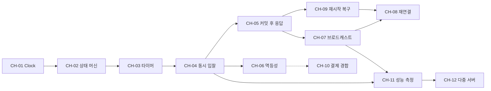

# Four-Lane Auction — 백엔드 기술 과제

| 항목 | 내용 |
|---|---|
| 버전 | 0.2 (초안) |
| 작성일 | 2026-10-23 |
| 변경 이력 | 0.1 최초 작성 / 0.2 [ARCHITECTURE.md](ARCHITECTURE.md) 0.1 리뷰 반영: 장애 시나리오 추가 (CH-03 7, CH-05 5, CH-06 6, CH-08 7·8, CH-09 6·7, CH-12 7·8), 측정과 무관한 보강을 "정함"으로 표시, OQ-37 결정 |
| 근거 문서 | [PRD.md](PRD.md) 0.4, [IDEA.md](IDEA.md), [ARCHITECTURE.md](ARCHITECTURE.md) |
| 상태 | 문제 정의 단계. **측정으로 고를 해결 방식은 아직 정하지 않았다.** 측정과 무관한 것만 정했다: PRD 0.3의 1주차 계약 항목 5개, PRD 0.4의 리뷰 결정(OQ-10·37·43·44), 후보 선택과 무관한 보강(각 과제의 "정함") |

---

## 0. 이 문서를 읽는 법

**목적.** PRD의 규칙을 그대로 구현하면 어디서 무엇이 깨지는지 정리한다. 기술 이름이 아니라 장애 시나리오에서 출발한다. 과제마다 "PRD의 어떤 규칙 때문에 이 문제가 생기는가"를 먼저 밝혔고, 그 근거를 댈 수 없는 기술은 과제로 세우지 않았다 ([부록 A](#부록-a-과제로-세우지-않은-기술)).

**원칙**

- 해결 후보는 2~4개를 적되 고르지 않는다. 선택은 재현 테스트나 측정 결과를 보고 하며, 고른 뒤에는 이 문서의 후보 표에 결과와 근거(테스트, 수치)를 표시한다.
- PRD나 IDEA가 이미 전제로 둔 방식(레인 직렬 큐, Simple Broker 등)도 후보 중 하나로 되돌려 두고 `PRD 전제`로 표시했다. 그 전제가 맞다는 것을 수치로 보여주는 것까지가 과제다.
- Redis, 메시지 브로커 같은 외부 도구는 **단일 인스턴스에서 측정한 병목이 그 도구로만 풀린다는 것이 확인된 뒤에** 도입한다. 후보 표에 넣더라도 도입 조건을 함께 적는다.
- PRD에 없는 수치 기준에는 `(제안)`을 붙였다. 첫 측정 뒤에 조정한다.

**난이도 기준**

| 난이도 | 의미 |
|---|---|
| 상 | 스레드·시간·장애가 얽힌다. 재현 자체가 어렵고, 잘못 고르면 나중에 구조를 바꿔야 한다 |
| 중 | 원리는 알려져 있지만 경계 조건이 많다. 테스트로 꼼꼼히 막으면 된다 |
| 하 | 알려진 표준 방식으로 풀린다. 빠뜨리지 않는 것이 핵심이다 |

**MVP 포함 여부**: PRD 4장 Must 또는 9장 검증 목표에 필요하면 "포함", Should·Could에만 걸리면 "미포함".

---

## 1. 과제 한눈에 보기

| ID | 과제 | 검토 영역 | 난이도 | MVP | 착수 (IDEA 10장 주차) |
|---|---|---|:-:|:-:|:-:|
| [CH-01](#ch-01-시간의-단일-출처-주입된-clock과-클라이언트-시계) | 시간의 단일 출처: 주입된 `Clock`과 클라이언트 시계 | 서버 기준 시간 | 중 | 포함 | 1~3 |
| [CH-02](#ch-02-레인회차-상태-머신과-회차-수준-동기화) | 레인·회차 상태 머신과 회차 수준 동기화 | 레인 진행 엔진 | 상 | 포함 | 2~3 |
| [CH-03](#ch-03-마감-타이머와-소프트-클로즈) | 마감 타이머와 소프트 클로즈 | 마감 타이머·소프트 클로즈 | 상 | 포함 | 3 |
| [CH-04](#ch-04-동일-호가-동시-입찰) | 동일 호가 동시 입찰 | 동시 입찰 정합성 | 상 | 포함 | 4, 8 (실험 ①) |
| [CH-05](#ch-05-커밋-후-응답-메모리-상태와-db의-어긋남) | 커밋 후 응답: 메모리 상태와 DB의 어긋남 | 동시 입찰 정합성 (영속화) | 상 | 포함 | 4~5 |
| [CH-06](#ch-06-입찰-멱등성) | 입찰 멱등성 | 입찰 멱등성 | 중 | 포함 | 4 |
| [CH-07](#ch-07-5000명-브로드캐스트) | 5,000명 브로드캐스트 | 실시간 브로드캐스트 | 상 | 포함 | 4 (프로파일링), 9 (실험 ②) |
| [CH-08](#ch-08-클라이언트-재연결과-시퀀스-재동기화) | 클라이언트 재연결과 시퀀스 재동기화 | 재연결 시 상태 복구 | 중 | 포함 | 4~5 |
| [CH-09](#ch-09-서버-재시작-복구) | 서버 재시작 복구 | 재연결 시 상태 복구 (서버 측) | 중 | 포함 | 5 |
| [CH-10](#ch-10-결제-기한-만료와-결제-요청의-경합) | 결제 기한 만료와 결제 요청의 경합 | (추가) 낙찰 이후 거래 | 하 | 포함 | 6 |
| [CH-11](#ch-11-성능-측정의-신뢰성) | 성능 측정의 신뢰성 | 성능 측정 | 중 | 포함 | 4 (최소판), 7 |
| [CH-12](#ch-12-다중-서버-확장) | 다중 서버 확장 | 다중 서버 확장 | 상 | 미포함 (C-03) | 스트레치 |

**과제 사이의 의존 관계** (화살표: 앞 과제의 결정이 뒤 과제의 전제가 된다)

---

## 2. 공통 검증 도구

여러 과제가 같은 도구로 재현하고 검증한다. 과제 본문에서는 이름으로만 부른다.

| 도구 | 쓰임 | 필요한 이유 |
|---|---|---|
| **가짜 시계·스케줄러** (`FakeClock`, `FakeScheduler`) | 시간을 앞으로 돌리고, 그 사이에 예약된 타이머를 시각 순서대로 실행한다 | 15초·10초·5초 규칙을 실제로 기다리면 테스트 하나에 수십 초가 걸리고, 실행 타이밍에 따라 결과가 흔들린다 (CH-01) |
| **MySQL 통합 테스트** (Testcontainers) | 락, 격리 수준, 유니크 제약, `DATETIME` 정밀도를 실제 MySQL로 확인한다 | H2(MySQL 호환 모드 포함)는 InnoDB의 락·격리 동작을 그대로 재현하지 않아, 동시성 테스트가 거짓으로 통과할 수 있다 |
| **동시 요청 하네스** | `CountDownLatch`로 스레드 N개를 한 순간에 출발시키고, 같은 시나리오를 수백~수천 번 반복한다 | 경합은 확률적으로만 드러난다. 한 번 통과한 것은 증거가 되지 않는다 |
| **장애 주입** | 저장소 데코레이터로 예외·지연을 넣거나, 애플리케이션과 DB 사이에 지연 프록시(예: Toxiproxy)를 둔다. 부하 중 `kill -9` | "커밋은 됐는데 예외가 났다" 같은 상태는 정상 경로로 만들 수 없다 |
| **정합성 재계산 스크립트** | 부하 테스트가 끝난 뒤 DB 입찰 이력을 다시 돌려 아래 불변식을 검사한다 | PRD 9.3 정합성 목표의 공식 검증 수단이다 |
| **k6 시나리오** | 입찰(HTTP)과 관전(WebSocket/STOMP)을 함께 만든다. 상세는 CH-11 | PRD 9.1~9.2 수치 목표를 측정한다 |

### 정합성 불변식

재계산 스크립트가 검사하는 항목이다. 과제의 성공 기준에서 ID로 부른다.

| ID | 불변식 | 관련 과제 |
|---|---|---|
| INV-1 | Lot마다 수락된 입찰을 수락 순서로 놓으면, 첫 금액 = 시작가 + 호가 단위(시작가)이고, 이후 금액 = 직전 금액 + 호가 단위(직전 금액)다. 호가 단위는 회차에 고정된 정책 버전으로 계산한다 | CH-04 |
| INV-2 | 같은 Lot에서 같은 금액으로 수락된 입찰은 최대 1건이다 | CH-04 |
| INV-3 | 연속한 두 수락 입찰의 입찰자는 서로 다르다 | CH-04 |
| INV-4 | 모든 수락 입찰의 수락 시각은 그 직전 시점의 마감 시각보다 앞선다. 마감 시각은 Lot 시작 시각, 정지·재개 이력, 이전 입찰로 다시 계산한다. 정지 구간 안에 수락된 입찰도 0건이다 | CH-03 |
| INV-5 | `SOLD` Lot의 낙찰자·낙찰가는 마지막 수락 입찰과 같고, 낙찰가 ≥ 최저 낙찰가다. `UNSOLD` Lot은 입찰 0건, 최저가 미달, 강제 종료 중 하나다 | CH-02, CH-04 |
| INV-6 | `SOLD` Lot마다 거래가 정확히 1건, `UNSOLD` Lot에는 0건이다 | CH-02, CH-09 |
| INV-7 | k6가 성공 응답(2xx)으로 기록한 입찰은 모두 DB에 있다 | CH-05, CH-09 |
| INV-8 | 관전 클라이언트마다 레인별 수신 시퀀스가 1씩 증가한다. 갭과 역순은 기록해서 횟수를 센다 | CH-07, CH-08 |

> **설계에 주는 영향.** INV-4를 검사하려면 Lot 시작 시각, 입찰 수락 시각(레인 큐가 처리한 시각, C3), 레인 정지·재개 시각이 밀리초 단위로 DB에 남아 있어야 한다. 정지·재개 이력을 감사 로그(S-03, Should)에만 맡기면 안 된다. 감사 로그가 일정에서 빠져도 검증은 돌아가야 하기 때문이다.

---

## CH-01. 시간의 단일 출처: 주입된 `Clock`과 클라이언트 시계

| 검토 영역 | 난이도 | MVP | 관련 요구사항 |
|---|:-:|:-:|---|
| 서버 기준 시간 | 중 | 포함 | 6.5 C1·C4, M-06, M-07, AC-07-6, 9.7 |

### 왜 생기는가

PRD는 자동 시작, 마감, 소프트 클로즈, 간격, 정지·재개, 결제 기한을 모두 서버 시계로 판단하고(C1), 테스트에서는 시간을 마음대로 조작하라고 한다(AC-07-6). 그런데 서버 안에는 시간의 출처가 여러 개다. `Instant.now()`, JPA Auditing의 `@CreatedDate`, MySQL의 `NOW()`와 `DEFAULT CURRENT_TIMESTAMP`, 그리고 `ScheduledExecutorService` 내부의 단조 시계. 이들이 섞이면 테스트에서 시간을 돌려도 일부는 실제 시간으로 움직이고, 운영에서는 서로 다른 시각이 DB에 남는다. 클라이언트는 남은 시간을 그려야 하는데(C4), 사용자 PC의 시계는 틀려 있을 수 있다.

### 장애 시나리오

1. **시간 출처가 섞인 테스트.** 엔진은 `FakeClock` 기준 10:00:15에 Lot을 마감했는데, 입찰 행의 `created_at`은 DB `NOW()`가 찍은 실제 시각이다. 재계산 스크립트(INV-4)가 멀쩡한 입찰을 "마감 뒤 수락"으로 잡거나, 진짜 위반을 놓친다.
2. **DB 시간 정밀도.** MySQL `DATETIME`은 기본 정밀도가 초 단위이고, 소수 초가 붙은 값을 넣으면 반올림한다. 마감 10:00:15.000 직전인 10:00:14.600에 수락된 입찰이 DB에는 10:00:15로 저장되어, 기록상으로는 마감 시각에 수락된 입찰이 된다. 같은 초에 수락된 입찰들의 순서도 시각만으로는 알 수 없다.
3. **시간대.** 운영자가 "오후 8시 시작"을 입력했는데 서버(EC2)는 UTC이고 저장 타입이 `LocalDateTime`이면, 회차가 9시간 어긋나게 시작한다.
4. **클라이언트 시계 오차.** 사용자 PC 시계가 3초 늦다. 클라이언트가 `마감 시각 − Date.now()`로 카운트다운을 그리면, 서버 기준으로는 이미 마감인데 화면에는 3초가 남아 있다. 그때 누른 입찰은 `LOT_NOT_BIDDING`으로 거절되고, 사용자는 "시간이 남았는데 거절당했다"고 느낀다. 시계가 3초 빠르면 반대로 실제로는 3초가 남았는데 화면은 0이 되어 입찰을 포기한다.
5. **서버 시계 점프.** NTP가 서버 시계를 한 번에 몇 초 당기거나 밀면(step), 벽시계(`Instant`) 기준의 마감 비교와 단조 시계 기준의 타이머 예약이 어긋난다. 시계가 2초 뒤로 가면 타이머는 제때 울렸는데 `현재 시각 < 마감 시각`이라 마감되지 않는다. 앞으로 5초 가면 실제로는 5초가 남은 Lot에서 입찰이 `LOT_NOT_BIDDING`으로 거절되기 시작한다.

### 재현 방법

- **정적 검사**: Gradle 빌드 단계의 검색으로 운영 Java의 `Instant.now()`, `LocalDateTime.now()`, `System.currentTimeMillis()`, `new Date()`와 SQL·쿼리의 `NOW()`·`CURRENT_TIMESTAMP`를 검사한다 (M0-02 사용자 승인, 2026-10-27, [ADR-002](adr/ADR-002-M0-02-schema-and-time-sources.md)). `test`와 `build`에 포함한다. 아래 해결 후보의 판단·실행 방식, 클라이언트 시계, 시계 점프 선택과는 별개의 결정이다.
- **정밀도 테스트** (MySQL 통합): 소수 초가 있는 시각으로 입찰을 저장하고 다시 읽어 같은 값인지 확인한다. 시나리오 2(반올림으로 마감 경계를 넘는 경우)를 그대로 테스트로 만든다.
- **시간대 테스트**: JVM 기본 시간대를 `UTC`로 두고 `+09:00`이 붙은 예정 시각으로 회차를 만든 뒤, `FakeClock`을 그 순간으로 옮겨 자동 시작되는지 본다.
- **클라이언트 시계 오차**: 브라우저 테스트에서 `Date.now()`를 ±3초, ±5분 어긋나게 바꾸고, 화면에 표시된 남은 시간과 서버 기준 남은 시간의 차이를 잰다.
- **시계 점프**: 타이머와 무관하게 `FakeClock`만 앞뒤로 점프시켜, 엔진이 이른 마감이나 마감 누락을 일으키는지 본다.

### 해결 후보 (미결정)

**(가) 서버 시간 출처와 테스트 방식**

| 후보 | 방식 | 얻는 것 | 치르는 비용 |
|---|---|---|---|
| A1 | `java.time.Clock` 빈 하나를 모든 곳에 주입하고, 타이머는 `Scheduler` 인터페이스로 감싸 테스트에서 `FakeScheduler`로 바꾼다 | 엔진 코드가 프로덕션과 같은 경로로 테스트된다 | 가짜 스케줄러의 실행 순서가 실제 스레드 동작과 다를 수 있다. JPA Auditing과 DB 기본값도 모두 같은 `Clock`으로 바꿔야 한다 |
| A2 | 엔진을 `(상태, 이벤트, 현재 시각) → (새 상태, 할 일 목록)` 순수 함수로 만들고, 타이머 예약도 "할 일"로 돌려받아 바깥 드라이버가 실행한다 | 시간과 스레드가 엔진 밖으로 빠져 테스트가 결정적이다 | 드라이버(큐·스레드·타이머)의 버그는 따로 테스트해야 한다. 설계 난도가 올라간다 |
| A3 | 실제 시간 + 아주 짧은 파라미터(예: 300ms / 200ms / 100ms) + Awaitility | 실제 스레드·타이머 동작까지 확인한다 | 느리고, CI 부하에 따라 결과가 흔들린다. 통합 테스트 보조로만 쓸 수 있다 |

**(나) 클라이언트 카운트다운**

M1-06 승인 (2026-10-28, ADR-011): 홈 예정 회차에 B1을 적용한다. EVENTS 7.3대로 실제 수신 performance.now 표본의 최근 60초 최댓값을 쓴다. 홈 표시 선택이며 레인 화면의 200ms 목표·네트워크 지연 측정 완료를 뜻하지 않는다.

| 후보 | 방식 | 얻는 것 | 치르는 비용 |
|---|---|---|---|
| B1 (홈 적용 승인, M1-06·ADR-011) | 메시지의 `serverTime`과 수신 시각의 차이로 시계 오차를 추정하고, `마감 시각 − (Date.now() + 오차)`를 그린다 | 추가 요청이 없다. PRD 메시지 형식 그대로다 | 단방향 네트워크 지연만큼 늘 늦게 보인다 (모바일이면 수십~수백 ms) |
| B2 | 접속할 때 시간 동기 요청을 몇 번 보내 왕복 시간의 절반으로 지연을 보정한다 (Cristian 방식) | 지연 편향이 줄어든다 | 엔드포인트와 클라이언트 로직이 늘어난다. B1보다 의미 있게 정확한지 측정으로 확인해야 한다 |
| B3 | 서버가 절대 마감 시각 대신 남은 시간(ms)을 보내고, 클라이언트는 수신 시점부터 센다 | 클라이언트 시계와 무관하다 | 메시지를 늦게 받은 만큼 늦게 0이 된다. 재연결 때 오차가 쌓인다 |

- 어느 후보든 입찰 응답의 시각은 쓰지 않는다. 입찰 응답에는 `serverTime`을 넣지 않기로 했다 (ARCHITECTURE 7.7). 멱등 재생 응답은 처음 응답을 그대로 돌려주므로, 응답에 서버 시각이 있으면 재생할 때 몇 초 전 시각이 나가 오차 추정을 흐린다. 추정에는 레인 메시지, 레인 비컨, 스냅샷의 `serverTime`만 쓴다.

**(다) 서버 시계 점프**: 운영 규칙으로 막기(chrony를 slew 모드로 두어 step을 막음) / 엔진은 마감 판단에 단조 시계를 쓰고 벽시계는 표시·저장에만 쓰기 / 점프를 감지하면 레인을 정지하기. 어느 쪽인지는 [OQ-35]. 어느 쪽이든 레인 안의 처리 시각은 `max(Clock 값, 직전 처리 시각)`으로 뒤로 가지 않게 고정한다 (정함, ARCHITECTURE R13). 레인 안의 수락 시각 역전과 마감 재계산 역행은 이것으로 막히고, OQ-35에는 시계가 앞으로 뛰는 경우와 타이머(단조 시계)·판정(벽시계)의 어긋남이 남는다.

**(라) 시각의 저장과 표현 — 결정됨 (PRD OQ-42, 6.5 C5)**: 코드는 `Instant`와 주입된 `Clock`, DB는 UTC 기준 `DATETIME(3)`, API는 밀리초까지 포함한 ISO-8601(요청은 오프셋 필수, 응답은 UTC). 시나리오 1~3을 막는 규칙이다. 측정으로 답이 바뀌지 않고 계약과 스키마에 들어가므로 1주차에 정했다.

### 성공 판단 기준

- 정적 검사: `Clock`을 거치지 않는 현재 시각 호출 0건, DB 기본값·`NOW()` 사용 0건.
- AC-07-6: 회차 시작부터 Lot 진행, 정지·재개까지 시간 규칙 테스트가 실제 대기 없이 통과한다. 엔진 시간 규칙 테스트 전체 실행 시간 5초 미만 (제안).
- 정밀도 테스트: 저장한 시각과 다시 읽은 시각이 밀리초까지 같다.
- 시간대 테스트(AC-04-5): 서버 시간대가 UTC여도 `+09:00` 예정 시각에 정확히 시작하고, 오프셋 없는 시각은 거절된다.
- 클라이언트 시계를 ±5분 어긋나게 해도 표시 남은 시간의 오차가 200ms 이내 (제안).
- 시계 점프 테스트: 고른 방식대로 동작함을 보여주는 테스트가 있다 (이른 마감 0건, 또는 감지 후 정지).

---

## CH-02. 레인·회차 상태 머신과 회차 수준 동기화

| 검토 영역 | 난이도 | MVP | 관련 요구사항 |
|---|:-:|:-:|---|
| 레인 진행 엔진 (상태 머신) | 상 | 포함 | 6.1, 6.2, M-05, M-06, M-07, M-13, M-14, AC-06-1~5, AC-07-1~4, AC-14-1~4 |

### 왜 생기는가

상태가 세 층이다 (회차 3개 상태, 레인 4개 상태, Lot 4개 상태). 상태를 바꾸는 주체도 여럿이다: 스케줄러(자동 시작), 타이머(마감·간격), 입찰, 운영자 명령(수동 시작·정지·재개·강제 종료). 레인 안의 이벤트는 레인 직렬 큐로 줄을 세우지만(C2), **어느 레인의 큐에도 속하지 않는 전이**가 있다. 회차 시작은 모든 레인을 한꺼번에 바꾸고, 회차 종료는 모든 레인의 결과를 모아야 한다.

### 장애 시나리오

1. **회차 이중 시작.** 예정 시각 20:00:00에 스케줄러가 시작을 실행하는 동안 운영자가 "지금 시작"을 누른다. 둘 다 `SCHEDULED`를 읽고 시작하면 레인마다 이벤트 루프가 2개 생기거나, 1번 Lot이 서로 다른 `t0`로 두 번 `BIDDING`에 들어간다.
2. **편성 변경과 시작의 경합.** 운영자가 레인 3의 마지막 Lot을 빼는 순간 자동 시작이 "모든 레인에 Lot ≥ 1"을 검사한다. 검사는 통과했는데 커밋 시점에는 레인 3이 비어 있어 Lot 0개 레인이 `RUNNING`이 된다. 반대로 시작 직후에 추가된 Lot은 DB에는 `PENDING`으로 있는데 엔진은 모른다.
3. **놓친 예정 시각의 판정.** 서버가 꺼져 있는 동안 지난 예정 시각에는 자동 시작하지 않아야 한다(AC-06-4). 그런데 "1초마다 `예정 시각 ≤ 현재 시각`인 회차를 찾는" 스케줄러는 부팅 직후 놓친 회차도 똑같이 찾아서 시작해 버린다. 그렇다면 GC 정지로 스케줄러가 2초 늦게 돈 것은 "놓친" 것인가? 예정 시각을 바꾸면(AC-04-4) 이미 예약한 시작도 바뀌어야 한다.
4. **회차 종료 집계의 누락과 중복.** 레인 2와 레인 4의 마지막 Lot이 같은 순간에 끝난다. 각 레인 스레드가 "다른 레인이 모두 `FINISHED`인가?"를 검사하면, 둘 다 상대가 아직 안 끝났다고 보고 넘어가 회차가 영원히 `RUNNING`으로 남는다. 또는 둘 다 끝났다고 보고 회차 종료를 두 번 처리해 종료 메시지가 두 번 나간다.
5. **정의되지 않은 전이.** Lot 간 간격 중(`BIDDING` Lot 없음)에 강제 종료가 오면 무엇을 끝내는가? 아직 시작하지 않은 `PENDING` Lot을 건너뛰는 강제 종료는 PRD에 없다. `FINISHED` 레인에 재개가 오면? 이런 조합을 코드 곳곳의 `if`로 막다 보면 빠진 조합이 생긴다 ([OQ-41]).
6. **끝난 레인의 자원.** 레인마다 스레드를 하나씩 잡는 구현에서 끝난 레인의 스레드를 정리하지 않으면, 회차 100개를 돌린 뒤 스레드 400개가 남는다.

### 재현 방법

- **전이 표 테스트**: (레인 상태 4개 × 명령·이벤트 종류) 모든 조합의 기대 결과(전이, 또는 거절과 그 코드)를 표로 적고 파라미터화 테스트로 돌린다. 표에 빈칸이 생기면 그것이 PRD에 없는 결정이다.
- **무작위 이벤트 시퀀스 테스트**: 입찰, 타이머 만료, 정지, 재개, 강제 종료를 무작위 순서와 간격으로 수천 개 넣고, 매 단계 불변식을 검사한다. 불변식 예: 레인당 `BIDDING` Lot은 최대 1개, `FINISHED` 레인의 Lot은 모두 종료 상태, 정지 중에는 마감 시각이 바뀌지 않음. 프로퍼티 기반 테스트 도구(예: jqwik)나 시드를 고정한 난수로 만들고, 실패하면 시드로 같은 순서를 재현한다.
- **이중 시작 테스트**: 수동 시작과 자동 시작을 `CountDownLatch`로 동시에 출발시켜 1,000번 반복한다.
- **종료 집계 테스트**: 레인 4개의 마지막 Lot 마감을 같은 순간에 일으켜 1,000번 반복하고 회차 종료 횟수를 센다.
- **놓친 예정 시각 테스트**: `FakeClock`으로 예정 시각이 지난 뒤에 엔진을 "부팅"시켜 시작되지 않는지, 예정 시각 직전에 부팅하면 제때 시작되는지 확인한다.

### 해결 후보 (미결정)

**(가) 상태 머신 표현**

| 후보 | 방식 | 얻는 것 | 치르는 비용 |
|---|---|---|---|
| A1 | Lane·Lot 도메인 객체 안에 `enum` 상태와 전이 메서드(`pause()`, `close()` 등)를 두고 메서드가 직접 검증한다. 이벤트는 Java 21 `sealed interface` + `switch` 패턴 매칭 | 평범한 Java라 읽기 쉽고 Spring 의존이 없다 | 전이 규칙이 메서드마다 흩어져 표 전체를 한눈에 보기 어렵다 |
| A2 | 전이 표를 데이터로 정의한다: `(상태, 이벤트) → (다음 상태, 동작)` | 표가 곧 문서이자 테스트 입력이다. 빠진 조합을 기계적으로 찾는다 | 동작(타이머 재설정 등)이 표 밖 코드로 분리되어 간접층이 생긴다 |
| A3 | 상태 패턴 (상태마다 클래스 하나) | 상태별 동작이 한곳에 모인다 | 상태가 4개뿐이라 클래스가 늘어나는 것에 비해 이득이 작을 수 있다 |
| A4 | Spring Statemachine | 기능이 많다 | PRD 9.7 "Spring에 의존하지 않는 순수 도메인 코드"와 충돌한다. 고르려면 PRD를 바꿔야 한다 |

**(나) 레인 큐 바깥의 전이 (회차 시작·종료)**

M1-07 적용 (사용자 승인, ADR-012): 편성 측은 ARCH 5.5.1의 B1 조건부 갱신으로 회차 행을 먼저 잠근다. 다른 회차의 동일 Item 경합은 별도의 Item PK 잠금과 편성 전용 READ_COMMITTED로 검사한다. 실제 시작 구현·편성/시작 종합 경합은 M2-02에서 확인한다. 상태 머신 표현·자동 시작 후보는 선택하지 않았다.

| 후보 | 방식 | 얻는 것 | 치르는 비용 |
|---|---|---|---|
| B1 | DB 조건부 갱신: `UPDATE session SET status='RUNNING' WHERE id=? AND status='SCHEDULED'`의 영향받은 행이 1인 쪽만 시작한다. 종료도 "끝나지 않은 레인 수 = 0"을 조건에 넣는다. **M1-07은 편성 측 조건부 갱신만 적용** (ADR-012), 실제 시작·경합 종합은 M2-02 후속 | 추가 구성 요소가 없고, 서버가 여러 대여도 유효하다 | 편성 변경과의 경합(시나리오 2)은 편성 쪽에도 같은 조건을 걸어야 막힌다 |
| B2 | 회차 행 비관적 락 (`SELECT … FOR UPDATE`)으로 편성 변경과 시작을 직렬화한다 | 편성·시작 경합까지 한 번에 막힌다 | 락 대기가 생긴다. 다만 회차 단위 작업은 드물어 부하는 작다 |
| B3 | 회차 전용 직렬 큐 (레인 큐와 같은 모양). 시작 명령과 레인 종료 알림을 회차 큐로 보낸다 | 레인과 같은 모델로 통일된다. 집계가 단일 스레드라 경합이 없다 | 큐가 하나 더 생기고, 재시작 때 회차 큐 상태도 복구해야 한다 |

**(다) 놓친 예정 시각 판정**: 부팅 시각 이후의 예정 시각에만 시작을 예약 / 예정 시각에서 허용 오차(예: 스케줄러 주기 × 2) 안이면 시작 / 회차에 "자동 시작 대상" 표시를 두고 부팅할 때 지난 회차의 표시를 끔. 어느 방식이든 예정 시각 변경(AC-04-4) 때 예약을 다시 잡아야 한다. 판정 기준은 [OQ-38].

### 성공 판단 기준

- AC-06-1~5, AC-07-1~4, AC-13-3, AC-14-1~4 통과.
- 전이 표의 모든 칸이 테스트로 덮인다. 빈칸 0개 (빈칸은 PRD 질문으로 올린다).
- 무작위 이벤트 시퀀스 10,000개에서 불변식 위반 0건 (제안).
- 이중 시작 1,000회 반복: 매번 회차 시작 정확히 1회, 레인마다 이벤트 루프 1개, 1번 Lot의 `t0` 1개.
- 종료 집계 1,000회 반복: 매번 회차 `FINISHED` 정확히 1회, 종료 메시지 1회.
- 놓친 예정 시각: AC-06-4 통과. 정상 가동 중에는 예정 시각 대비 시작 지연 1초 미만 (제안).
- 회차 N개를 돌린 뒤 스레드·타이머 수가 기준값으로 돌아온다.

---

## CH-03. 마감 타이머와 소프트 클로즈

| 검토 영역 | 난이도 | MVP | 관련 요구사항 |
|---|:-:|:-:|---|
| 마감 타이머·소프트 클로즈 | 상 | 포함 | 6.4 T1~T5, 6.5 C2·C3, M-07, M-10, AC-07-5, AC-10-4, AC-10-5, AC-13-1·2 |

### 왜 생기는가

마감 시각이 고정되어 있지 않다. 입찰이 수락될 때마다 `마감 = max(현재 마감, 수락 시각 + 10초)`로 늘어나고(T2), 정지하면 멈췄다가 재개 때 다시 계산된다(T5). 이미 예약한 타이머가 수시로 무효가 된다는 뜻이다. 그러면서도 "마감 시각 이후 수락된 입찰 0건"(9.3)은 타이머가 늦게 울려도 지켜야 한다(C3).

동시에 살아 있는 타이머는 레인 수만큼(최대 4개 × 진행 중인 회차 수)이므로, 타이머 개수나 타이머 자료구조의 성능은 과제가 아니다. 과제는 **타이머 하나의 정확성**이다.

### 장애 시나리오

1. **낡은 타이머.** `t0`에 `t0+15초` 마감 타이머를 예약했다. `t0+8초`에 입찰이 들어와 마감이 `t0+18초`로 늘었다. 처음 타이머를 취소하지 않으면 `t0+15초`에 Lot이 3초 일찍 마감된다. 취소를 해도, 취소하는 순간 타이머 작업이 이미 실행되어 "만료 이벤트"가 레인 큐에 들어가 있으면 소용이 없다.
2. **늦은 타이머.** GC 정지나 스케줄러 스레드 포화로 만료 이벤트가 마감 시각보다 400ms 늦게 큐에 들어간다. 그 사이 마감 + 200ms에 큐에서 처리된 입찰은 C3에 따라 거절되어야 한다. 처리 시각을 다시 검사하지 않으면 마감 뒤의 입찰이 수락되고 마감이 10초 늘어난다.
3. **경계 시각.** 처리 시각이 마감 시각과 정확히 같은 입찰은 수락인가 거절인가? `<`와 `≤`를 코드마다 다르게 쓰면 엔진과 재계산 스크립트의 판정이 갈린다.
4. **정지·재개.** 정지할 때 남은 시간을 저장하지 않거나 타이머를 취소하지 않으면 정지 중에 Lot이 마감된다. 재개 명령이 두 번 오면 타이머가 두 개 생긴다.
5. **간격 타이머.** 마감 뒤 5초 간격 타이머도 같은 문제를 가진다. 간격 중 정지나 강제 종료가 섞이면 정지 상태의 레인에서 다음 Lot이 시작될 수 있다. 정지 전에 예약된 간격 타이머가 재개 뒤에 울려도 같다. 간격 종료를 "Lot 종료 시각 + 5초"로 판정하면 재개 직후에도 조건이 참이라, PRD OQ-10(재개하면 간격 5초를 다시 준다)을 지키지 못한다.
6. **늦게 보이는 마감.** 타이머가 늦게 울리면 Lot은 이미 입찰을 받지 않는데(C3) 마감 메시지는 늦게 나간다. 클라이언트 카운트다운은 0에서 멈춘 채 결과를 기다린다(C4). 이 지연이 길면 사용자는 멈춘 화면을 본다. 마감 메시지 자체를 놓치면 화면은 계속 멈춰 있다 (→ 레인 비컨의 시퀀스로 감지한다, PRD OQ-37, CH-08).
7. **사라진 타이머.** 커밋 뒤 타이머 예약이 예외로 실패하면 그 Lot은 영원히 마감되지 않는다. 고정 주기 작업도 같다. `ScheduledExecutorService`는 주기 작업이 예외를 던지면 그 뒤 실행을 하지 않는다. 타이머가 늦는 것보다 위험하다.

### 재현 방법

- **`FakeClock` + `FakeScheduler` 단위 테스트**
  - `t0+8초` 입찰 → `t0+15초`로 시간 이동 후에도 `BIDDING` → `t0+18초`에 마감 (낡은 타이머).
  - 만료 이벤트와 입찰을 두 순서로 큐에 넣어 AC-10-4의 두 결과를 모두 확인.
  - 만료 이벤트를 마감 + 400ms에 실행되도록 늦추고 마감 + 200ms에 입찰 처리 → `LOT_NOT_BIDDING` (AC-10-5).
  - 마감 −1ms, 마감 정각, 마감 +1ms 입찰의 경계 테스트.
  - 정지 → 시간 이동 → 재개 → 재개: 타이머 1개, 마감 시각은 T5대로.
- **실시간 스트레스 테스트**: 짧은 파라미터(첫 입찰 대기 300ms, 소프트 클로즈 200ms, 간격 100ms)로 레인을 돌리며 봇이 마감 직전에 몰아서 입찰한다. Lot 수천 개를 돌린 뒤 재계산 스크립트로 INV-4를 검사한다.
- **부하 테스트 중 마감 지연 측정**: (마감 시각 → 마감 처리 시각) 분포를 메트릭으로 남긴다.

### 해결 후보 (미결정)

| 후보 | 방식 | 얻는 것 | 치르는 비용 |
|---|---|---|---|
| A | 레인마다 1회성 타이머. 입찰·정지 때 취소하고 다시 예약한다 | 직관적이다 | 취소와 실행이 엇갈리는 경합(시나리오 1 후반)을 따로 막아야 한다 |
| B | 취소하지 않는 1회성 타이머. 타이머는 "마감 확인" 이벤트만 큐에 넣고, 처리할 때 `현재 시각 ≥ 현재 마감`이면 마감, 아니면 새 마감 시각에 다시 예약한다 | 낡은 타이머가 해롭지 않게 된다. 취소 경합이 사라진다 | 쓸모없는 확인 이벤트가 생긴다 (입찰 1건당 최대 1개 수준) |
| C | 고정 주기 틱. 예를 들어 50ms마다 레인 큐에 틱 이벤트를 넣는다 | 타이머 재설정 로직이 없다. 지연 상한 = 틱 주기 | 할 일이 없어도 틱이 돈다. 마감 정밀도가 틱 주기에 묶인다 |
| D | 레인 루프가 큐를 `poll(마감까지 남은 시간)`으로 기다리고, 시간이 다 되면 마감을 확인한다 | 별도 스케줄러 스레드가 없다. 큐와 타이머가 한 스레드다 | 레인당 스레드 1개 모델을 전제로 한다 (CH-04 후보 C의 구현과 묶인다) |

어느 후보든 **처리 시각 재검사(C3)는 그대로 필요하다.** 타이머는 "언제 확인할지"만 정하고, "마감됐는지"는 큐가 처리하는 순간의 시각으로 판단한다.

> **정함 (후보 선택과 무관한 보강, ARCHITECTURE 5.8)**
> - 주 경로가 어느 후보든, 레인마다 1초 주기 `Tick`을 안전망으로 겹친다. `Tick`을 처리할 때 마감이나 간격 종료가 지났으면 그 처리를 한다. 타이머가 사라져도 최대 1초 늦게 닫힌다 (시나리오 7). 후보 C를 주 경로로 쓰는 것과는 다르다. 마감 정밀도를 이 주기에 맡기지 않는다.
> - 간격 종료도 마감과 같이 저장한 종료 시각(`gapEndsAt`)으로 판정하고, 재개할 때 다시 잡는다 (시나리오 5).
> - 타이머 명령에 세대 번호를 붙인다. 재개·재구성처럼 확인을 새로 예약하는 경로가 세대를 올리고, 낡은 세대의 명령은 다시 예약하지 않고 버린다.

### 성공 판단 기준

- AC-07-5, AC-10-4, AC-10-5, AC-13-1, AC-13-2 통과.
- 위 단위 테스트 시나리오(낡은 타이머, 늦은 타이머, 경계 시각, 중복 재개)가 모두 통과한다.
- 실시간 스트레스 테스트와 부하 테스트 모두에서 INV-4 위반 0건 (PRD 9.3 "마감 시각 이후 수락된 입찰 0건").
- 마감 지연 p99 100ms 미만 (제안). 초당 1,000건 입찰 부하 중에도 유지된다.
- 정지 중에 마감된 Lot 0건.
- 타이머 예약 실패를 주입해도 Lot이 안전망 주기(1초) 안에 마감된다.
- 간격 중 정지 → 재개에서 다음 Lot이 재개 시각 + 5초에 시작한다 (AC-13-4). 정지 전에 예약된 간격 타이머는 아무것도 바꾸지 않는다.

---

## CH-04. 동일 호가 동시 입찰

| 검토 영역 | 난이도 | MVP | 관련 요구사항 |
|---|:-:|:-:|---|
| 동시 입찰 정합성 | 상 | 포함 | 6.3, 6.5 C2, M-09, AC-09-2, AC-09-6~8, AC-10-4, 9.3, 실험 ① |

### 왜 생기는가

입찰 UI가 "다음 호가" 버튼 하나뿐이라(5장) 같은 순간에 누른 사람들은 모두 **같은 금액**을 보낸다. 마감 직전에는 이런 요청이 몰린다. 목표 부하는 레인당 초당 250건이고 대부분이 같은 가격을 두고 경쟁한다(9.2). "현재가를 읽고 → 비교하고 → 쓰는" 과정이 원자적이지 않으면 한 가격에 승자가 여럿 생긴다.

### 장애 시나리오

1. **이중 성공.** 현재가 50,000원에서 A와 B가 동시에 60,000원으로 입찰한다. 두 요청이 모두 현재가 50,000원을 읽고 검증을 통과해 입찰이 2건 저장된다. 둘 다 성공 응답을 받고, 브로드캐스트는 "A 60,000원" 다음에 "B 60,000원"을 보낸다. 최고 입찰자가 누구인지 DB와 화면이 서로 다르게 말한다.
2. **갱신 유실.** Lot 행의 `current_price`·`highest_bidder`를 두 트랜잭션이 차례로 덮어쓴다. A는 성공 응답을 받았지만 최고 입찰자는 B로 남는다. "상위 입찰에 밀림" 알림의 대상도 낡은 값으로 계산해 A에게 알림이 가지 않는다.
3. **Lot 전환과의 경합.** Lot 3(시작가 50,000원)이 마감되고 Lot 4(시작가 50,000원)가 열리는 순간, Lot 3을 노린 `expectedPrice=50,000` 입찰이 처리된다. `lotId` 검사와 Lot 전환이 같은 직렬화 단위 안에 있지 않으면 이 입찰이 Lot 4에 들어간다 (AC-09-6이 막으려는 상황).
4. **정지·만료와의 경합.** 입찰 경로만 락을 잡고 타이머 만료나 정지 명령은 락 없이 상태를 바꾸면, 마감 처리와 입찰 수락이 동시에 일어난다. 입찰끼리의 동시성만 막아서는 부족하고, **같은 Lot의 상태를 바꾸는 모든 경로**가 같은 방식으로 직렬화되어야 한다.
5. **핫 로우와 커넥션 풀.** 모든 입찰을 DB 행 락으로 직렬화하면 Lot 행 하나에 레인당 초당 250건이 줄을 선다. 락을 기다리는 동안 DB 커넥션을 쥐고 있으므로 커넥션 풀(HikariCP 기본 10개)이 바닥나고, **다른 레인의 입찰과 무관한 API까지** 커넥션을 얻지 못해 지연된다.

### 재현 방법

- **실패를 먼저 보여주는 테스트**: 동시성 제어가 없는 순진한 구현(읽고 → 검사 → 저장)에 동시 입찰 100건을 넣어 이중 성공이 실제로 나오는 것을 먼저 확인한다. 이 기준선이 있어야 이후 해결이 의미를 가진다.
- **동시 요청 하네스** (MySQL 통합): 서로 다른 회원 N명(10, 100, 500)이 같은 `expectedPrice`로 동시에 입찰하는 시나리오를 1,000번 반복한다. 첫 입찰 경합(`expectedPrice` = 시작가)도 같은 방식으로 돌린다.
- **혼합 경합**: 입찰 N건, 만료 이벤트, 정지 명령을 동시에 출발시킨다.
- **부하 테스트**: 4레인 × 초당 250건. 입찰자가 브로드캐스트를 보고 최신 현재가로 입찰하는 시나리오(CH-11). 끝난 뒤 재계산 스크립트로 INV-1~3, INV-5를 검사한다.
- **실험 ①**: 아래 후보를 같은 환경과 같은 시나리오로 돌려 처리량, 입찰 응답 p99, 커넥션 풀 대기 시간, 정합성 위반 수를 비교한다. 관전자 0명 조건을 따로 잰다. 팬아웃이 레인 스레드에서 일어나면(CH-07 시나리오 1) 관전자 수가 후보의 수치에 섞이기 때문이다.

### 해결 후보 (미결정)

| 후보 | 방식 | 얻는 것 | 치르는 비용 |
|---|---|---|---|
| A | DB 비관적 락: 입찰 트랜잭션에서 Lot 행을 `SELECT … FOR UPDATE`로 잡는다. 만료·정지 처리도 같은 락을 쓴다 | 서버가 여러 대여도 그대로 맞다. 메모리 상태가 없어 CH-05의 어긋남이 생기지 않는다 | 거절될 요청(대부분 409)까지 락을 기다린다. 시나리오 5의 커넥션 고갈 위험 |
| B | DB 낙관적 동시성: `UPDATE lot SET price=?, bidder=?, version=version+1 WHERE id=? AND price=? AND status='BIDDING'` 같은 조건부 갱신(또는 JPA `@Version`). 영향받은 행 0 → `PRICE_CHANGED` | 락 대기가 없다. 실패가 곧 409라 재시도 로직이 필요 없다 | 거절 요청도 DB 왕복을 한다. 마감 시각 검사(C3)를 조건에 함께 넣어야 하고, 타이머 경로도 같은 조건부 갱신을 써야 한다 |
| C | 레인별 직렬 큐(단일 작성자): 입찰, 만료, 운영자 명령을 레인 큐에서 하나씩 처리한다. 검증은 메모리 상태로 하고 수락된 입찰만 DB에 쓴다 `PRD 전제 (C2)` | 409 거절이 DB를 거치지 않는다. 입찰·타이머·명령 간 경합이 구조적으로 사라진다 | 메모리와 DB의 일관성, 큐 적체(CH-05), 서버 1대 전제(CH-12)라는 새 과제가 생긴다 |

- **후보 C를 고르면 남는 구현 선택**: 레인당 전용 스레드 / 공유 스레드 풀 위에서 레인별 순서를 보장하는 실행기 / 레인당 가상 스레드. 레인이 최대 4개라 스레드 개수 자체는 문제가 아니다.
- **후보와 별개로 검토할 방어선**: DB에 `(lot_id, amount)` 유니크 제약. 한 Lot 안에서 금액은 엄격히 증가하므로(INV-1) 같은 금액의 입찰은 2건일 수 없다. 애플리케이션이 어떤 방식이든, 이중 성공이 DB까지 내려가는 것을 마지막으로 막는다.
- **조건부 레인 쓰기** (정함, ARCHITECTURE 6.3): 후보 C에서도 입찰과 마감의 Lot UPDATE를 `WHERE status='BIDDING' AND bid_count=:expected`로 쓰고 영향 행이 1인지 확인한다. 단일 작성자에서는 언제나 1이라 비용이 없고, 메모리가 DB와 어긋났을 때(CH-05 시나리오 2, 인스턴스가 둘 뜬 CH-09 시나리오 7)만 0이 된다. 유니크 제약은 같은 금액의 이중 성공만 막지만, 이 조건은 어긋난 메모리로 마감해 엉뚱한 낙찰자로 거래가 생기는 것까지 막는다.

### 성공 판단 기준

- 순진한 구현에서 이중 성공이 재현된다 (기준선 확보).
- AC-09-2: N = 10 / 100 / 500 각각 1,000회 반복에서 매번 성공 정확히 1건, 나머지는 `409 PRICE_CHANGED`, DB 입찰 +1건. 첫 입찰 경합도 같다.
- AC-09-6, AC-09-8, AC-10-4 통과. 혼합 경합 테스트 위반 0건.
- 초당 1,000건 부하 테스트 뒤 INV-1~3, INV-5 위반 0건.
- 입찰 응답 p99 100ms 미만 (PRD 9.1, 측정 지점은 [OQ-30]).
- 한 레인에 부하를 몰아도 다른 레인의 입찰 응답 p99가 목표 안에 있다 (제안: 레인 격리).
- 실험 ① 리포트: 세 후보의 처리량·p99·정합성을 같은 조건에서 비교한 표와 선택 근거.

---

## CH-05. 커밋 후 응답: 메모리 상태와 DB의 어긋남

| 검토 영역 | 난이도 | MVP | 관련 요구사항 |
|---|:-:|:-:|---|
| 동시 입찰 정합성 (영속화) | 상 | 포함 | 3.2 B3, M-09, M-17, M-18, AC-09-10, 9.3, 9.4 |

### 왜 생기는가

PRD는 입찰을 DB에 커밋한 뒤에 성공을 응답하고, 메모리는 캐시이며 원본은 DB라고 한다(9.4). CH-04 후보 C처럼 메모리 상태로 검증하는 방식을 고르면 레인의 현재가가 **메모리와 DB 두 곳**에 있게 된다. 두 곳을 원자적으로 함께 바꾸는 방법은 없으므로, 그 사이에서 실패하면 둘이 어긋난다. 또 DB 커밋이 레인 큐 안에서 일어나므로 DB 지연이 곧 레인 처리 속도가 된다.

(CH-04에서 DB 락 계열(후보 A·B)을 고르면 시나리오 1·2는 사라지는 대신, 처리량을 DB 행 락이 결정한다.)

### 장애 시나리오

1. **유령 입찰.** 메모리 현재가를 60,000원으로 먼저 바꾸고 브로드캐스트까지 한 뒤 DB 커밋이 실패한다 (락 대기 시간 초과, 연결 끊김). 화면에는 A가 최고 입찰자인데 DB에는 입찰이 없다. 재시작하면 현재가가 50,000원으로 돌아간다.
2. **결과를 모르는 커밋.** DB는 커밋했는데 그 응답이 애플리케이션에 닿기 전에 연결이 끊겨 예외가 난다. 애플리케이션은 실패로 보고 메모리를 갱신하지 않은 채 5xx를 응답한다. DB에는 A의 60,000원이 있고 메모리는 50,000원이다. 다음 사람 B의 `expectedPrice=50,000` 입찰이 메모리 기준으로 통과해, DB에 60,000원이 2건 들어가거나 유니크 제약에 걸린다.
3. **DB 지연이 레인을 멈춘다.** 평소 5ms이던 커밋이 2초 동안 느려진다. 레인 큐에 초당 250건 × 2초 = 500건이 쌓인다. 큐 결과를 기다리는 HTTP 요청 스레드가 Tomcat 스레드 풀(기본 200개)을 다 잡아, **다른 레인과 모든 API가** 응답하지 못한다. 클라이언트는 이미 타임아웃으로 포기했는데 큐에 남은 요청은 나중에 처리된다.
4. **부수 효과가 레인을 느리게 한다.** 입찰 한 건마다 레인 스레드 안에서 입찰 INSERT, Lot UPDATE, 알림함 INSERT(S-01), 브로드캐스트를 모두 처리하면 레인 처리량의 상한은 이 시간의 합이 정한다. 커밋만 10ms여도 레인당 수락 입찰은 초당 최대 100건이다.
5. **레인 스레드가 멈추거나 죽는다.** DB가 응답하지 않을 때 트랜잭션·소켓·락 대기에 시간 제한이 없으면(기본값: `innodb_lock_wait_timeout` 50초, Hikari `connectionTimeout` 30초, Connector/J `socketTimeout` 무제한) 레인 스레드가 수십 초에서 무기한까지 멈춘다. 정지·강제 종료 명령도 같은 큐에 있으므로 운영자도 그 레인을 멈출 수 없다. 커밋 뒤 단계(발행, 타이머 예약, 알림)의 예외가 루프를 죽이면 레인 하나가 아무 신호 없이 멈춘다.

### 재현 방법

- **장애 주입 테스트**: 저장소 데코레이터로 ① 커밋 전 예외 ② 커밋 후 예외(실제로는 커밋됨) ③ 지연을 넣는다. 주입할 때마다 메모리 상태와 DB 상태가 같은지 비교한다.
- **DB 지연 테스트**: 애플리케이션과 DB 사이에 지연 프록시를 두거나, 다른 세션에서 Lot 행 락을 잡아 커밋을 2초 붙잡는다. 그동안 레인 큐 길이, 대기 중인 요청 스레드 수, 다른 레인과 다른 API의 응답 시간을 본다.
- **강제 종료 테스트**: 부하 중 무작위 시점에 `kill -9`를 20회 한다. k6가 성공으로 기록한 입찰이 모두 DB에 있는지 본다 (INV-7, AC-09-10).
- **레인 스레드 정지 테스트**: DB 무응답(지연 프록시로 연결을 붙잡음)과 커밋 뒤 단계 예외(발행·타이머 예약에서 던짐)를 주입한다. 레인 스레드가 시간 제한 안에 돌아오는지, 루프가 살아남아 다음 명령을 처리하는지, 생존 지표(마지막 처리 뒤 경과 시간)가 이상을 보이는지 본다.
- **풀 경합 측정**: 초당 1,000건 부하에서 HTTP 점조회와 레인 커밋이 같은 커넥션 풀을 쓸 때의 풀 대기 시간(Hikari `hikaricp.connections.pending`, 연결 획득 시간)을 잰다. 레인 커밋이 풀을 기다리는 것이 보이면 엔진 전용 풀을 나눈다.

### 해결 후보 (미결정)

**(가) 커밋과 메모리 갱신의 순서, 실패 처리**

| 후보 | 방식 | 얻는 것 | 치르는 비용 |
|---|---|---|---|
| A1 | 커밋 성공 → 메모리 갱신 → 응답 → 브로드캐스트. 커밋이 어떤 이유로든 실패하면 그 레인 상태를 DB에서 다시 읽어 메모리를 재구성한다 | 결과를 모르는 커밋(시나리오 2)도 DB를 다시 읽어 해결된다 | 재구성하는 동안 그 레인으로 오는 요청을 어떻게 할지 정해야 한다 |
| A2 | 커밋이 실패하면 레인을 자동으로 `PAUSED`로 바꾸고, 재시작 복구(CH-09)와 같은 경로로 재구성한다. 운영자가 재개한다 | 복구 경로가 하나로 통일되고, 이미 테스트된 경로를 쓴다 | PRD에 없는 자동 정지 전이가 생긴다 ([OQ-32]) |
| A3 | 메모리 갱신 → 커밋 → 실패하면 메모리를 되돌린다 | 구현이 단순해 보인다 | 되돌리기 전에 메모리를 읽은 쪽(브로드캐스트, 다음 입찰 검증)이 시나리오 1을 그대로 일으킨다. 실패 재현의 기준선으로 쓸 수 있다 |

- A1의 재구성은 잠금 읽기(`SELECT … FOR UPDATE`)로 한다 (정함). 커밋 패킷이 아직 DB에서 처리 중인 트랜잭션이 있으면 일반 읽기는 이전 값을 보지만, 잠금 읽기는 그 트랜잭션이 끝날 때까지(락 대기 상한 안에서) 기다려 한 번에 맞는 값을 읽는다.
- 시나리오 5는 어느 후보든 시간 제한, 루프의 예외 격리, 생존 지표로 막는다 (정함, ARCHITECTURE 5.8). 멈춘 레인을 자동으로 정지할지는 [OQ-32]이고, 시간 제한을 넣은 뒤 레인 스레드 정지 테스트로 실제 동작을 보고 정한다.

**(나) 큐 적체와 역압**

| 후보 | 방식 | 얻는 것 | 치르는 비용 |
|---|---|---|---|
| B1 | 레인 큐에 상한을 두고, 넘치면 즉시 거절한다 | 스레드 고갈을 막고, 적체가 응답으로 드러난다 | 상한값을 측정으로 정해야 한다 |
| B2 | 요청에 처리 기한을 붙여, 큐에서 꺼냈을 때 기한이 지났으면 처리하지 않고 버린다 | 클라이언트가 이미 포기한 요청에 자원을 쓰지 않는다 | 버린 요청의 멱등 키를 어떻게 남길지 정해야 한다 (CH-06) |
| B3 | HTTP 스레드가 레인 결과를 블로킹으로 기다리지 않게 비동기 응답(`DeferredResult` 등)이나 가상 스레드를 쓴다 | 스레드 고갈 자체를 늦춘다 | 큐 적체는 그대로다. 원인이 아니라 증상을 미룬다 |

> **결정됨 (PRD OQ-31)**: 큐에 상한을 두고, 넘치면 `503 LANE_OVERLOADED`로 거절한다. 처리하지 않은 요청이므로 멱등 키를 기록하지 않고, 클라이언트는 자동으로 재시도하지 않는다. 상한값, 그리고 B2·B3를 함께 쓸지는 측정한 뒤에 정한다.

> **결정됨 (PRD OQ-44)**: HTTP 스레드의 결과 대기에는 상한을 두고(값은 측정), 넘으면 `500 BID_RESULT_UNKNOWN`으로 응답한다. 이때 멱등 진행 중 항목은 명령이 끝날 때까지 남겨, 재전송이 같은 명령의 결과를 받게 한다 (CH-06 시나리오 6). 커밋 결과를 모르는 실패(시나리오 2)도 같은 코드다.

**(다) 부수 효과 분리**: 알림 저장·감사 로그를 입찰과 같은 트랜잭션에 넣기(원자적, 느림) / 커밋 뒤 별도 실행기로 넘기기(빠름, 크래시 때 알림 유실 가능) / 아웃박스 테이블(원자적이고 비동기, 구성 요소 증가). 알림은 Should 기능이므로 유실을 얼마나 허용할지부터 정한다.

> **정함 (ARCHITECTURE 6.3)**: 낙찰(WON)·유찰(LOT_UNSOLD) 알림 행은 Lot당 1행이라 마감 트랜잭션에 함께 쓴다. 입찰마다 생기는 OUTBID만 커밋 뒤 별도 실행기로 넘긴다. OUTBID의 유실 허용 범위는 그대로 미결이다.

### 성공 판단 기준

- AC-09-11 통과 (큐 상한 초과 시 `503 LANE_OVERLOADED`, 현재가·마감 시각·시퀀스 변화 없음).
- 장애 주입 ①②③ 각각에서, 주입 뒤 메모리 상태 = DB 상태.
- `kill -9` 20회: INV-7 위반 0건 (성공 응답을 받은 입찰의 유실 0, AC-09-10). DB에는 있지만 k6가 성공 응답을 받지 못한 입찰은 허용하되, INV-1~6은 지켜진다.
- DB 커밋 2초 지연 중: 레인 큐 길이가 상한을 넘지 않고 Tomcat 스레드가 고갈되지 않으며, 지연이 풀린 뒤 10초 안에 큐가 비워진다 (제안).
- 레인 처리 시간이 구성 요소별(검증, 커밋, 부수 효과, 브로드캐스트)로 나뉘어 메트릭으로 보이고, 레인 큐 적체량(M-18)이 Grafana에 있다.
- 레인 스레드 정지 테스트: DB 무응답 중에도 레인 스레드가 시간 제한 안에 돌아오고 생존 지표가 이상을 보인다. 커밋 뒤 단계 예외를 주입한 뒤에도 레인이 다음 명령을 처리한다.

---

## CH-06. 입찰 멱등성

| 검토 영역 | 난이도 | MVP | 관련 요구사항 |
|---|:-:|:-:|---|
| 입찰 멱등성 | 중 | 포함 | 6.3 조건 2, OQ-17, AC-09-4, AC-09-5, 9.4 클라이언트 재접속 5번 |

### 왜 생기는가

입찰은 REST라 응답이 사라질 수 있다 (모바일 네트워크 전환, 타임아웃). PRD는 같은 키·같은 본문이면 **처음 응답을 그대로** 돌려주고, 같은 키가 동시에 와도 입찰은 1건만 처리하라고 정했다(OQ-17). 동작은 이미 정해졌다. 과제는 이것을 빠르고 원자적으로 구현하는 것이다.

### 장애 시나리오

1. **재전송이 실패로 보인다.** A의 입찰이 커밋되고 응답이 사라진다. A가 재전송하면 현재가는 이미 A의 60,000원이므로, 멱등 처리가 없으면 `409 PRICE_CHANGED`(또는 `ALREADY_HIGHEST_BIDDER`)가 돌아간다. A는 실제로 최고 입찰자인데 화면은 실패라고 말한다.
2. **동시 중복.** 더블 클릭으로 같은 키의 요청 2개가 5ms 간격으로 도착한다. 둘 다 "처음 보는 키"로 검사를 통과해 레인 큐에 들어간다. 첫 요청은 성공하고 둘째는 `ALREADY_HIGHEST_BIDDER`를 받는다. PRD는 둘째도 첫 결과(성공)를 받아야 한다고 정했다.
3. **키와 결과가 따로 논다.** 키를 "처리 중"으로 먼저 저장한 뒤 서버가 죽으면, 재시작 후 같은 키로 재전송해도 "처리 중"이 영원히 풀리지 않는다. 반대로 입찰은 커밋됐는데 키 기록이 따로 실패하면, 재전송이 입찰을 한 번 더 시도한다.
4. **거절 응답 저장 비용.** 초당 1,000건 중 대부분이 409다. OQ-17대로 거절도 같은 응답을 재생하려면 거절 결과도 저장해야 한다. 이것을 DB에 쓰면 거절 경로에도 초당 수백 건의 INSERT가 생겨, "409는 DB 없이 빠르게 끝난다"는 CH-04 후보 C의 장점이 사라진다. (→ PRD OQ-33에서 규칙을 좁혔다. 아래 결정 참고)
5. **보관량.** 24시간 보관에 초당 1,000건이면 이론상 하루 최대 8,640만 건이다. 실제 부하는 훨씬 작지만, 부하 테스트를 반복하면 키가 쌓이므로 만료와 정리가 필요하다.
6. **대기 시간 초과 뒤의 재전송.** 커밋이 2초 느려진 동안(CH-05 시나리오 3) HTTP 스레드가 결과를 기다리다 시간 초과로 응답하고 진행 중 항목을 지운다. 클라이언트가 같은 키로 재전송하면, 첫 요청은 아직 큐에 있어 맵에도 DB에도 키가 없다. 같은 키가 큐에 두 번 들어가 첫째는 성공하고 둘째는 `ALREADY_HIGHEST_BIDDER`를 받는다. 사용자는 이겼는데 실패를 본다.

### 재현 방법

- **AC-09-4**: 성공 → 다른 입찰로 현재가 변경 → 같은 키·같은 본문으로 재전송 → 처음 성공 응답을 받는지.
- **동시 중복**: 같은 키·같은 본문 요청 2~10개를 `CountDownLatch`로 동시에 출발시켜 1,000번 반복한다. 응답(상태 코드와 본문)이 모두 같고 입찰 행이 1건인지 확인한다.
- **크래시 지점 주입**: ① 키 저장 후 입찰 처리 전 ② 입찰 커밋 후 응답 전에 프로세스를 죽이고 재전송한다.
- **본문 비교**: 같은 키로 `amount`만, `lotId`만, `laneId`만 다른 요청 → `422 IDEMPOTENCY_KEY_REUSED`.
- **보관 기간**: `FakeClock`으로 24시간 + 1초 뒤에 같은 키로 재전송 → 새 요청으로 처리.
- **대기 시간 초과 재전송**: 커밋을 지연시켜 HTTP 대기 상한을 넘긴 뒤 같은 키로 재전송한다 → 입찰 행 1건, 재전송은 첫 처리의 결과(성공)를 받는다.

### 해결 후보 (미결정)

| 후보 | 방식 | 얻는 것 | 치르는 비용 |
|---|---|---|---|
| A | DB 테이블에 `(member_id, idem_key)` 유니크 + 요청 본문 해시를 두고, 키 행을 입찰과 **같은 트랜잭션**에서 INSERT한다 | 키와 입찰이 함께 있거나 함께 없다 (시나리오 3 해결) | 동시 중복의 둘째 요청은 유니크 위반 뒤 첫 결과가 생길 때까지 기다려야 한다. 거절까지 저장하면 시나리오 4 |
| B | 레인 큐 안에서 메모리 맵으로 검사한다. 성공한 입찰은 키를 입찰 트랜잭션에 함께 저장하고, 거절 결과는 메모리에만 만료 시간과 함께 둔다 | 같은 레인의 중복이 큐에서 자연스럽게 직렬화된다. 거절 경로에 DB 쓰기가 없다 | 재시작하면 거절 결과가 사라져 재전송이 다시 평가된다(대개 `LANE_NOT_RUNNING`). OQ-33으로 PRD 규칙이 바뀌어 이제 규칙과는 맞다. 재시작 전까지의 보관량과 만료 정리는 직접 해야 한다 |
| C | HTTP 계층에서 `ConcurrentHashMap.putIfAbsent(key, future)`로 첫 요청만 큐에 넣고, 중복 요청은 같은 `future`를 기다린다. 성공은 DB에도 저장한다 | 동시 중복이 레인 큐에 들어가지도 않는다 | 메모리 보관량과 만료 정리를 직접 해야 한다. 서버가 여러 대면 무력해진다 |

> **규칙 결정됨 (PRD OQ-33, OQ-17 일부 수정)**: 성공 응답은 서버 재시작 뒤에도 반드시 재생한다. 거절 응답은 재시작 전까지만 재생을 보장하고, 재시작 뒤에는 새로 평가할 수 있다. 클라이언트는 처음 요청 뒤 (가정) 10초 안에만 재전송한다. 이 규칙은 후보 A·B·C를 모두 허용한다. **구현 선택은 아직이다.** 거절 기록을 DB에 쓰는 비용을 측정한 뒤에 고른다.

- Redis `SET NX`는 서버가 여러 대일 때(CH-12)에만 후보가 된다. 단일 인스턴스에서는 메모리 맵이나 DB 유니크 제약보다 나은 점이 없다.
- 후보 C를 쓰면 진행 중 항목의 수명은 HTTP 요청이 아니라 **명령의 수명**이어야 한다 (정함). 대기 시간 초과로 응답해도 항목은 명령이 끝날 때 지운다 (시나리오 6, PRD OQ-44). 같은 키에 다른 본문이 동시에 오면 합류시키지 않고 `IDEMPOTENCY_KEY_REUSED`로 거절한다.
- 결제 요청의 멱등성(AC-16-2)도 같은 구조다. 결제는 빈도가 낮으므로 후보 A로 충분한지부터 본다 (CH-10).

### 성공 판단 기준

- AC-09-4, AC-09-5, AC-09-12 통과.
- 동시 중복 1,000회: 매번 입찰 행 1건, 모든 응답의 상태 코드와 본문이 같다.
- 크래시 지점 ①②: 재전송 결과가 일관된다 (① 새로 처리 ② 처음 성공 재생). "처리 중"으로 영구히 남는 키 0건.
- 대기 시간 초과 재전송 1,000회: 매번 입찰 행 1건, 재전송 응답이 첫 처리의 결과와 같다 (AC-09-13).
- 멱등 처리로 늘어난 입찰 처리 시간 p99 5ms 미만 (제안).
- 부하 테스트를 반복해도 만료된 키가 정리되어 보관량이 상한 안에 있다.

---

## CH-07. 5,000명 브로드캐스트

| 검토 영역 | 난이도 | MVP | 관련 요구사항 |
|---|:-:|:-:|---|
| 실시간 브로드캐스트 | 상 | 포함 | M-11, 9.1, 9.2, 9.6, 실험 ② |

### 왜 생기는가

관전 화면 하나가 레인 1~4개를 동시에 구독하므로, 관전자 5,000명이 같은 회차를 보면 입찰 1건이 수락될 때마다 프레임 5,000개가 나간다. 목표는 입찰 확정부터 5,000명 수신까지 p99 300ms다(9.1). 레인당 초당 10건만 수락돼도 4레인 × 10건 × 5,000명 = **초당 20만 프레임**이다. 프레임 하나가 300바이트면 초당 약 60MB(약 480Mbps)로, 인스턴스 타입에 따라 기준 네트워크 대역폭에 닿는다.

### 장애 시나리오

1. **레인 스레드가 팬아웃을 떠안는다.** Spring Simple Broker는 기본 설정에서 구독자 목록 순회와 구독자별 메시지 생성을 보낸 쪽 스레드에서 하는 것으로 보인다 (측정으로 확인할 가설). 레인 스레드에서 브로드캐스트를 보내면 구독자 5,000명분의 작업이 다음 입찰 처리를 막는다.
2. **느린 클라이언트.** 관전자 5%(250명)가 느린 네트워크에 있어 세션마다 송신 버퍼가 쌓인다. Spring 기본값(송신 시간 제한 10초, 버퍼 512KB)이면 최악의 경우 250 × 512KB ≈ 125MB가 힙에 쌓이고, 송신 스레드가 느린 소켓에 붙잡혀 **정상 클라이언트의 수신까지** 늦어진다.
3. **순서 뒤바뀜.** 송신 채널(`clientOutboundChannel`)은 스레드 풀이라 같은 세션으로 가는 시퀀스 5와 6이 서로 다른 스레드에서 처리되어 6이 먼저 도착할 수 있다. 클라이언트는 갭으로 판단해 스냅샷을 다시 받는다(M-11). 5,000명이 동시에 그러면 스냅샷 API에 5,000건이 한꺼번에 몰린다.
4. **개인화 필드가 공유 직렬화를 막는다.** 브로드캐스트에 "내가 최고 입찰자" 같은 수신자별 필드를 넣으면 메시지를 수신자마다 따로 만들어야 한다. PRD가 브로드캐스트에는 마스킹 닉네임만 넣고 본인 여부는 입찰 응답과 스냅샷으로 알려주는 것은(6.3) 이 비용과도 맞물린다. 이 원칙이 깨지지 않게 지켜야 한다.
5. **연결 수 한도.** OS 파일 디스크립터 한도(많은 배포판의 기본 소프트 한도 1,024)에 걸려 1,000번째 연결 근처부터 실패한다. 하트비트 주기를 짧게 잡으면 연결 5,000개 × 주기마다 프레임이 추가로 나간다.

### 재현 방법

- **단일 머신 계측부터** (4주차 첫 부하 테스트에서 한다, PRD 9.8): 서버 안에서 "브로드캐스트 호출 → 마지막 세션 송신 완료" 시간을 재고, 프로파일러(async-profiler, JFR)로 구독자마다 반복되는 작업이 무엇인지 본다. 실험 ②의 비교군은 이 결과를 보고 정한다.
- **시나리오 1은 실험 ① 전에 확인한다.** `brokerChannel`에 실행기를 설정하지 않으면 `convertAndSend`를 부른 스레드(레인 스레드)가 구독 순회를 맡는다. 설정과 스레드 덤프 한 번으로 확인되고, 참이면 실험 ①의 수치가 관전자 수에 따라 달라진다 (CH-04).
- **k6 관전자 시나리오**: 연결을 1,000 → 3,000 → 5,000개로 늘리며 (수신 시각 − 메시지의 확정 시각)으로 지연 분포를 잰다 (시계 동기화는 CH-11). 시퀀스 역순과 갭 횟수(INV-8)도 센다.
- **느린 클라이언트 시나리오**: 관전자 일부(1%, 5%, 10%)가 프레임을 아주 천천히 읽게 하고, 정상 관전자의 지연, 서버 힙, 강제로 끊긴 세션 수를 본다.
- **연결 한도**: 기본 `ulimit` 그대로 연결 수를 올려 실패 지점을 먼저 확인한 뒤 한도를 올린다.

### 해결 후보 (미결정)

| 후보 | 방식 | 얻는 것 | 치르는 비용 |
|---|---|---|---|
| A | Simple Broker 유지 + 설정 튜닝: 송신 스레드 풀 크기, `sendTimeLimit`·`sendBufferSizeLimit`(느린 클라이언트 격리), 세션별 발행 순서 보장(`setPreservePublishOrder`), 하트비트 주기, 브로커 채널 실행기 `PRD 전제` | 코드 변경이 적고, 튜닝 값 하나하나가 측정 대상이 된다 | 단일 JVM의 송신 성능이 상한이다. 순서 보장은 처리량을 조금 낮춘다 |
| B | 페이로드 축소: 매번 전체 상태 대신 바뀐 필드만 보내기(델타), 필드 이름 축약, 이미지·설명 같은 정적 정보는 Lot 시작 메시지에만 싣기 | 대역폭과 직렬화 비용이 함께 준다 | 델타는 순서와 누락에 더 민감하다. 전체 상태 메시지는 하나만 받아도 화면이 맞지만 델타는 그렇지 않다 |
| C | 레인 상태를 한 번만 직렬화해 바이트로 공유하고, 레인 스레드 밖의 전용 실행기에서 팬아웃한다 (실험 ②) | 레인 스레드가 팬아웃 비용에서 분리된다 | 프레임워크가 이미 페이로드를 한 번만 변환하고 있다면 이득이 작다. 위 "단일 머신 계측"으로 먼저 확인해야 한다 |
| D | 병합(conflation): 레인마다 초당 최대 N번만 보내고, 그 사이에 바뀐 상태는 최신 것 하나로 합친다 | 수락 입찰이 몰려도 프레임 수에 상한이 생긴다 | 시퀀스 번호의 의미가 바뀐다 (보내지 않은 시퀀스가 갭으로 보임). 시퀀스를 송신 시점에 매기거나 갭 규칙을 바꿔야 한다 ([OQ-40]) |

- 후보는 서로 배타적이지 않다. 조합할 수 있으며, 실험 ②에서 하나씩 켜 가며 효과를 나눠 잰다.
- 후보 C로 발행을 레인 스레드 밖으로 옮길 때도 레인별 순서를 지켜야 한다. 레인당 단일 스레드나 레인 키로 직렬화하는 실행기로 넘긴다. 공유 스레드 풀로 넘기면 seq 순서가 깨진다.
- 외부 STOMP 브로커(RabbitMQ 등)로의 릴레이는 후보에 넣지 않았다. A~D를 적용한 뒤에도 300ms를 맞추지 못하고 병목이 단일 JVM의 송신 처리로 확인되면 CH-12에서 다룬다.

> **열어둘 질문.** 입찰은 REST이므로 실시간 방향은 서버 → 클라이언트뿐이다. SSE로도 레인 갱신과 개인 알림을 보낼 수 있다. IDEA는 WebSocket + STOMP를 골랐지만 "단방향인데 왜 WebSocket인가"는 면접에서 나올 만한 질문이다. 연결 하나에서 레인 토픽 여러 개와 개인 큐를 구독·해지하는 편의 같은 근거를 측정 리포트에 짧게 남겨 둔다.

### 성공 판단 기준

- 관전자 5,000명 + 초당 1,000건 입찰 부하에서 브로드캐스트 지연 p99 300ms 미만 (PRD 9.1).
- 연결 5,000개 수립 실패 0건. 30분 유지하는 동안 비정상 끊김 0건, 힙 사용량이 일정 범위에서 안정 (제안).
- 느린 클라이언트 5%가 섞여도 정상 관전자의 지연 p99 증가 10% 이내 (제안). 느린 세션은 설정한 한도에서 끊기고 힙은 상한을 넘지 않는다.
- 세션별 시퀀스 역순 0건. 정상 부하에서 갭 감지로 인한 스냅샷 재요청이 분당 1건 미만 (제안).
- 레인 스레드의 입찰 처리 시간이 관전자 수(0 → 5,000)에 따라 늘어나지 않는다.
- 실험 ② 리포트: 단일 머신 계측으로 찾은 병목과, 후보별 지연·CPU·대역폭·페이로드 크기 비교.

---

## CH-08. 클라이언트 재연결과 시퀀스 재동기화

| 검토 영역 | 난이도 | MVP | 관련 요구사항 |
|---|:-:|:-:|---|
| 재연결 시 상태 복구 | 중 | 포함 | M-11, AC-11-3, AC-11-4, AC-15-3, 9.4 |

### 왜 생기는가

WebSocket 연결은 끊긴다 (Wi-Fi 전환, 노트북 절전, 서버 재시작). PRD는 재연결 → 재구독 → 스냅샷 → 이후 시퀀스만 반영하는 절차를 정했다(9.4). 이 절차가 실제로 동작하려면 **스냅샷과 메시지 흐름 사이의 틈**, **시퀀스 번호의 수명**, **동시 재연결 폭주**를 처리해야 한다.

### 장애 시나리오

1. **스냅샷과 구독 사이의 틈.** 클라이언트가 스냅샷(시퀀스 10)을 받은 뒤 구독한다. 그 사이 발행된 시퀀스 11은 놓친다. 다음 메시지 12에서 갭을 감지해 스냅샷을 또 받는다. 갱신이 잦은 레인에서는 이 일이 반복되어 화면이 계속 한 박자 늦다.
2. **찢어진 스냅샷.** 레인 스레드가 상태를 바꾸는 도중에 HTTP 스레드가 스냅샷을 만든다. 현재가는 새 입찰의 60,000원인데 시퀀스는 이전 값 10이다. 클라이언트는 시퀀스 11(60,000원 입찰)을 다시 반영하거나, 반대로 낡은 현재가를 최신이라고 믿는다. 낡은 현재가로 누른 입찰은 모두 409가 된다.
3. **재시작 후 시퀀스 역행.** 시퀀스를 메모리에만 두면 서버 재시작 뒤 1부터 다시 센다. 시퀀스 500을 가진 클라이언트는 "500 이하는 무시" 규칙에 따라 새 메시지를 전부 버리고, 화면이 멈춘다.
4. **재연결 폭주.** 서버 재시작이나 네트워크 순단 뒤 5,000명이 동시에 재연결하고 레인마다 스냅샷을 요청하면 몇 초 안에 2만 건(5,000명 × 4레인)이 들어온다. 스냅샷을 DB에서 만들면 DB가 먼저 무너진다.
5. **응답을 못 받은 입찰.** 입찰을 누른 직후 연결이 끊겼다. 클라이언트가 멱등 키를 잃어버리고 새 키로 다시 보내면 PRD 9.4의 "같은 키로 재전송" 절차가 동작하지 않는다.
6. **토큰 만료.** JWT는 STOMP 연결 시점에만 검증한다(2.2). Access Token이 만료된 뒤 재연결할 때 CONNECT를 익명으로 받을지 거절할지 정해 두지 않으면, 개인 큐 없이 관전만 되거나 재연결 루프에 빠진다. **결정됨 (PRD OQ-39)**: 토큰이 없으면 익명 연결, 만료·위조 토큰은 거절(클라이언트가 재발급 후 재연결), 연결 중 만료는 연결 유지.
7. **마지막 메시지 유실.** 갭은 다음 메시지가 와야 보인다. 마감, 정지, 레인 종료처럼 뒤에 메시지가 한동안 없는 이벤트를 잃으면, 갭 검사만으로는 화면이 무기한 틀린다(정지했는데 카운트다운이 돈다, 끝났는데 진행 중으로 보인다). 잃는 경로: SUBSCRIBE는 receipt를 요청하지 않으면 응답이 없어서, 브로커가 구독을 등록하기 전에 스냅샷 응답이 올 수 있다. 재연결 폭주로 inbound 채널이 밀리면 이 틈이 커진다. 커밋 뒤 발행이 예외로 실패해도 같다.
8. **절차를 우회하는 재조회.** 클라이언트 캐시 라이브러리의 자동 재조회(창 포커스, 재연결, 재마운트)는 구독 → 버퍼 → 스냅샷 절차를 거치지 않는다. 시퀀스 10일 때 보낸 스냅샷 응답이, 그 사이 STOMP로 반영한 시퀀스 11 위에 덮이면 화면이 뒤로 간다.

### 재현 방법

- **틈 재현 테스트**: 스냅샷 응답과 구독 사이에 테스트 훅으로 메시지를 하나 발행하고, 클라이언트 절차(서버 통합 테스트에서는 Spring `WebSocketStompClient`로 흉내)가 최종 상태를 맞추는지 본다.
- **찢어진 스냅샷 테스트**: 입찰을 계속 넣으면서 다른 스레드에서 스냅샷을 수만 번 조회해, 스냅샷의 (현재가, 입찰 수, 시퀀스)가 늘 같은 시점의 값인지 검사한다.
- **재연결 반복**: 테스트 클라이언트의 연결을 무작위로 끊었다 붙이기를 1,000번 하고, 매번 끝 상태를 서버 스냅샷과 비교한다.
- **서버 재시작**: 관전 중 서버를 재시작하고 레인을 재개한 뒤, 클라이언트가 새 메시지를 받는지 확인한다.
- **재연결 폭주** (k6): 관전자 5,000명이 연결된 상태에서 서버를 재시작하거나 연결을 일제히 끊고, 모두가 동기화될 때까지 걸린 시간과 스냅샷 API p99를 잰다.
- **마지막 메시지 유실**: 테스트 훅으로 정지 이벤트를 한 번 버리고, 클라이언트가 비컨 2주기 안에 정지 상태로 돌아오는지 본다. 레인 종료 이벤트도 같은 방식으로 버린다.
- **우회 재조회**: 스냅샷 응답을 지연시키고 그 사이 메시지를 보내, 화면 상태의 시퀀스가 뒤로 가지 않는지 본다.

### 해결 후보 (미결정)

**(가) 재동기화 절차**

| 후보 | 방식 | 얻는 것 | 치르는 비용 |
|---|---|---|---|
| A1 | 스냅샷 → 구독 → 갭이 보이면 스냅샷 재요청 | 클라이언트가 단순하다 | 시나리오 1의 재요청이 잦을 수 있다 |
| A2 | 구독 → 수신 메시지 버퍼링 → 스냅샷 → 스냅샷 시퀀스 이하는 버리고 나머지 적용 `PRD 9.4 절차` | 틈이 없다 | 클라이언트에 버퍼 로직이 필요하다 |
| A3 | 서버가 레인별 최근 N개 메시지를 링 버퍼로 보관하고, 재연결 시 "시퀀스 k 이후"를 다시 보낸다 | 스냅샷 요청이 줄어 폭주에 강하다 | 서버 상태와 API가 늘어난다. 폭주가 실제 문제로 측정될 때만 의미가 있다 |

> **결정됨 (PRD OQ-37)**: A1~A3 어느 절차든 시나리오 7을 막지 못하므로 레인 비컨을 더한다. 레인마다 1초 `Tick`(CH-03)이 비컨 주기(제안: 5초)가 될 때마다 레인 스레드에서 `HEARTBEAT`(epoch, 마지막 시퀀스, 서버 시각)를 발행한다. 시퀀스는 올리지 않는다. 레인 스레드가 보내므로 상태 이벤트와 순서가 뒤바뀌지 않는다. 클라이언트는 비컨의 시퀀스가 반영한 시퀀스보다 크거나, `RUNNING`·`PAUSED` 레인에서 비컨이 2주기 동안 없으면 스냅샷을 다시 받는다. 비용은 관전자 5,000명 × 4레인 ÷ 5초 = 초당 4,000프레임으로 CH-07 추정 팬아웃(초당 20만)의 2%다. SUBSCRIBE receipt로 구독 등록을 확인하는 방법은 구독 순간의 틈만 막고, Simple Broker가 지원하는지 버전별로 확인해야 해서 고르지 않았다.

**(나) 시퀀스의 수명 (서버 재시작)**

| 후보 | 방식 | 얻는 것 | 치르는 비용 |
|---|---|---|---|
| B1 | 시퀀스를 레인 상태와 함께 DB에 저장하고, 재시작 뒤 이어서 센다 | 클라이언트 규칙이 그대로다 | 상태가 바뀔 때마다 DB 쓰기가 생긴다 (입찰 커밋에 함께 넣으면 추가 비용은 작다) |
| B2 | 메시지에 서버가 부팅할 때마다 바뀌는 `epoch`를 넣고, epoch가 바뀌면 클라이언트가 스냅샷부터 다시 시작한다 | DB 쓰기가 없다 | 1주차 메시지 계약에 필드가 늘어난다 |

> **결정됨 (PRD OQ-34)**: B2를 채택해 메시지와 스냅샷에 `epoch`를 넣는다. 시퀀스는 epoch 안에서만 단조 증가한다. 계약을 고정한 뒤에는 필드를 추가하기 어렵고, 측정으로 답이 바뀌지 않는 결정이라 1주차에 정했다. B1(시퀀스 영속화)은 필요해지면 나중에 함께 쓸 수 있다.

**(다) 스냅샷 일관성과 비용**: 레인 스레드가 상태가 바뀔 때마다 불변 스냅샷 객체를 새로 만들어 참조를 교체하고 HTTP 스레드는 그 참조만 읽기 / 스냅샷 요청도 레인 큐를 거치기(일관되지만 폭주 때 레인을 막음). 로그인 사용자의 "내가 최고 입찰자" 여부는 공통 스냅샷에 회원 비교 결과만 덧붙이면 되므로, 스냅샷 본체는 모든 사용자가 공유할 수 있다.

시나리오 8은 클라이언트 설정으로 막는다 (정함, ARCHITECTURE 7.6). 레인 쿼리의 자동 재조회를 끄고, 스냅샷을 캐시에 넣는 곳을 한 함수로 모아 epoch가 다르거나 같은 epoch에서 시퀀스가 현재 이상일 때만 바꾼다.

### 성공 판단 기준

- AC-11-3~6, AC-15-3 통과.
- 재연결 1,000회 반복: 끝 상태가 서버 스냅샷과 100% 같다.
- 찢어진 스냅샷 검사 위반 0건.
- 서버 재시작·재개 뒤 화면이 멈춘 클라이언트 0명.
- 재연결 폭주: 5,000명 모두 30초 안에 재동기화 (제안). 그동안 스냅샷 API p99 200ms 미만 (제안). DB 쿼리 수가 관전자 수에 비례해 늘지 않는다.
- 재연결 뒤 같은 멱등 키로 재전송한 입찰의 중복 처리 0건.
- 마지막 메시지를 잃은 클라이언트가 비컨 2주기 안에 서버 상태로 돌아온다 (AC-11-7). 화면 상태의 시퀀스가 뒤로 간 사례 0건.

---

## CH-09. 서버 재시작 복구

| 검토 영역 | 난이도 | MVP | 관련 요구사항 |
|---|:-:|:-:|---|
| 재연결 시 상태 복구 (서버 측) | 중 | 포함 | M-17, AC-17-1~3, AC-09-10, AC-10-6, 6.4 T6, 9.4 |

### 왜 생기는가

엔진은 메모리에서 돌지만 원본은 DB다. 재시작 뒤 진행 중이던 레인을 `PAUSED`로 복구하고 현재가와 최고 입찰자를 DB에서 읽으려면(M-17), **복구에 필요한 사실이 모두 DB에 있어야** 하고, 여러 행을 바꾸는 전이(마감 + 거래 생성, 회차 시작)가 중간 상태로 DB에 남지 않아야 한다.

### 장애 시나리오

1. **낙찰했는데 거래가 없다.** Lot을 `SOLD`로 커밋한 직후, 거래를 만들기 전에 서버가 죽는다. 재시작 뒤 Lot은 `SOLD`인데 결제할 거래가 없다. 반대로 복구 로직이 "거래 없는 `SOLD`"를 보고 거래를 다시 만들다가 2건이 된다 (AC-10-6 위반).
2. **반쯤 시작한 회차.** 회차를 `RUNNING`으로 바꾸고 레인 4개 중 2개만 `RUNNING`으로 바꾼 상태에서 죽는다.
3. **복구가 타이머부터 켠다.** 꺼져 있는 동안 마감 시각이 지났다. 복구 코드가 레인을 `PAUSED`로 두기 전에 타이머를 다시 예약하면, 부팅하자마자 모든 레인의 Lot이 마감 처리된다.
4. **어디까지 진행했는지 모른다.** 레인의 현재 Lot 순번, 간격 중이었는지, 남은 시간을 메모리에만 두면 재시작 뒤 어느 Lot부터 이어야 할지 DB만으로는 알 수 없다.
5. **따라잡아야 할 것과 아닌 것.** 꺼져 있는 동안 지난 예정 시각의 회차는 자동 시작하면 **안 되고**(AC-06-4), 꺼져 있는 동안 지난 결제 기한은 부팅 뒤 **반드시** 처리해야 한다(AC-16-3). 같은 "놓친 시각"인데 규칙이 반대라 한 가지 방식으로 일괄 처리하면 둘 중 하나가 틀린다.
6. **운영자가 정지해 둔 레인이 재시작된다.** 남은 시간과 정지 원인이 메모리와 이력 테이블에만 있으면, 재시작 뒤 재개할 때 T5(남은 시간 복원)와 T6(10초) 중 무엇을 쓸지 DB 상태만으로 알 수 없다 (PRD OQ-43: T5를 따른다).
7. **인스턴스가 둘 뜬다.** 배포가 겹치거나 컨테이너가 하나 더 뜨면, 두 번째 인스턴스의 부팅 복구가 첫 번째가 처리 중인 레인을 DB에서 `PAUSED`로 바꾼다. 첫 번째는 그 사실을 모른 채 입찰을 계속 커밋하고, 메모리 상태와 타이머가 둘이 된다. CH-12의 문제가 MVP에서 실수로 생기는 경우다.

### 재현 방법

- **엔진 교체 테스트** (MySQL 통합): 엔진을 원하는 상태(입찰 중, 간격 중, 정지 중, 마지막 Lot 마감 직후)까지 돌린 뒤 엔진 객체를 버리고 같은 DB로 새 엔진을 만든다. 복구된 상태를 AC-17-1~3과 비교한다.
- **크래시 지점 주입**: 마감 처리, 회차 시작처럼 여러 행을 바꾸는 작업의 단계 사이에서 예외를 던져 DB에 중간 상태가 남는지 본다.
- **부하 중 `kill -9`** 20회 (CH-05와 같이 돌린다): 재시작 뒤 INV-5~7을 검사하고, 진행 중이던 레인이 모두 `PAUSED`인지 확인한다.
- **놓친 시각 테스트**: `FakeClock`으로 예정 시각과 결제 기한이 모두 지난 시점에 부팅해, 회차는 `SCHEDULED`로 남고 거래는 `CANCELED`가 되는지 확인한다.

### 해결 후보 (미결정)

| 후보 | 방식 | 얻는 것 | 치르는 비용 |
|---|---|---|---|
| A | 기존 도메인 테이블(Session·Lane·Lot의 상태 컬럼)만으로 복구한다. 전이마다 관련 행을 한 트랜잭션에 커밋한다 | 테이블이 늘지 않는다 | 남은 시간, 간격 중 여부 같은 런타임 값을 둘 곳이 애매하다 |
| B | 레인 런타임 테이블(`current_lot_id`, 상태, 마감 시각, 정지 시 남은 시간, 마지막 시퀀스)을 전이마다 갱신한다 | 복구에 필요한 값이 한 행에 모인다. 시퀀스 연속성(CH-08 B1)도 함께 풀린다 | 전이마다 쓰기가 1회 늘어난다 |
| C | 레인 이벤트 로그(추가 전용 테이블)에 전이를 기록하고, 복구 때는 마지막 몇 건만 읽는다 | INV-4 검증에 필요한 정지·재개 이력도 함께 해결된다 | 완전한 이벤트 소싱(PRD Non-goal)으로 번지지 않게 경계를 정해야 한다 |

**종료 방식도 함께 정한다**: 정상 종료 때 레인 큐를 비우고 정지시키는 경로를 따로 둘지, 정상 종료도 크래시와 같은 복구 경로만 쓸지(crash-only). 후자는 배포할 때마다 복구 경로가 실행되어 늘 검증된다는 장점이 있고, 전자는 정상 종료 때 진행 중인 요청을 덜 잃는다.

> **정함 (ARCHITECTURE 4.4, 5.5.9)**
> - 후보 A에 `lane.paused_remaining_ms`, `lane.pause_cause` 두 컬럼을 더한다 (후보 B의 최소판, 시나리오 6). 정지·재개 때 이미 `lane`을 갱신하므로 쓰기가 늘지 않는다. 입찰 단계인지 간격 단계인지는 Lot 상태로 알 수 있어 컬럼을 두지 않는다 (시나리오 4). 간격 중 정지는 남은 간격을 저장하지 않는다 (PRD OQ-10).
> - 부팅할 때 전용 연결로 MySQL `GET_LOCK`을 잡고, 못 잡으면 기동하지 않는다. 배포는 기존 인스턴스를 멈춘 뒤 새 인스턴스를 띄운다 (시나리오 7). 의도한 다중 서버에서는 레인 담당 임대로 바꾼다 (CH-12).
> - 종료 방식은 crash-only다. 정상 종료도 크래시와 같은 복구 경로를 쓰므로, 배포할 때마다 복구 경로가 검증된다. 진행 중이던 입찰은 응답을 받지 못한 입찰이 되어 같은 키 재전송이나 스냅샷으로 결과를 확인한다.

### 성공 판단 기준

- AC-17-1~3, AC-09-10 통과.
- 엔진 교체 테스트: 정의한 모든 중단 상태에서 복구 결과가 기대와 같다.
- 크래시 지점 주입: DB에 중간 상태(거래 없는 `SOLD`, 일부 레인만 `RUNNING`인 회차) 0건.
- `kill -9` 20회: INV-5~7 위반 0건, 중복 거래 0건, 부팅 직후 마감 처리된 Lot 0건.
- 프로세스 시작부터 레인 복구 완료까지 10초 미만 (제안).
- 놓친 시각 테스트: 회차 자동 시작 0건, 기한 지난 거래의 취소 누락 0건.
- 운영자가 정지해 둔 레인을 재시작한 뒤 재개하면 저장한 남은 시간으로 재개된다 (AC-17-4).
- 같은 DB로 두 번째 인스턴스를 띄우면 기동하지 않고, 첫 인스턴스의 레인 상태는 바뀌지 않는다.

---

## CH-10. 결제 기한 만료와 결제 요청의 경합

| 검토 영역 | 난이도 | MVP | 관련 요구사항 |
|---|:-:|:-:|---|
| (추가) 낙찰 이후 거래 | 하 | 포함 (M-16. 패널티는 S-02 Should) | M-16, AC-16-1~4, S-02, 6.4 결제 기한 |

### 왜 생기는가

거래 상태는 두 경로에서 바뀐다. 낙찰자의 결제 요청(→ `COMPLETED`)과 기한 만료 처리(→ `CANCELED` + 경고 1회). PRD는 시연을 위해 결제 기한을 설정으로 줄일 수 있게 했으므로(6.4), 기한을 몇 분으로 줄인 시연에서는 두 경로가 같은 순간에 부딪히는 일이 실제로 생긴다. 경고 3회면 입찰 정지(S-02, 가정)이므로 경고가 잘못 쌓이면 회원이 부당하게 정지된다.

### 장애 시나리오

1. **결제했는데 취소된다.** 기한 1초 전에 결제 요청이 거래를 `AWAITING_PAYMENT`로 읽고 결제를 처리하는 사이, 만료 처리도 같은 거래를 `AWAITING_PAYMENT`로 읽고 `CANCELED`로 바꾼다. 결과: 결제 기록은 있는데 거래는 취소되고 경고가 1회 쌓인다.
2. **경고 이중 누적.** 만료 처리가 주기보다 오래 걸려 다음 실행과 겹치거나, 실패 후 재실행되어 같은 거래에 경고가 두 번 쌓인다. 실제 미결제 2회로 입찰이 정지된다.
3. **중복 결제.** 결제 버튼 더블 클릭으로 모의 결제가 두 번 처리된다 (AC-16-2).
4. **기한 경계.** 기한 정각에 도착한 결제 요청은 유효한가? 요청을 받은 시각과 처리한 시각 중 무엇이 기준인가? 아직 정하지 않았다 ([OQ-36]).

### 재현 방법

- `FakeClock`을 기한 직전에 두고 결제 요청과 만료 처리를 `CountDownLatch`로 동시에 출발시켜 1,000번 반복한다 (MySQL 통합).
- 만료 처리를 같은 시각에 두 번 연속 실행한다.
- 같은 멱등 키로 결제 요청 N개를 동시에 보낸다.

### 해결 후보 (미결정)

| 후보 | 방식 | 얻는 것 | 치르는 비용 |
|---|---|---|---|
| A | 조건부 갱신. 결제는 `… SET status='COMPLETED' WHERE id=? AND status='AWAITING_PAYMENT' AND deadline > ?`, 만료는 `… SET status='CANCELED' WHERE id=? AND status='AWAITING_PAYMENT' AND deadline ≤ ?`. 영향받은 행이 1일 때만 결제 기록·경고를 같은 트랜잭션에 쓴다 | 먼저 갱신한 쪽만 이긴다. 만료 처리를 두 번 돌려도 두 번째는 영향 행 0이다 | 이 조건을 모든 경로에 빠짐없이 걸어야 한다 |
| B | 거래 행 비관적 락 (`SELECT … FOR UPDATE`) | 이해하기 쉽다 | 만료 처리가 여러 행을 잠그는 동안 결제 요청이 기다린다 |
| C | JPA `@Version` 낙관적 락 + 충돌 시 상태 재조회 | 엔티티 모델을 그대로 쓴다 | 충돌 뒤 처리(재시도 또는 재조회)를 경로마다 작성해야 한다 |

Spring Batch나 스케줄러 락(ShedLock 등)은 과제로 세우지 않았다. 만료 대상은 한 번에 많아야 수백 건이고 서버는 1대다 ([부록 A](#부록-a-과제로-세우지-않은-기술)).

### 성공 판단 기준

- AC-16-1~4 통과.
- 경합 1,000회: 매번 최종 상태가 `COMPLETED`와 `CANCELED` 중 하나이고, `COMPLETED` ⇔ 결제 기록 1건, `CANCELED` ⇔ 경고 +1. 결제 기록이 있는 `CANCELED` 0건.
- 만료 처리 2회 연속 실행: 두 번째 실행에서 바뀐 거래·경고 0건.
- 같은 키의 중복 결제 요청 N개: 결제 기록 1건.

---

## CH-11. 성능 측정의 신뢰성

| 검토 영역 | 난이도 | MVP | 관련 요구사항 |
|---|:-:|:-:|---|
| 성능 측정 | 중 (시간이 많이 듦) | 포함 | M-18, AC-18-1·2, 9.1~9.3, OQ-30, IDEA 7장, IDEA 9.1 리스크 2 |

### 왜 생기는가

이 프로젝트 결과물의 상당 부분이 수치다 (입찰 p99 100ms, 브로드캐스트 p99 300ms, 연결 5,000, 정합성 100%). 측정 방법 때문에 수치가 틀리면 "왜 레인 큐를 골랐나"에 대한 답 자체가 무너진다. 게다가 측정 환경(k6 STOMP 스크립트, EC2, Grafana, NTP)을 만드는 데만 며칠이 걸린다(IDEA 9.1).

### 장애 시나리오 (잘못 측정하는 경우)

1. **조정된 누락(coordinated omission).** VU 수를 고정하고 각 VU가 응답을 받은 뒤에 다음 요청을 보내면(닫힌 모델), 서버가 느려질 때 요청률이 저절로 줄어든다. 서버가 2초 멈춰도 그동안 보낼 요청이 아예 생기지 않아 p99가 좋게 나온다.
2. **비현실적인 입찰 시나리오.** 봇이 브로드캐스트를 보지 않고 고정 가격으로 입찰하면 거의 모든 요청이 409가 되어 **거절 경로만** 측정된다. 봇이 최고 입찰자인 채로 계속 누르면 `ALREADY_HIGHEST_BIDDER`만 잰다. 봇이 끝없이 입찰하면 소프트 클로즈 때문에 Lot이 끝나지 않는다(T3). 대량의 회원·출품물·JWT도 미리 만들어 둬야 한다([OQ-27]).
3. **부하 발생기가 병목.** k6는 WebSocket 연결마다 VU가 하나 필요하고 VU마다 JS 런타임 메모리를 쓴다. 한 머신에서 5,000 VU가 STOMP 프레임을 파싱하면 k6의 CPU가 먼저 포화되어, 측정된 지연이 서버가 아니라 k6의 지연이 된다.
4. **시계가 맞지 않는 두 머신.** 브로드캐스트 지연 = 클라이언트 수신 시각 − 서버 확정 시각이다. 두 머신의 시계가 30ms 어긋나 있으면 모든 측정값이 30ms씩 틀린다. 메시지에 넣는 서버 시각이 "커밋 시각"인지 "송신 시각"인지도 메시지 계약에서 정해 둬야 지연을 잴 수 있다.
5. **합칠 수 없는 백분위수, 폭발하는 시계열.** Micrometer에서 백분위수를 애플리케이션 안에서 계산해 내보내면(`publishPercentiles`) 레인이나 인스턴스 사이에서 합칠 수 없다. 메트릭 태그에 `lotId`나 `memberId`를 넣으면 시계열 수가 폭발한다.
6. **흔들리는 환경.** JIT 워밍업 구간이 결과에 섞이거나, 버스터블 인스턴스(t 계열)의 CPU 크레딧 설정 때문에 긴 테스트의 후반부 성능이 달라진다. 실험 ①·②의 후보별 결과를 다른 날, 다른 인스턴스에서 재면 비교가 의미 없다.

### 재현 방법 (측정 방법 자체를 검증)

- 서버에 인위적인 2초 정지를 넣고(테스트용 설정), 닫힌 모델과 열린 모델(k6 `constant-arrival-rate`)의 p99를 비교한다. 열린 모델만 정지를 드러내야 정상이다.
- 부하 발생기의 CPU와 메모리를 함께 수집해, 목표 도달률(초당 요청 수)을 실제로 냈는지 확인한다.
- 측정 전후로 두 머신의 시계 오차(`chronyc tracking` 등)를 기록한다.
- 같은 시나리오를 3회 반복해 p99의 편차를 본다.

### 해결 후보 (미결정)

**(가) 부하 발생 구성**

| 후보 | 방식 | 얻는 것 | 치르는 비용 |
|---|---|---|---|
| A1 | k6 하나로 입찰(HTTP)과 관전(WebSocket/STOMP)을 모두 만든다 `IDEA 전제` | 스크립트 한 벌, 결과 한 곳 | 5,000 VU를 한 머신에서 감당하는지 먼저 확인해야 한다 |
| A2 | k6는 입찰만 맡고, 관전자는 별도 경량 클라이언트(예: 프로세스 하나에 연결 수천 개를 여는 JVM 기반 WebSocket 클라이언트)가 맡는다 | 연결당 비용이 작다 | 도구가 둘이라 결과를 합쳐야 한다 |
| A3 | 부하 발생기를 여러 대로 나눠 k6를 돌린다 | 발생기 병목이 풀린다 | 머신, 비용, 시계 동기화 대상이 늘어난다 |

**(나) 지연 측정 지점** ([OQ-30])

| 후보 | 측정하는 것 | 한계 |
|---|---|---|
| B1 | 클라이언트 측(k6): 네트워크 왕복을 포함한, 사용자가 느끼는 값 | 시계 동기화와 발생기 부하의 영향을 받는다 |
| B2 | 서버 측(Micrometer 히스토그램): 요청 수신 → 응답, 커밋 → 마지막 세션 송신 | 서버 안의 병목을 정확히 가리키지만 네트워크 구간이 빠진다 |

두 지점은 함께 기록할 수 있다. 목표 판정에 어느 쪽을 쓸지는 OQ-30에서 정한다.

### 성공 판단 기준 (측정이 믿을 만하다는 기준)

- 4주차 말: 최소 기능(입찰 + 브로드캐스트)으로 첫 부하 테스트 수치를 한 번 이상 얻는다 (IDEA 9.1 리스크 2 대응). 같은 테스트에서 브로드캐스트 경로를 프로파일링해 실험 ②의 비교군을 정한다 (PRD 9.8).
- 열린 모델로 측정하고, 실제 도달률이 목표의 98% 이상 (제안).
- 부하 발생기 CPU 70% 미만 (제안). 넘은 회차의 결과는 버린다.
- 두 머신의 시계 오차를 측정 전후로 기록하고, 5ms 미만 (제안).
- 같은 조건 3회 반복의 p99 편차 10% 이내 (제안). 리포트에는 중앙값과 범위를 함께 적는다.
- 워밍업 구간(예: 처음 2분)을 결과에서 뺀다.
- 지연 메트릭은 히스토그램으로 내보내고, 태그는 레인 수준까지만 쓴다. AC-18-1·2 통과.
- 모든 리포트에 인스턴스 타입, JVM 옵션, 주요 설정값, 커밋 해시, k6 스크립트 버전을 적는다.

---

## CH-12. 다중 서버 확장

| 검토 영역 | 난이도 | MVP | 관련 요구사항 |
|---|:-:|:-:|---|
| 다중 서버 확장 | 상 | 미포함 (C-02·C-03, 스트레치) | PRD C-02·C-03, IDEA 9.2 |

### 왜 생기는가

PRD의 여러 보장은 **서버가 1대라는 사실**에 기대고 있다. 레인 직렬 큐는 메모리에 있고(C2), Simple Broker는 자기 JVM에 연결된 세션에만 보내며, 회차 자동 시작 스케줄러와 결제 만료 처리는 프로세스 하나에서만 돈다. 서버를 그냥 2대로 늘리면 이 보장이 조용히 사라진다. 그래서 확장은 "Redis Pub/Sub를 붙이는 일"이 아니라 이 보장들을 하나씩 다시 세우는 일이다.

### 장애 시나리오 (서버 2대를 로드 밸런서 뒤에 그냥 놓았을 때)

1. **안 보이는 입찰.** 관전자 X는 서버 1에 연결되어 있고 입찰 요청은 서버 2에 도착한다. 서버 2의 브로커는 서버 1의 세션을 모르므로 X의 화면은 바뀌지 않는다.
2. **직렬 큐가 둘.** 같은 레인의 입찰이 두 서버로 나뉘어 들어가면 레인 큐가 서버마다 따로 생긴다. CH-04 후보 C의 정합성 보장이 사라지고 이중 성공이 다시 생긴다. DB 유니크 제약이 있으면 한쪽이 예외로 끝나지만, 두 서버의 메모리 상태는 서로 다르다.
3. **타이머가 둘.** 두 서버가 같은 Lot의 마감을 각자 처리해 마감 메시지가 두 번 나가고, 거래 생성이 경합한다.
4. **스케줄러와 만료 처리가 둘.** 회차가 두 번 시작되고(CH-02 시나리오 1이 서버 사이에서 재발), 만료 처리가 두 번 돌아 경고가 두 번 쌓인다(CH-10).
5. **멱등 저장소가 둘.** 재전송이 다른 서버로 가면 메모리 멱등 맵에 키가 없어 입찰을 다시 처리한다 (CH-06).
6. **레인 담당 서버가 죽으면.** 레인을 서버 하나에 맡겨도, 그 서버가 죽었을 때 누가 언제 이어받는지, 죽은 줄 알았던 서버가 살아나 두 서버가 같은 레인을 처리하는 경우(스플릿 브레인)를 막아야 한다.
7. **부팅 복구가 남의 레인을 멈춘다.** 서버 하나가 재시작하면 부팅 복구가 DB의 `RUNNING` 레인을 모두 `PAUSED`로 바꾸므로, 다른 서버가 처리 중인 레인까지 멈춘다. 복구는 자기가 담당하던 레인에만 해야 한다.
8. **개인 알림이 다른 서버로 가지 않는다.** Simple Broker의 사용자 레지스트리는 JVM 로컬이라, 엔진 서버가 보낸 `/user/queue/notifications`가 다른 서버에 연결된 사용자에게 닿지 않는다.

### 착수 조건 (측정으로 필요성이 증명되어야 한다)

아래 세 가지가 모두 확인되기 전에는 착수하지 않는다 (PRD C-03, IDEA 9.2).

1. 단일 인스턴스 목표(PRD 9장)와 실험 ①·②를 끝냈다.
2. CH-07의 튜닝(후보 A~D) 뒤에도 목표(연결 5,000, 또는 스트레치 10,000에서 브로드캐스트 p99 300ms)를 맞추지 못한다.
3. 병목이 단일 머신 자원(CPU, 네트워크 대역폭, 메모리)으로 측정되었고, 인스턴스를 키우는 것(수직 확장)보다 나누는 것이 낫다는 근거가 있다.

예상으로는 병목이 입찰 처리(레인당 초당 250건)보다 **팬아웃(초당 수십만 프레임)** 쪽에 있을 가능성이 크다. 측정으로 확인되면 아래 후보 C·D처럼 입찰 처리는 1대로 두고 연결 계층만 늘리는 방향이 자연스럽다. 확인되지 않으면 이 예상은 버린다.

### 재현 방법

- 로컬 Docker Compose로 서버 2대와 로드 밸런서(nginx 등)를 띄우고, CH-04·CH-06·CH-10의 기존 테스트와 관전 수신 테스트를 그대로 돌린다. 시나리오 1~5가 실제로 깨지는 것부터 확인한다.
- 레인 담당 서버(또는 엔진)를 `kill -9`하고, 이어받기까지 걸린 시간과 그 사이 입찰 처리를 본다.

### 해결 후보 (미결정)

| 후보 | 방식 | 얻는 것 | 치르는 비용 |
|---|---|---|---|
| A | 확장하지 않는다. 인스턴스를 키우고(수직 확장), 단일 인스턴스의 한계 수치와 그 근거를 리포트로 남긴다 | 지금까지의 보장이 모두 유지된다. 가장 정직한 결과일 수 있다 | 스트레치 목표를 못 맞출 수 있다 |
| B | 레인 담당 서버 지정: DB 임대(lease) 행으로 레인마다 담당 서버를 정하고 입찰을 담당 서버로 전달한다. 브로드캐스트는 Redis Pub/Sub로 모든 서버에 뿌린다 | 입찰 처리와 연결이 모두 수평 확장된다 | 담당 서버로의 전달, 임대 만료와 이어받기, 스플릿 브레인 방지(펜싱 토큰)까지 구현해야 한다 |
| C | 연결 계층과 엔진 분리: 엔진(입찰·타이머·스케줄러) 1대 + WebSocket 게이트웨이 N대. 엔진이 발행하고 게이트웨이가 팬아웃한다 (전달은 Redis Pub/Sub 등) | 병목이 팬아웃이면 그 부분만 늘린다. 레인 직렬 큐와 스케줄러는 1대 그대로다 | 엔진은 여전히 단일 장애점이다. 배포 단위가 둘로 나뉜다 |
| D | 외부 STOMP 브로커 릴레이(RabbitMQ STOMP 등)로 팬아웃을 넘긴다. 엔진은 1대 | Spring의 브로커 릴레이 설정으로 붙일 수 있다 | 운영할 구성 요소가 늘고, 브로커 자체의 지연과 처리량을 다시 측정해야 한다 |

Redis Pub/Sub는 구독자가 없거나 끊겨 있으면 메시지를 보관하지 않는다. 그러므로 B·C를 고르면 CH-08의 시퀀스 갭 재동기화가 예외 경로가 아니라 정상 경로의 일부가 된다. 마지막 메시지 유실은 레인 비컨(CH-08)이 그대로 감지한다.

- 후보 B의 펜싱 토큰은 이미 있는 `epoch`로 시작할 수 있다. 담당을 얻을 때 `lane.owner_epoch`를 기록하고, 레인 트랜잭션에 `AND owner_epoch = :myEpoch` 조건을 건다. 영향 행이 0이면 그 레인을 스스로 멈춘다. MVP의 단일 인스턴스 가드(CH-09)를 이것으로 바꾼다.
- 레인 쓰기의 조건부 UPDATE(CH-04)는 단일 작성자가 깨졌을 때 DB에서 한 번 더 막는다. 펜싱을 대신하지는 않는다.

### 성공 판단 기준

- 착수 조건 세 가지를 수치로 문서화했다. 착수하지 않기로 했다면 후보 A의 리포트가 결과물이다.
- 서버 2대에서 CH-04·CH-06·CH-10의 정합성 테스트와 INV-1~8이 그대로 통과한다.
- 서버 사이 브로드캐스트 지연 p99 300ms 미만.
- 레인 담당 서버(또는 엔진) 중단 시: 해당 레인이 `PAUSED`로 복구되고, 두 서버가 같은 레인을 동시에 처리한 사례 0건.
- 수평 확장 효과: 서버 2대에서 같은 p99로 받을 수 있는 연결 수가 1대의 1.8배 이상 (제안).

---

## 부록 A. 과제로 세우지 않은 기술

떠올렸지만 지금은 넣지 않는 기술과, 넣게 될 조건을 남긴다. "왜 안 썼나요?"에도 답할 수 있어야 하기 때문이다.

| 기술 | 떠올린 이유 | 지금 넣지 않는 이유 | 도입 조건 (측정 트리거) |
|---|---|---|---|
| Redis (레인 상태 저장소, C-02) | 레인 상태를 빠르게 공유 | 서버 1대에서는 JVM 메모리가 더 빠르고, 원본은 DB다. Redis는 네트워크 왕복만 더한다 | 다중 서버(CH-12)에서 레인 상태를 서버 사이에 공유해야 할 때 |
| Redis 분산 락 (Redisson 등) | 동시 입찰 방지 | 서버 1대에서는 레인 큐나 DB 락으로 충분하다. CH-04 후보들보다 느리고 복잡하다 | 다중 서버에서 DB 임대로 레인 담당을 정할 수 없다는 것이 확인될 때 |
| Kafka | 이벤트 전달, 유실 방지 | 유실 방지는 DB 커밋으로 해결한다. 팬아웃 비용은 브로커가 아니라 WebSocket 송신에 있다 | 엔진과 다른 소비자(정산, 분석 등) 사이에 다시 읽을 수 있는 이벤트 스트림이 필요할 때. 현재 범위에는 없다 |
| 외부 STOMP 브로커 (RabbitMQ) | Simple Broker의 한계 | 한계가 아직 측정되지 않았다 | CH-07 튜닝 뒤에도 p99 300ms를 못 맞추고, 병목이 단일 JVM 송신으로 확인될 때 (CH-12 후보 D) |
| 이벤트 소싱 / CQRS | 완전 복구, 이력 | PRD Non-goal. 복구는 `PAUSED` + 운영자 재개로 충분하다 | 범위 밖 |
| Spring Batch | 결제 기한 만료 처리 | 조건부 UPDATE 한 문장이면 되고 대상이 적다 | 만료 대상이 한 번에 수만 건 이상이고 청크 단위 재시작이 필요할 때 |
| ShedLock 등 스케줄러 락 | 스케줄러 중복 실행 방지 | 서버가 1대다. 조건부 갱신으로 중복 실행이 이미 무해할 수 있다 (CH-10) | 다중 서버이고, 중복 실행이 무해하지 않은 작업이 있을 때 |
| 가상 스레드 | 요청 스레드 고갈 | 레인 큐 적체가 원인이면 스레드를 늘려도 증상만 미룬다 (CH-05 B3) | Tomcat 스레드 포화가 측정되고 원인이 블로킹 대기로 확인될 때 |
| 서킷 브레이커 (Resilience4j) | 외부 호출 보호 | 외부 호출이 없다 (결제는 가짜 구현) | 실제 PG 연동 (범위 밖) |
| 회원별 요청 빈도 제한 | 버튼 연타·스크립트 방어 | 연타는 409로 빠르게 끝나고, 부하 테스트 자체가 고빈도 요청이다 | 한 회원이 레인 큐 적체의 상당 부분을 만든다는 것이 측정될 때 |
| 타이머 휠 같은 대량 타이머 자료구조 | 타이머 성능 | 동시에 살아 있는 타이머는 레인 수만큼(최대 4개 × 진행 중 회차 수)이다 | 없음 |
| QueryDSL | 조회 화면의 조인·조건 조합 | 조회 전용 쿼리가 2~3개(내 입찰 내역, 내 거래 등)라 `@Query`(JPQL)와 DTO 프로젝션으로 충분하다. Boot 4·Hibernate 7과의 호환 확인과 애노테이션 처리 설정만 늘어난다. ARCHITECTURE 0.2에서 확정 스택에서 뺐다 | 조건을 조합하는 동적 조회(운영자 목록 필터 등)가 여러 개 생길 때 |

---

## 부록 B. PRD에 올린 질문 (OQ-31~42)

이 문서를 쓰며 찾은, PRD에 답이 없던 질문이다. PRD 0.3에서 10장에 OQ-31~42로 올렸다. 그중 계약과 스키마에 들어가 1주차에 정해야 하고 측정으로 답이 바뀌지 않는 5개는 결정했고, 나머지는 결정 시한까지 미결로 둔다. OQ-37은 PRD 0.4에서 ARCHITECTURE 리뷰와 함께 결정했다. 질문의 배경과 결정 내용은 PRD 10장에 있다.

| OQ | 상태 | 질문 (결정됨이면 → 결정 요지) | 관련 과제 | 결정 시한 |
|---|---|---|---|---|
| OQ-31 | 결정됨 | 레인 큐 상한 도달 시 응답 → `503 LANE_OVERLOADED`, 멱등 키 미기록, 자동 재시도 금지 | CH-05 | 1주차 (계약) |
| OQ-32 | 미결 | 실행 중 DB 쓰기가 실패하면 레인을 자동으로 정지하는가? | CH-05 | 4주차 |
| OQ-33 | 결정됨 | 거절 응답 재생 범위 → 재시작 전까지만 보장, 성공은 항상 재생, 재전송은 (가정) 10초 안 (OQ-17 일부 수정) | CH-06 | 1주차 (계약) |
| OQ-34 | 결정됨 | 재시작 뒤 시퀀스 → 메시지·스냅샷에 `epoch`, 시퀀스는 epoch 안에서만 단조 증가 | CH-08, CH-09 | 1주차 (계약) |
| OQ-35 | 미결 | 서버 시계가 점프하면 엔진은 어떻게 동작하는가? | CH-01 | 3주차 |
| OQ-36 | 미결 | 결제 기한 정각의 결제 요청은 유효한가? 기준은 요청 수신 시각인가 처리 시각인가? | CH-10 | 6주차 |
| OQ-37 | 결정됨 | 카운트다운 0 이후 마감 메시지 누락 → 시간이 아니라 레인 비컨의 시퀀스로 감지 (PRD 0.4) | CH-03, CH-08 | 1주차 (계약) |
| OQ-38 | 미결 | "놓친 예정 시각"의 판정 기준은? | CH-02 | 2주차 |
| OQ-39 | 결정됨 | 만료 토큰의 STOMP 연결 → 거절(재발급 후 재연결), 토큰 없음은 익명, 연결 중 만료는 유지 | CH-08 | 1주차 (계약) |
| OQ-40 | 미결 | 브로드캐스트를 병합(conflation)해도 되는가? | CH-07 | 4주차 |
| OQ-41 | 미결 | `PENDING` Lot을 강제 종료(건너뛰기)할 수 있는가? 간격 중 강제 종료의 대상은? | CH-02 | 5주차 |
| OQ-42 | 결정됨 | 시각의 저장·표현 → 코드 `Instant` + `Clock`, DB UTC `DATETIME(3)`, API ISO-8601(요청 오프셋 필수, 응답 UTC) | CH-01 | 1주차 (계약) |
