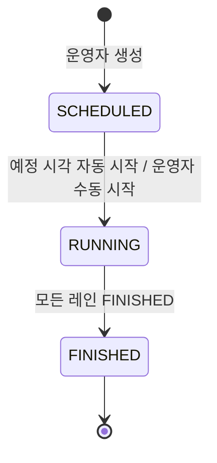
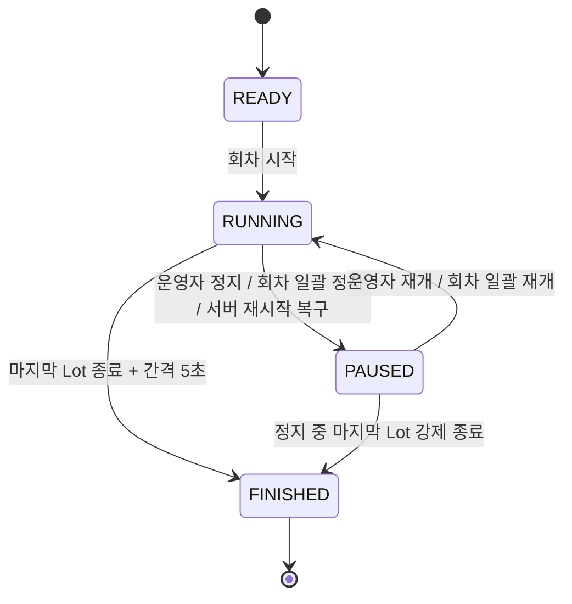
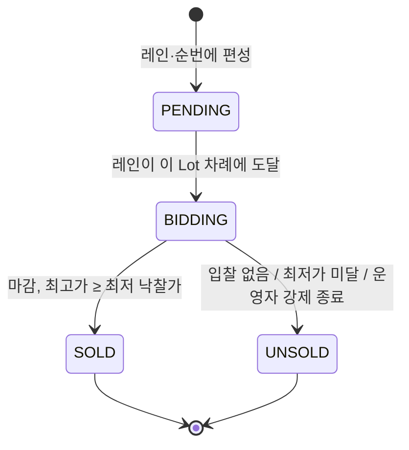
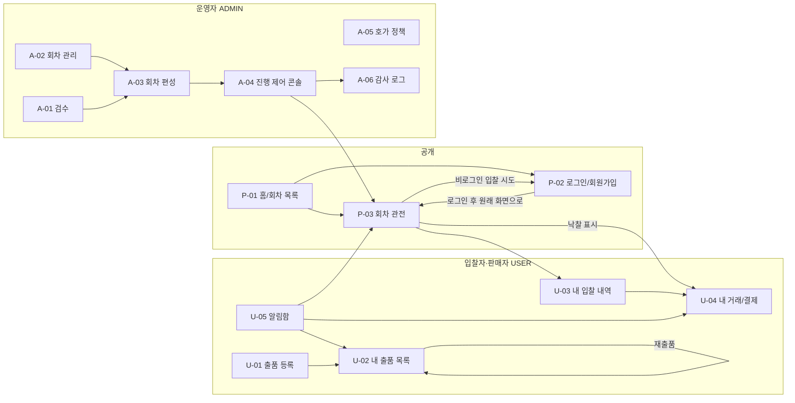

# Four-Lane Auction — PRD

| 항목 | 내용 |
|---|---|
| 버전 | 0.6 (초안) |
| 작성일 | 2026-10-23 |
| 변경 이력 | 0.6 M1-01의 OQ-49~51 승인 반영 / 0.1 최초 작성 / 0.2 OQ 19개 결정 반영 (OQ-01~05, 07~09, 12, 15~21, 23, 24, 29) / 0.3 [CHALLENGES.md](CHALLENGES.md)에서 찾은 질문 12개를 OQ-31~42로 추가하고 그중 1주차 계약 항목 5개 결정 (OQ-31, 33, 34, 39, 42). OQ-17 일부 수정. 실험 ② 프로파일링을 4주차로 당김 (9.8) / 0.4 [ARCHITECTURE.md](ARCHITECTURE.md) 리뷰 반영: OQ-10·37 결정, OQ-11 일부 결정, 리뷰에서 찾은 질문 2개를 OQ-43~44로 추가해 결정. 레인 비컨(M-11, 9.4)과 `500 BID_RESULT_UNKNOWN`(6.3) 추가 / 0.5 [API.md](API.md)·[EVENTS.md](EVENTS.md) 계약 작성 중 찾은 질문 4개를 OQ-45~48로 추가해 결정: 로그아웃(M-01), 편성할 수 있는 출품물(A2, M-05), 지난 Lot 결과 목록 제외(5장), 지난 예정 시각 거절(6.1). 에러 응답 형식과 운영자 API 에러 코드를 계약 문서로 넘김(6.1, 6.3) |
| 근거 문서 | [IDEA.md](IDEA.md), [CHALLENGES.md](CHALLENGES.md), [ARCHITECTURE.md](ARCHITECTURE.md) |
| 계약 문서 | [API.md](API.md) (REST), [EVENTS.md](EVENTS.md) (WebSocket/STOMP). 요청·응답·메시지의 형식은 계약 문서가 정한다 |

**표기 규칙**

- `(가정)`: IDEA.md에서 가정으로 둔 값. 아직 확정되지 않았으며 바뀔 수 있다.
- `[OQ-nn]`: 아직 결정되지 않은 사항. [10장 Open Questions](#10-아직-결정되지-않은-질문-open-questions)를 참조한다. 이 문서는 해당 부분을 임의로 정하지 않았다.
- `미정`: 값을 비워둔 항목. 대응하는 OQ가 있다.
- 결정된 OQ의 내용은 본문에 반영했고, 10장 표에 "결정됨"으로 표시해 결정 내용을 남겼다.

---

## 1. 한 줄 정의

일반 회원이 올린 중고 물품을 회차마다 1~4개 레인에서 **동시에** 영국식(오름 경매)으로 진행하고, 입찰자는 한 화면에서 모든 레인을 실시간으로 보면서 **"다음 호가로 입찰" 버튼 하나**로 원하는 레인에 입찰하는 웹 경매 플랫폼.

---

## 2. 사용자 역할과 권한

### 2.1 역할 정의

| 역할 | 시스템 권한 | 설명 |
|---|---|---|
| 관전자 | 비로그인 | 회차와 레인을 실시간으로 관전한다. 입찰·출품은 할 수 없다. |
| 입찰자 | `USER` (일반 회원) | 관전 + 입찰. **같은 계정으로 판매자 역할(출품)도 겸한다.** |
| 운영자 | `ADMIN` | 검수, 회차 생성·편성, 진행 제어, 호가 정책 관리. **입찰·출품은 할 수 없다.** |

- 입찰자와 판매자는 별도 역할이 아니다. 하나의 `USER`가 둘 다 할 수 있다.
- **본인이 출품한 물품에는 입찰할 수 없다.** 이것은 역할 권한이 아니라 도메인 규칙이며, 입찰 검증에서 처리한다 (6.3절).
- `ADMIN`은 입찰·출품을 할 수 없다. 자기가 편성하고 제어하는 경매에 참여하는 이해충돌을 막기 위해서다.
- `ADMIN` 계정은 마이그레이션이나 시드 데이터로만 만든다. 회원가입으로 만들 수 없고, 권한 승격 API도 없다.

### 2.2 권한 매트릭스

| 기능 | 관전자 | 입찰자(USER) | 운영자(ADMIN) |
|---|:-:|:-:|:-:|
| 회차 목록 조회, 레인 실시간 구독, 레인 스냅샷 조회 | O | O | O |
| 개인 알림 큐 구독 (`/user/queue/notifications`) | X | O | O |
| 입찰 | X | O (본인 출품 제외, 입찰 정지 상태 제외) | X |
| 출품 등록, 재출품 | X | O | X |
| 내 출품·입찰·거래 조회, 모의 결제 | X | O (본인 것만) | X |
| 출품 검수(승인·반려) | X | X | O |
| 회차 생성, 레인·순번 편성 | X | X | O |
| 회차 수동 시작, 일시정지·재개, Lot 강제 종료 | X | X | O |
| 호가 정책 관리 | X | X | O |

인증 방식: JWT(Access + Refresh). (가정) 단일 인스턴스이므로 Refresh Token은 DB에 저장한다. 로그아웃하면 서버가 Refresh Token을 폐기한다 (OQ-45). WebSocket(STOMP)은 레인 토픽 구독을 익명으로 허용하고, 개인 큐는 연결 시점에 JWT를 검증한 사용자만 쓸 수 있다.

**WebSocket 연결과 토큰** (OQ-39)

- STOMP `CONNECT`에 토큰이 없으면 익명 연결로 받는다. 익명 연결은 레인 토픽만 구독할 수 있다.
- 토큰이 있는데 만료되었거나 검증에 실패하면 연결을 거절한다(STOMP `ERROR` 프레임). 익명 연결로 낮춰 받지 않는다. 낮춰 받으면 사용자는 개인 알림이 끊긴 것을 모른 채 관전하게 된다. 클라이언트는 토큰을 재발급받은 뒤 다시 연결한다.
- 연결 중에 Access Token이 만료되어도 연결과 개인 큐 구독은 끊지 않는다. 입찰은 REST라 요청마다 토큰을 검증한다.

---

## 3. 핵심 시나리오

### 3.1 운영자

```
경매 회차 생성 → 출품물 등록과 레인 배정 → 레인 시작(회차 시작) → 진행 관리
```

| 단계 | 내용 |
|---|---|
| **A1. 경매 회차 생성** | 운영자가 회차를 만들면서 레인 수(1~4)와 **예정 시작 시각(필수, 지금보다 뒤, OQ-48)**을 정한다. 시간 파라미터(첫 입찰 대기 15초, 리셋 10초, Lot 간 간격 5초)는 기본값으로 채워지며 회차별로 조정할 수 있다 (언제까지, 어느 범위까지 바꿀 수 있는지는 [OQ-14]). 생성 직후 회차는 `SCHEDULED`, 모든 레인은 `READY`다. 홈 화면에 예정 회차로 노출된다. |
| **A2. 출품물 등록과 레인 배정** | ① 판매자가 등록한 출품물이 검수 대기 목록에 쌓인다. ② 운영자가 이미지·정보를 보고 승인 또는 반려한다. ③ 승인된 뒤 아직 편성되지 않은 출품물을 회차의 레인과 순번에 배정한다. 낙찰되었거나 경매 중인 출품물은 편성할 수 없다. 유찰된 출품물은 판매자가 재출품해 다시 승인받아야 편성할 수 있다 (OQ-46). 배정된 출품물마다 `PENDING` 상태의 Lot이 생긴다. 회차가 `SCHEDULED`인 동안에는 편성과 예정 시각을 바꿀 수 있다. 운영자가 직접 출품물을 만들지는 않는다. 시연·부하 테스트용 출품물을 어떻게 넣을지는 [OQ-27]. |
| **A3. 레인 시작 (회차 시작)** | 레인은 따로 시작하지 않는다. **회차가 시작되면 모든 레인이 동시에 시작**된다. 회차는 예정 시각이 되면 자동으로 시작되고, 운영자가 그 전에 "지금 시작"으로 직접 시작할 수도 있다. 시작 조건은 모든 레인에 Lot이 1개 이상 있는 것이다. 시작하면 회차는 `RUNNING`, 모든 레인은 `RUNNING`이 되고 각 레인의 1번 Lot이 `BIDDING`에 들어간다. 이 순간 편성이 잠기고 호가 정책이 스냅샷으로 고정된다. 예정 시각에 서버가 꺼져 있었다면 나중에 켜져도 자동으로 시작하지 않으며, 회차는 `SCHEDULED`로 남아 운영자가 직접 시작한다. |
| **A4. 진행 관리** | 운영자는 진행 제어 콘솔에서 모든 레인의 현재 Lot, 현재가, 남은 시간, 진행 순번을 본다. 필요하면 레인 단위 또는 회차 전체를 일시정지·재개하고, 특정 Lot을 강제 종료(유찰 처리)한다. 레인이 정지된 상태에서도 강제 종료할 수 있다. 모든 운영자 조치는 감사 로그에 남는다. 모든 레인이 `FINISHED`가 되면 회차가 `FINISHED`가 된다. |

### 3.2 입찰자

```
접속 → 4레인 관전 → 입찰 → 경쟁 → 낙찰/패찰 확인
```

| 단계 | 내용 |
|---|---|
| **B1. 접속** | 홈에서 진행 중인 회차를 고른다(예정 회차는 시작 시각을 볼 수 있다). 비로그인으로도 관전할 수 있지만, 입찰하려면 로그인해야 한다. |
| **B2. 4레인 관전** | 회차 관전 화면에 레인 수(1~4)만큼 패널이 뜬다. 패널마다 현재 Lot의 이미지·이름, 현재가(입찰 전에는 시작가), 다음 호가, 남은 시간, 최고 입찰자(마스킹한 닉네임, 예: `송**`), "최저가 미달" 배지, 레인 상태, "현재 N번째 / 남은 Lot 수"가 실시간으로 갱신된다. 내가 최고 입찰자면 "내가 최고 입찰자"로 표시된다. 레인들은 서로 독립적으로 진행되므로 패널마다 진행 순번이 다르다. 회차 전체 종료 시각은 예측할 수 없으므로 표시하지 않는다. |
| **B3. 입찰** | 원하는 레인의 "다음 호가로 입찰" 버튼을 누른다. 클라이언트는 지금 화면의 Lot(`lotId`), 화면에 보이는 현재가(`expectedPrice`), 입찰 금액(`amount`), `Idempotency-Key`를 담아 REST로 보낸다. 서버는 입찰을 DB에 커밋한 뒤 성공을 응답하고, 같은 레인의 모든 관전자에게 새 현재가를 브로드캐스트한다. 마감까지 남은 시간이 10초보다 적으면 10초로 늘어난다. |
| **B4. 경쟁** | 다른 사람이 더 높은 가격으로 입찰하면 화면이 갱신되고, 밀려난 입찰자에게는 "상위 입찰에 밀림" 알림이 간다. 최고 입찰자는 연속으로 다시 입찰할 수 없으므로, 내 입찰 뒤에 수락된 입찰은 언제나 다른 사람의 것이다. 동시에 같은 호가로 입찰하면 먼저 처리된 1건만 성공하고 나머지는 `409 PRICE_CHANGED`를 받는다. 이때 클라이언트는 최신 현재가로 화면을 갱신할 뿐 **더 높은 금액으로 자동 재입찰하지 않는다** (자동 입찰은 범위 밖). 다시 입찰하려면 사용자가 버튼을 또 눌러야 한다. |
| **B5. 낙찰/패찰 확인** | 마감 시각이 되면 서버가 마감을 판정하고 결과를 브로드캐스트한다. 낙찰자에게는 "낙찰" 표시와 알림이 가고 결제 대기 거래가 생긴다. 낙찰자는 결제 기한(기본 24시간) 안에 모의 결제를 한다. 그 Lot에 입찰했지만 낙찰받지 못한 입찰자에게는 "패찰"이 표시된다. 결과는 "내 입찰 내역"에서도 볼 수 있다. 패찰의 정확한 정의와 최저가 미달로 유찰된 경우에 입찰자에게 무엇을 보여줄지는 [OQ-25]. |

### 3.3 (참고) 판매자 흐름

판매자는 입찰자와 같은 `USER`이며, 운영자 시나리오 A2의 입력을 만든다.

```
출품 등록(이미지·시작가·최저 낙찰가) → 검수 결과 확인 → 경매 결과 확인 → (유찰 시) 재출품 → 검수 대기로 복귀
```

---

## 4. 기능 목록

**분류 기준** (확정)

- **Must**: 출품 → 편성 → 경매 → 낙찰 → 결제로 이어지는 핵심 흐름, 그리고 성능·정합성 증명(9장 목표)에 꼭 필요한 기능. 하나라도 빠지면 시연이 성립하지 않는다.
- **Should**: IDEA에서 포함하기로 했지만, 빠져도 핵심 흐름은 시연할 수 있는 기능. 일정이 밀리면 여기서부터 뺀다.
- **Could**: 스트레치 목표, 또는 교체할 수 있게 인터페이스만 열어둔 구현
- **Won't**: 이번 범위에서 제외 확정 (5장)

### Must

| ID | 기능 | 비고 |
|---|---|---|
| M-01 | 회원가입·로그인·로그아웃, JWT 발급·재발급 | (가정) Refresh Token은 DB 저장. ADMIN 계정은 시드로만 생성. 로그아웃은 Refresh Token 폐기 (OQ-45) |
| M-02 | 출품 등록: 이미지(필수), 이름·설명, 시작가(1,000원 단위), 비공개 최저 낙찰가(선택, 1,000원 단위, 시작가 이상) | (가정) 로컬 스토리지 어댑터. 저장소는 인터페이스로 분리 |
| M-03 | 출품 검수: 승인 / 반려 | |
| M-04 | 회차 생성: 레인 수 1~4, 예정 시작 시각(필수), 시간 파라미터 | |
| M-05 | 회차 편성: 승인된 뒤 아직 편성되지 않은 출품물을 레인·순번에 배정. 회차 시작 시 잠금 | 낙찰·유찰된 출품물은 편성 불가, 유찰은 재출품 후 재승인 (OQ-46) |
| M-06 | 회차 시작: 예정 시각 자동 시작 + 운영자 수동 시작. 모든 레인 동시 시작 | 스케줄러도 주입된 `Clock` 기준 |
| M-07 | 레인 엔진: 레인·Lot 상태 전이, 타이머, 레인별 직렬 큐, Lot 자동 진행, 회차 종료 판정 | Spring에 의존하지 않는 순수 도메인 코드, `Clock` 주입 |
| M-08 | 호가 정책: Strategy로 분리, 기본 3구간, DB 버전 관리, 회차 시작 시 스냅샷 고정 | |
| M-09 | 입찰 API: `POST /api/lanes/{laneId}/bids`, 검증 순서대로 처리, `lotId`·`expectedPrice` 비교, 멱등 키, DB 커밋 후 응답 | |
| M-10 | 마감 판정: 낙찰(SOLD) / 유찰(UNSOLD) | |
| M-11 | 실시간 브로드캐스트: STOMP 레인 토픽, 레인별 단조 증가 시퀀스 번호, 서버가 부팅할 때마다 바뀌는 `epoch`, 서버 시각 포함. REST 레인 스냅샷으로 재동기화. 주기적인 레인 비컨으로 마지막 메시지 유실을 감지 | 시퀀스는 epoch 안에서만 단조 증가 (OQ-34). 비컨은 시퀀스를 올리지 않는다 (OQ-37). 병합 허용 여부는 [OQ-40] |
| M-12 | 멀티레인 관전 화면 + "다음 호가로 입찰" 버튼 | |
| M-13 | 일시정지·재개: 레인 단위, 회차 전체 일괄 | |
| M-14 | Lot 강제 종료 (유찰로 처리). 레인이 정지된 상태에서도 가능 | |
| M-15 | 낙찰/패찰 결과 확인: 관전 화면 표시, 내 입찰 내역 | |
| M-16 | 거래: 낙찰 시 Trade 생성 → 모의 결제(멱등) → 완료. 결제 기한 초과 시 자동 취소 | 결제 모듈은 인터페이스로 분리 |
| M-17 | 서버 재시작 복구: 진행 중이던 레인을 `PAUSED`로 복구하고, 최고가와 최고 입찰자는 DB에서 읽는다 | |
| M-18 | 메트릭 계측: 입찰 처리 시간, 레인 큐 적체량, 브로드캐스트 지연, 연결 수 | IDEA 리스크 대응: 처음부터 계측 |

### Should

| ID | 기능 | 비고 |
|---|---|---|
| S-01 | 개인 알림: 접속 중이면 WebSocket 개인 큐로 즉시 전송 + DB 알림함 저장. 종류: 상위 입찰에 밀림, 낙찰, 유찰(판매자), 결제 기한 임박, 거래 취소, 검수 결과 | |
| S-02 | 미결제 패널티: 거래 취소 시 경고 누적, (가정) 경고 3회면 입찰 정지 | [OQ-26] |
| S-03 | 운영자 감사 로그 기록 (모든 운영자 조치) | |
| S-04 | 호가 정책 관리 화면: 운영자가 새 정책 버전을 등록 | 정책 엔진 자체는 M-08 |
| S-05 | 유찰 출품물 재출품: 같은 Item에 새 Lot, 검수 대기로 복귀 | |

### Could

| ID | 기능 |
|---|---|
| C-01 | 동시 WebSocket 연결 10,000 (스트레치 목표) |
| C-02 | 레인 상태 저장소의 Redis 구현 |
| C-03 | scale-out: Redis Pub/Sub, 레인 담당 인스턴스 선출. 단일 인스턴스 목표와 실험 2개를 마친 뒤에만 착수 |
| C-04 | 이미지 저장소의 S3 어댑터 |
| C-05 | 감사 로그 조회 화면 (IDEA는 기록만 결정함) |

### Won't

5장 Non-goals와 같다.

---

## 5. Non-goals (이번에 절대 만들지 않는 것)

| 분류 | 항목 | 이유 |
|---|---|---|
| 경매 규칙 | 자동 입찰(프록시 입찰) | 입찰 UI는 "다음 호가" 버튼 하나로 고정 |
| 경매 규칙 | 금액 직접 입력 입찰 | 같은 이유 |
| 경매 규칙 | 조건부 낙찰 (최저가 미달 시 판매자와 최고 입찰자의 협상) | 유찰은 그대로 종료 |
| 경매 규칙 | 차순위 입찰자 승계 | 미결제 시 거래 취소로 끝 |
| 경매 규칙 | Lot 최대 길이 제한 | 입찰이 이어지면 무제한 진행이 규칙 |
| 운영 | 운영자의 특정 입찰 취소(롤백) | |
| 운영 | 진행 중인 회차의 동적 재편성 | 시작 후 편성 잠금 |
| 운영 | 레인별 개별 시작 | 회차가 시작되면 모든 레인이 함께 시작 |
| 운영 | 자동 편성 알고리즘, 운영 통계 대시보드 | 운영자 직접 편성과 진행 제어만 |
| 관전 | 회차의 지난 Lot 결과 목록 (진행 중·종료된 회차) | 관전 화면은 레인마다 현재 Lot만 보여 준다. 내 결과는 내 입찰 내역(U-03), 판매 결과는 내 출품 목록(U-02)에서 본다 (OQ-47) |
| 결제·거래 | 실제 PG 연동(테스트 모드 포함), 정산, 환불, 배송 | 결제 인터페이스 + 가짜 구현에서 멈춤 |
| 알림 | 이메일 알림 | WebSocket + DB 알림함만 |
| 복구 | 이벤트 소싱 기반 완전 복원 (남은 시간까지 복원) | 일시정지 상태로 복구 + 운영자 재개 |
| C2C 마켓 | 거래 채팅, 검색·카테고리·찜·추천, 소셜 로그인·본인인증, 평판(매너온도), 모바일 앱 | 출품 → 경매 → 결제 한 줄 흐름만 구현 |

---

## 6. 경매 규칙 상세

### 6.1 회차·레인 상태와 전이

#### 회차 상태



| 상태 | 의미 |
|---|---|
| `SCHEDULED` | 생성됨. 편성과 예정 시각을 바꿀 수 있다. 홈에 예정 회차로 노출된다 |
| `RUNNING` | 시작됨. 편성이 잠기고 호가 정책이 고정된다. 레인이 일시정지되어도 회차는 `RUNNING`이다 |
| `FINISHED` | 모든 레인이 `FINISHED`. 종료 상태 |

**회차 시작 규칙**

- 시작 조건: 회차의 모든 레인에 Lot이 1개 이상 있어야 한다. 레인당 Lot 수에는 상한이 없다.
- 예정 시각의 범위: 회차를 만들거나 예정 시각을 바꿀 때, 예정 시각은 서버의 현재 시각보다 뒤여야 한다. 지난 시각은 거절한다. 받아 주면 그 회차는 처음부터 "놓친 예정 시각"이 되어 자동으로 시작하지 않고, 운영자는 시각을 잘못 넣은 것을 모른 채 기다린다 (OQ-48).
- 자동 시작: 서버 시각이 예정 시각에 이르면 시작한다. 시작 조건을 만족하지 못하면 시작하지 않고 `SCHEDULED`로 남는다.
- 수동 시작: 운영자는 예정 시각 전에도 "지금 시작"으로 시작할 수 있다. 시작 조건을 만족하지 못하면 거절된다.
- 놓친 예정 시각: 예정 시각에 서버가 꺼져 있었다면 서버가 켜진 뒤에도 자동으로 시작하지 않는다. 회차는 `SCHEDULED`로 남고, 운영자가 직접 시작한다. "놓친" 것과 "조금 늦게 실행된" 것을 가르는 기준은 [OQ-38].
- 시작하는 순간 모든 레인이 동시에 `READY → RUNNING`이 되고, 편성이 잠기며, 그 시점의 호가 정책 버전이 스냅샷으로 고정된다.

#### 레인 상태



| 상태 | 의미 | 입찰 |
|---|---|---|
| `READY` | 회차 시작 전 | 거절 (`LANE_NOT_RUNNING`) |
| `RUNNING` | Lot이 순서대로 진행 중. Lot 간 간격(5초)도 이 상태에 포함된다 | `BIDDING` Lot이 있을 때만 수락 |
| `PAUSED` | 운영자 명령 또는 서버 재시작으로 멈춤. 타이머가 정지된다 | 거절 (`LANE_NOT_RUNNING`) |
| `FINISHED` | 편성된 모든 Lot이 `SOLD` 또는 `UNSOLD`로 끝남. 종료 상태 | 거절 (`LANE_NOT_RUNNING`) |

| 전이 | 트리거 | 결과 |
|---|---|---|
| READY → RUNNING | 회차 시작 (모든 레인 동시) | 1번 Lot이 `BIDDING`에 진입 |
| RUNNING → PAUSED | 운영자 레인 정지, 회차 일괄 정지, 서버 재시작 복구 | 남은 시간을 저장하고 타이머를 멈춘다 (6.4절 T5) |
| PAUSED → RUNNING | 운영자 레인 재개, 회차 일괄 재개 | 타이머를 다시 잡는다 (6.4절 T5, T6) |
| RUNNING → FINISHED | 마지막 Lot이 `SOLD` 또는 `UNSOLD`가 되고, 결과 표시 간격(5초)이 지남 | 모든 레인이 `FINISHED`면 회차도 `FINISHED` |
| PAUSED → FINISHED | 정지 중에 마지막 Lot을 강제 종료함 | 간격 없이 바로 `FINISHED` |

- 레인끼리는 동기화하지 않는다. 시작만 함께 하고, 그 뒤로는 각 레인이 독립적으로 다음 Lot으로 넘어간다.
- 회차 일괄 정지·재개는 `RUNNING`(정지 시) 또는 `PAUSED`(재개 시)인 레인에만 적용한다. `FINISHED` 레인은 변하지 않는다. 개별로 정지해 둔 레인이 일괄 재개에 함께 재개되는지는 [OQ-13].
- 허용되지 않은 전이를 명령하면 운영자 API는 거절한다. 운영자 API의 에러 코드는 [API.md](API.md) 7장과 9장에 정했다.
- 내부 `Activate`는 READY에서만 적용한다. 다른 단계에 재전달되면 상태·이벤트 변화 없이 내부 거절한다(OQ-57). READY·FINISHED에 전달된 내부 `Tick`은 상태·예약·이벤트 변화 없이 무시한다(OQ-58). 운영자 API 계약은 바뀌지 않는다.

### 6.2 출품물(Lot) 상태와 전이



> **IDEA.md와의 차이.** IDEA는 `SCHEDULED → WAITING_FIRST_BID → BIDDING`으로 나눴다. 이 PRD는 4개 상태를 쓴다. `SCHEDULED`는 `PENDING`에 대응하고, `WAITING_FIRST_BID`는 `BIDDING` 안의 "첫 입찰 대기 단계"로 흡수했다. 동작은 IDEA와 같다. API와 메시지에는 별도 상태나 단계 필드를 두지 않고, **입찰 수(`bidCount`)로 두 단계를 구분**한다 (`bidCount = 0`이면 첫 입찰 대기).

| 상태 | 의미 |
|---|---|
| `PENDING` | 편성되었고 아직 차례가 오지 않음 |
| `BIDDING` | 입찰을 받는 중. 두 단계가 있다. **① 첫 입찰 대기**: 입찰 0건, 마감까지 15초. **② 카운트다운**: 입찰 1건 이상, 입찰이 수락될 때마다 남은 시간이 최소 10초로 늘어남 |
| `SOLD` | 낙찰. 종료 상태 |
| `UNSOLD` | 유찰. 종료 상태 |

| 전이 | 트리거 | 결과 |
|---|---|---|
| PENDING → BIDDING | 회차 시작(1번 Lot), 또는 이전 Lot이 끝나고 Lot 간 간격(5초)이 지남. 레인이 `RUNNING`일 때만 일어난다 | 마감 시각 = 진입 시각 + 15초. 브로드캐스트 |
| BIDDING → SOLD | 마감 시각 도달 + 입찰 1건 이상 + 최고가 ≥ 최저 낙찰가 | Trade(`AWAITING_PAYMENT`) 생성, 낙찰 알림. 브로드캐스트 |
| BIDDING → UNSOLD | (a) 첫 입찰 대기 중 마감 시각 도달(입찰 0건) (b) 마감 시각 도달 + 최고가 < 최저 낙찰가 (c) 운영자 강제 종료 (최고가와 관계없이 유찰) | 판매자에게 유찰 알림, 재출품 가능. 브로드캐스트 |

- `SOLD`와 `UNSOLD`는 바뀌지 않는다. 입찰 롤백은 없다.
- 레인이 `PAUSED`인 동안 Lot은 `BIDDING`을 유지하고 타이머만 멈춘다.
- **정지 중 강제 종료**: 레인은 `PAUSED`를 유지한다. 재개하면 Lot 간 간격(5초)이 지난 뒤 다음 Lot이 시작된다. 마지막 Lot이었다면 레인은 바로 `FINISHED`가 된다.
- **진행 중(`RUNNING`) 강제 종료** 뒤 다음 Lot이 간격 5초 뒤에 자동으로 시작하는지는 [OQ-06].
- 강제 종료 대상은 `BIDDING` Lot이다. 아직 시작하지 않은 `PENDING` Lot을 건너뛰는 강제 종료와, Lot 간 간격 중 강제 종료의 대상은 [OQ-41].
- 유찰된 출품물을 판매자가 재출품하면 같은 Item에 새 Lot이 생기고 검수 대기로 돌아간다. 기존 Lot은 이력으로 남는다.

### 6.3 입찰 수락 조건과 거절 사유

#### 요청

```
POST /api/lanes/{laneId}/bids
Idempotency-Key: <클라이언트가 입찰 버튼을 누를 때마다 새로 만든 키>
{ "lotId": <화면에 보이는 Lot>, "expectedPrice": <화면에 보이는 현재가>, "amount": <입찰 금액> }
```

- `lotId`: 엔드포인트는 레인 단위지만, 요청에는 입찰하려는 Lot을 명시한다. 이전 Lot을 노린 입찰이 다음 Lot에 들어가는 일을 막기 위해서다.
- `expectedPrice`: 언제나 "화면에 보이는 현재가"다. 입찰 전 현재가는 시작가이므로, 첫 입찰의 `expectedPrice`는 시작가다.

#### 가격 규칙

| 현재가 | 호가 단위 | 예: 현재가 → 다음 호가 |
|---|---|---|
| 10,000원 미만 | +1,000원 | 9,000 → 10,000 |
| 10,000원 이상 100,000원 미만 | +10,000원 | 10,000 → 20,000 / 99,000 → 109,000 |
| 100,000원 이상 | +25,000원 | 100,000 → 125,000 |

- **현재가**: 입찰이 없으면 시작가, 있으면 최고 입찰가
- **다음 호가** = 현재가 + 호가 단위(현재가). **첫 입찰 금액은 시작가 + 호가 단위(시작가)**다. 예를 들어 시작가가 50,000원이면 첫 입찰은 60,000원이다. 시작가 그대로는 낙찰되지 않는다.
- **금액 단위**: 시작가와 최저 낙찰가는 1,000원 단위로만 받는다. 호가 단위가 모두 1,000원의 배수이므로 모든 가격이 1,000원 단위가 된다. 구간 경계값(9,999 / 10,000 / 99,999 / 100,000원) 테스트는 호가 정책의 단위 테스트로 그대로 둔다.
- 호가 정책은 회차 시작 시점의 버전으로 고정한다. 운영자가 진행 중에 정책을 바꾸면 다음 회차부터 적용된다.
- **최저 낙찰가**는 선택 입력이다. 비워두면 시작가와 같은 값으로 저장한다. 첫 입찰이 언제나 시작가보다 높으므로, 이 경우 입찰이 1건이라도 있으면 낙찰된다. 마감 판정은 "최고가 ≥ 최저 낙찰가" 하나로 유지된다.
- 최저 낙찰가는 공개 API·브로드캐스트·화면 어디에도 값을 노출하지 않는다. 내부 도메인 객체와 공개 DTO를 분리한다. 화면에는 "최저가 미달" 배지만 보인다. 배지를 띄우는 정확한 조건은 [OQ-22].

#### 최고 입찰자 표시

- 브로드캐스트와 스냅샷에는 최고 입찰자를 **마스킹한 닉네임**(첫 글자만 남기고 나머지는 `*`, 예: `송**`)으로만 넣는다. 회원 ID 같은 식별자는 넣지 않는다.
- "내가 최고 입찰자" 여부는 내 입찰 성공 응답과, 로그인 사용자가 받는 레인 스냅샷의 본인 여부 표시로 알 수 있다. 최고 입찰자는 연속으로 입찰할 수 없으므로(조건 9), 내 입찰 뒤에 수락된 입찰이 브로드캐스트되면 나는 밀린 것이다.
- 브로드캐스트와 스냅샷에는 마지막으로 수락된 입찰의 ID가 들어 있다. 이 값이 내 성공 응답의 입찰 ID와 같으면 내가 최고 입찰자다. 입찰 ID는 입찰 기록의 번호이고 회원 식별자가 아니다.

#### 수락 조건 (검증 순서)

아래 조건을 **순서대로** 검사하고, 처음 실패한 조건의 사유로 거절한다. 레인 상태와 관련된 조건(5~9)은 레인 직렬 큐 안에서, 큐가 그 요청을 처리하는 순간의 서버 시각으로 검사한다 (6.5절 C3). 레인 큐가 상한에 도달해 요청을 받을 수 없으면 5번을 검사하기 전에 `LANE_OVERLOADED`로 거절한다 (OQ-31).

1. 인증된 `USER`일 것 (`ADMIN`은 입찰할 수 없다)
2. 멱등 키가 처음 쓰는 키일 것. 이미 처리한 키라면:
   - 요청 본문이 같고 처음 결과가 **성공**이면 처음 성공 응답을 그대로 돌려준다. 입찰은 다시 처리하지 않는다. 이 보장은 서버가 재시작되어도 유지된다.
   - 요청 본문이 같고 처음 결과가 **거절**이면 같은 거절을 돌려준다. 단, 서버가 재시작된 뒤에는 처음 거절이 남아 있지 않을 수 있고, 그때는 요청을 새로 평가한다. 다른 거절 사유가 나올 수 있다 (OQ-33).
   - 요청 본문이 다르면 `IDEMPOTENCY_KEY_REUSED`로 거절한다.
   - 키는 회원 단위로 유일하며 24시간 보관한다. 같은 키의 요청이 동시에 도착해도 입찰은 1건만 처리되고, 나머지 요청은 처음 요청의 결과를 받는다.
   - 처리되지 않은 요청(`LANE_OVERLOADED`)의 키는 기록하지 않는다.
   - 클라이언트는 응답을 받지 못한 입찰을 처음 요청 뒤 (가정) 10초 안에만 같은 키로 재전송한다. 그 뒤에는 재전송하지 않고, 레인 스냅샷과 내 입찰 내역으로 결과를 확인한다.
   - 서버가 입찰 결과를 확인하지 못하면(커밋 결과를 모르는 실패, 결과 대기 상한 초과) `500 BID_RESULT_UNKNOWN`으로 응답한다. 이 응답을 받은 입찰도 응답을 받지 못한 입찰과 같이 같은 키로 재전송하며, 재전송은 그 입찰의 실제 결과를 받는다 (OQ-44).
3. 입찰 정지 상태가 아닐 것 (미결제 패널티)
4. 요청한 Lot이 본인이 출품한 물품이 아닐 것
5. 레인이 `RUNNING`이고, 지금 `BIDDING`인 Lot이 있고, 현재 시각이 그 Lot의 마감 시각 전일 것
6. 요청한 `lotId`가 지금 `BIDDING`인 Lot일 것
7. `expectedPrice`가 서버의 현재가와 같을 것
8. `amount`가 다음 호가와 같을 것
9. 요청자가 현재 최고 입찰자가 아닐 것 (연속 재입찰 금지)

> **IDEA.md 대비 변경.** 멱등 키 검사를 7번째에서 2번째로 옮겼다. IDEA 순서대로라면 성공한 입찰을 네트워크 재전송했을 때 `PRICE_CHANGED`가 돌아가서, 클라이언트는 자기 입찰이 성공했는지 알 수 없다. `lotId` 검사(6)와 마감 시각 재검사(5)를 새로 넣었다. 연속 재입찰 금지(9)는 가정에서 확정으로 바뀌었다.

조건을 모두 통과하면: 입찰을 DB에 커밋 → 현재가·최고 입찰자 갱신 → 마감 시각 = max(지금 마감 시각, 수락 시각 + 10초) → 성공 응답 → 레인 브로드캐스트(시퀀스 +1). 이전 최고 입찰자에게 "상위 입찰에 밀림" 알림을 보낸다 (S-01).

#### 거절 사유 전체 목록

HTTP 상태의 의미는 다음과 같다.

- **409**: 화면이 낡았다. 최신 상태로 갱신하면 해결된다.
- **422**: 요청이 지금 상태에서는 처리될 수 없다.
- **403**: 이 사용자는 이 입찰을 할 수 없다.
- **400**: 요청 형식이 잘못되었거나 클라이언트 계산에 버그가 있다.
- **503**: 서버가 지금 입찰을 받을 여유가 없다. 요청은 처리되지 않았다.
- **500** (`BID_RESULT_UNKNOWN`만): 서버가 입찰 결과를 확인하지 못했다. 입찰은 처리됐을 수도 있다. 같은 키로 재전송하면 결과를 받는다.

| 순서 | 에러 코드 | HTTP | 조건 | 클라이언트 처리 |
|---|---|---|---|---|
| — | `INVALID_REQUEST` | 400 | 필수값(`Idempotency-Key`, `lotId`, `expectedPrice`, `amount`) 누락 또는 형식 오류 | 버그로 간주, 로그 |
| — | `LANE_NOT_FOUND` | 404 | 존재하지 않는 `laneId` | 화면 새로고침 |
| 1 | `UNAUTHENTICATED` | 401 | 토큰 없음, 만료, 위조 | 토큰 재발급 후 재시도. 실패하면 로그인 화면 |
| 1 | `FORBIDDEN` | 403 | `USER`가 아님 (`ADMIN` 포함) | 입찰 버튼 숨김 |
| 2 | `IDEMPOTENCY_KEY_REUSED` | 422 | 이미 처리한 `Idempotency-Key`에 다른 요청 본문 | 버그로 간주. 키는 클릭마다 새로 만든다 |
| 3 | `BIDDER_SUSPENDED` | 403 | 입찰 정지 상태의 회원 | 정지 안내 |
| 4 | `SELF_BID_FORBIDDEN` | 403 | 본인이 출품한 Lot에 입찰 | 본인 Lot이면 버튼을 미리 비활성화 |
| 4와 5 사이 | `LANE_OVERLOADED` | 503 | 레인 큐가 상한에 도달해 요청을 받을 수 없음. 요청은 처리되지 않았고 멱등 키도 기록하지 않는다. 상한값은 측정으로 정한다 | "혼잡" 안내. 자동 재시도 금지. 사용자가 다시 누르면 새 키로 새 요청 |
| 5 | `LANE_NOT_RUNNING` | 422 | 레인이 `READY`, `PAUSED`, `FINISHED` | 레인 상태 표시 갱신 |
| 5 | `LOT_NOT_BIDDING` | 422 | 레인은 `RUNNING`이지만 `BIDDING` Lot이 없음(Lot 간 간격 중), 또는 큐에서 처리하는 시각이 이미 마감 시각을 지남 | 결과·다음 Lot 미리보기 표시 |
| 6 | `LOT_MISMATCH` | 409 | `lotId`가 이 레인에서 지금 `BIDDING`인 Lot이 아님 | 최신 상태로 갱신 |
| 7 | `PRICE_CHANGED` | 409 | `expectedPrice` ≠ 서버 현재가. 다른 입찰이 먼저 처리된 경우 | 최신 현재가로 갱신. 자동 재입찰 금지 |
| 8 | `INVALID_BID_AMOUNT` | 400 | `amount` ≠ 다음 호가. 가격 검사(7)를 통과했으므로 클라이언트의 호가 계산 버그 | 버그로 간주, 로그. 최신 상태로 갱신 |
| 9 | `ALREADY_HIGHEST_BIDDER` | 409 | 현재 최고 입찰자가 다시 입찰 | 최고 입찰자면 버튼을 미리 비활성화 |
| — | `BID_RESULT_UNKNOWN` | 500 | 거절이 아니라 결과 미정. 커밋 결과를 모르는 실패, 또는 서버의 결과 대기 상한 초과. 입찰은 처리됐을 수도 있다 (OQ-44) | 처음 요청 뒤 10초 안에 같은 키로 재전송한다. 결과는 재전송 응답으로 확정된다 |

에러 응답 본문의 형식은 [API.md](API.md) 1.4에 정했다: `{ "error": { "code", "message", … } }`. 레인 상태 때문에 거절된 경우(409, 그리고 422의 `LANE_NOT_RUNNING`·`LOT_NOT_BIDDING`)에는 `error.lane`에 그 순간 레인의 epoch와 마지막 시퀀스를 넣는다. 클라이언트는 스냅샷을 다시 받지 않고 그 시퀀스까지 브로드캐스트가 반영되기를 기다린다 (API.md 5.1).

### 6.4 시간 규칙

#### 파라미터 (회차 설정)

| 파라미터 | 기본값 | 설명 |
|---|---|---|
| 첫 입찰 대기 시간 | 15초 | `BIDDING` 진입 후 이 시간 안에 입찰이 없으면 유찰 |
| 소프트 클로즈 시간 | 10초 | 입찰이 수락되면 마감까지 남은 시간을 최소 이 값으로 늘림 |
| Lot 최대 길이 | 없음 | 입찰이 이어지면 무제한으로 진행 |
| Lot 간 간격 | 5초 | 결과 표시 + 다음 Lot 미리보기. 마지막 Lot 뒤에도 적용 |
| 재개 시 최소 보장 시간 | 10초 | 일시정지 후 재개할 때 보장하는 최소 남은 시간 |
| 결제 기한 | 24시간 | 시연을 위해 설정으로 줄일 수 있다. 기한 경계의 판정 기준은 [OQ-36] |

시간 파라미터 네 값은 실제 시작 전 SCHEDULED 동안 변경할 수 있다. 예정 시각이 지나도 SCHEDULED면 허용한다. 각각 1,000~60,000ms의 정수이며 배수·상호 대소 제약은 없다 (OQ-14, M1-06 승인).

#### 규칙

- **T0. 회차 시작.** 예정 시각에 자동으로, 또는 운영자 명령으로 시작한다. 모든 레인의 1번 Lot이 같은 시각에 `BIDDING`에 들어간다 (6.1절).
- **T1. 경매 시간.** Lot이 `BIDDING`에 들어간 서버 시각을 `t0`라 하면, 첫 마감 시각은 `t0 + 15초`다. 그때까지 입찰이 없으면 `UNSOLD`가 된다.
- **T2. 소프트 클로즈.** 입찰이 수락된 서버 시각을 `tb`라 하면, `마감 시각 = max(지금 마감 시각, tb + 10초)`다. 마감은 절대 앞당겨지지 않는다. 예: `t0 + 2초`에 첫 입찰이 들어오면 남은 13초가 그대로 유지된다. `t0 + 8초`에 들어오면 남은 7초가 10초로 늘어난다. 카운트다운 단계에서는 남은 시간이 항상 10초 이하이므로 매 입찰마다 10초로 리셋되는 것과 같다.
- **T3. 최대 길이 없음.** 회차 종료 시각은 예측할 수 없다. UI는 "현재 N번째 / 남은 Lot 수"만 보여준다.
- **T4. Lot 간 간격.** Lot이 `SOLD`·`UNSOLD`가 된 시각부터 5초 뒤에 다음 Lot이 `BIDDING`에 들어간다. 마지막 Lot이었다면 5초 뒤에 레인이 `FINISHED`가 된다. 간격 중 입찰은 `LOT_NOT_BIDDING`으로 거절한다.
- **T5. 일시정지 시 남은 시간.** 정지 시각 `tp`에 `남은 시간 = 마감 시각 − tp`를 저장하고 타이머를 멈춘다. 재개 시각 `tr`에 `마감 시각 = tr + max(남은 시간, 10초)`로 다시 잡는다. 이 규칙은 첫 입찰 대기 단계와 카운트다운 단계에 똑같이 적용된다. 예: 첫 입찰 대기 중 13초 남기고 정지했다면 재개 후 13초, 4초 남기고 정지했다면 10초다. Lot 간 간격 중에 정지했다면 재개 시각부터 간격(5초)을 처음부터 다시 준다 (OQ-10). 최소 보장을 간격에도 적용하고 그 최소값을 간격 길이로 잡은 것이다: `max(남은 간격, 5초) = 5초`. 정지 중에 강제 종료한 Lot 뒤의 간격(6.2)도 같은 규칙이다.
- **T6. 재시작 복구 후 재개.** 서버 재시작으로 `PAUSED`가 된 레인, 즉 재시작 순간 `RUNNING`이던 레인을 재개하면 `마감 시각 = tr + 10초`로 잡는다 (재시작 전 남은 시간은 복원하지 않는다). 간격 중이던 레인은 T5의 간격 규칙과 같이 재개 시각부터 간격 5초를 준다 (OQ-11 일부). 재시작 전에 운영자가 이미 정지해 둔 레인은 정보가 사라지지 않았으므로 T5를 그대로 따른다 (OQ-43). 입찰 0건인 Lot에도 10초를 적용할지는 [OQ-11].
- **T7. 레인 독립성.** T1~T6은 레인마다 따로 적용된다. 회차 일괄 정지·재개도 레인별 남은 시간을 각각 저장하고 복원한다.

### 6.5 시간 판단의 기준: 서버 시계

- **C1.** 회차 자동 시작, 마감, 소프트 클로즈, 간격, 정지·재개, 결제 기한을 포함한 **모든 시간 판단은 서버 시계로만 한다.** 서버는 `Clock`을 주입받아 사용하고, 테스트에서는 시간을 마음대로 조작한다. 서버 시계가 NTP 보정 등으로 한 번에 점프할 때의 동작은 [OQ-35].
- **C2.** 입찰, 타이머 만료, 운영자 명령(정지·재개·강제 종료)은 **모두 같은 레인 직렬 큐**에 들어가며 들어간 순서대로 하나씩 처리된다. 그래서 "마지막 순간의 입찰"과 "타이머 만료"가 동시에 처리되는 일이 없다. 정지 명령 직후에 도착한 입찰은 항상 `LANE_NOT_RUNNING`으로 거절된다.
- **C3.** 입찰의 기준 시각은 **레인 큐가 그 입찰을 처리하는 순간의 서버 시각**이다. HTTP 요청을 받은 시각이 아니다. 큐는 입찰을 처리할 때 `현재 시각 < 마감 시각`인지 다시 검사하고, 지났으면 `LOT_NOT_BIDDING`으로 거절한다. 그래서 타이머 이벤트가 늦게 실행되더라도 마감 뒤의 입찰은 한 건도 수락되지 않으며, 큐 순서와 시간 순서가 항상 일치한다.
- **C4.** 클라이언트 시계는 **표시용**이다. 브로드캐스트와 스냅샷에는 서버 시각과 마감 시각을 넣고, 클라이언트는 둘의 차이로 카운트다운을 그린다. 클라이언트 카운트다운이 0이 되어도 Lot은 끝나지 않으며, 서버의 마감 메시지를 받아야 결과를 표시한다. 클라이언트에는 아직 시간이 남아 보여도 서버 기준으로 마감되었다면 입찰은 거절된다. 마감 메시지를 놓쳤는지는 시간이 아니라 레인 비컨의 시퀀스로 판단한다 (OQ-37, 9.4). 마감 판정이 늦어지는 중이라면 비컨의 시퀀스가 그대로이므로 클라이언트는 계속 기다린다.
- **C5. 시각의 저장과 표현** (OQ-42)
  - 서버 코드는 시각을 `Instant`로 다루고, 현재 시각은 주입된 `Clock`에서만 얻는다. `Clock`을 거치지 않는 현재 시각 호출(`Instant.now()` 등)과 DB의 `NOW()`·`DEFAULT CURRENT_TIMESTAMP`는 쓰지 않는다.
  - DB는 모든 시각을 UTC 기준 `DATETIME(3)`(밀리초)으로 저장한다. 초 단위 컬럼은 소수 초를 반올림하므로, 마감 직전에 수락된 입찰이 마감 시각에 수락된 것처럼 기록될 수 있다.
  - API는 시각을 밀리초까지 포함한 ISO-8601 문자열로 주고받는다. 요청의 시각에는 오프셋이 반드시 있어야 하고(예: `2026-10-23T20:00:00.000+09:00`), 오프셋이 없으면 형식 오류로 거절한다. 응답의 시각은 UTC(`Z`)로 낸다.

---

## 7. Must 기능별 수용 기준

시간 값은 기본 파라미터(15초 / 10초 / 5초)를 기준으로 한다. 아직 열려 있는 OQ에 걸린 기준에는 OQ 번호를 달았다.

### M-01 회원가입·로그인

- **AC-01-1** Given 가입한 회원이, When 올바른 자격 정보로 로그인하면, Then Access Token과 Refresh Token을 받는다.
- **AC-01-2** Given Access Token이 만료되고 Refresh Token은 유효할 때, When 재발급을 요청하면, Then 새 Access Token을 받는다.
- **AC-01-3** Given 비로그인 상태에서, When 입찰을 요청하면, Then `401 UNAUTHENTICATED`로 거절된다.
- **AC-01-4** Given 회원가입 API로는, Then `ADMIN` 계정을 만들 수 없다. `ADMIN` 계정은 시드 데이터로만 존재한다.
- **AC-01-5** Given 로그인한 회원이, When 로그아웃하면, Then 그 Refresh Token은 폐기되어 이후 재발급 요청이 `401`로 거절되고, 화면을 새로고침해도 비로그인 상태다 (OQ-45).

### M-02 출품 등록

- **AC-02-1** Given 로그인한 회원이, When 이미지 1장 이상, 이름, 1,000원 단위 시작가를 입력해 등록하면, Then 출품물이 검수 대기 상태로 생성된다.
- **AC-02-2** Given 이미지가 없을 때, When 등록하면, Then 거절되고 출품물은 생성되지 않는다.
- **AC-02-3** Given 시작가나 최저 낙찰가가 1,000원 단위가 아닐 때(예: 12,345원), When 등록하면, Then 거절된다.
- **AC-02-4** Given 최저 낙찰가가 시작가보다 낮을 때, When 등록하면, Then 거절된다.
- **AC-02-5** Given 최저 낙찰가를 비워둘 때, When 등록하면, Then 최저 낙찰가가 시작가와 같은 값으로 저장된다.
- **AC-02-6** Given 등록된 출품물에 대해, When 판매자가 아닌 사용자가 공개 API·스냅샷·브로드캐스트로 조회하면, Then 응답 어디에도 최저 낙찰가 값이 없다.
- **AC-02-7** Given `ADMIN` 권한으로, When 출품 등록 API를 호출하면, Then `403`으로 거절된다.

### M-03 출품 검수

- **AC-03-1** Given 검수 대기 출품물이 있을 때, When 운영자가 승인하면, Then 그 출품물이 편성 가능 목록에 나타난다.
- **AC-03-2** Given 검수 대기 출품물이 있을 때, When 운영자가 반려하면, Then 판매자가 "내 출품 목록"에서 반려 결과를 볼 수 있고, 그 출품물은 편성 가능 목록에 나타나지 않는다.
- **AC-03-3** Given `USER` 권한으로, When 승인·반려 API를 호출하면, Then `403`으로 거절된다.

### M-04 회차 생성

- **AC-04-1** Given 운영자가, When 레인 수를 1~4 중 하나로 정하고 예정 시작 시각을 넣어 회차를 만들면, Then 회차는 `SCHEDULED`, 그 수만큼의 레인이 `READY`로 생성되고, 홈의 예정 회차 목록에 나타난다.
- **AC-04-2** Given 운영자가, When 레인 수를 0 또는 5 이상으로 요청하거나 예정 시작 시각을 비우면, Then 거절된다.
- **AC-04-3** Given 시간 파라미터를 입력하지 않았을 때, When 회차를 만들면, Then 기본값(15초 / 10초 / 5초)이 들어간다.
- **AC-04-4** Given `SCHEDULED` 회차에서, When 운영자가 예정 시작 시각을 바꾸면, Then 새 시각에 자동 시작된다.
- **AC-04-5** Given 서버 시간대가 UTC일 때, When 운영자가 `+09:00` 오프셋이 붙은 예정 시작 시각으로 회차를 만들면, Then 회차는 그 오프셋이 뜻하는 순간에 자동 시작된다. When 오프셋이 없는 시각을 보내면, Then 거절된다.
- **AC-04-6** Given 운영자가, When 서버의 현재 시각 이전의 예정 시작 시각으로 회차를 만들거나 예정 시각을 바꾸면, Then 거절된다 (OQ-48).

### M-05 회차 편성

- **AC-05-1** Given 승인된 출품물 3개가 있을 때, When 운영자가 레인 1의 순번 1~3에 배정하면, Then 레인 1에 `PENDING` Lot 3개가 순번대로 생긴다.
- **AC-05-2** Given 승인되지 않은(검수 대기·반려) 출품물을, When 편성하려 하면, Then 거절된다.
- **AC-05-3** Given 회차가 `RUNNING`이 된 뒤, When 운영자가 Lot을 추가·삭제·순서 변경하려 하면, Then 거절된다.
- **AC-05-4** Given 낙찰되었거나, 경매 중이거나, 유찰된 뒤 재출품하지 않은 출품물을, When 편성하려 하면, Then 거절된다. Given 유찰된 출품물을 판매자가 재출품하고 운영자가 다시 승인했을 때, When 편성하면, Then 새 Lot이 생긴다 (OQ-46).

### M-06 회차 시작

- **AC-06-1** Given 모든 레인에 Lot이 1개 이상 있는 `SCHEDULED` 회차에서, When 서버 시각이 예정 시각에 이르면, Then 회차와 모든 레인이 `RUNNING`이 되고, 각 레인의 1번 Lot이 같은 시각 `t0`에 `BIDDING`에 들어가며, 마감 시각은 `t0 + 15초`다.
- **AC-06-2** Given 예정 시각 전의 `SCHEDULED` 회차에서, When 운영자가 "지금 시작"을 누르면, Then AC-06-1과 같이 즉시 시작한다.
- **AC-06-3** Given Lot이 0개인 레인이 하나라도 있을 때, When 운영자가 수동으로 시작하면, Then 거절된다. When 예정 시각에 이르면, Then 시작하지 않고 `SCHEDULED`로 남는다.
- **AC-06-4** Given 예정 시각에 서버가 꺼져 있었을 때, When 예정 시각 이후에 서버가 켜지면, Then 회차는 자동으로 시작하지 않고 `SCHEDULED`로 남으며, 운영자는 수동으로 시작할 수 있다.
- **AC-06-5** Given 호가 정책 v1이 최신일 때 회차가 시작되면, Then 그 회차는 v1으로 고정되고 편성이 잠긴다.

### M-07 레인 엔진

- **AC-07-1** Given 1번 Lot에 입찰이 0건일 때, When `t0 + 15초`가 지나면, Then 1번 Lot은 `UNSOLD`가 되고, 그로부터 5초 뒤 2번 Lot이 `BIDDING`이 된다.
- **AC-07-2** Given 레인 A의 Lot이 진행 중일 때, When 레인 B의 Lot이 마감되면, Then 레인 A의 타이머와 Lot 순번은 영향을 받지 않는다.
- **AC-07-3** Given 마지막 Lot이 진행 중일 때, When 그 Lot이 `SOLD` 또는 `UNSOLD`가 되면, Then 5초 동안 결과가 표시된 뒤 레인이 `FINISHED`가 된다.
- **AC-07-4** Given 회차의 레인이 모두 `FINISHED`가 되면, Then 회차가 `FINISHED`가 된다.
- **AC-07-5** Given 첫 입찰 대기 중 13초가 남았을 때, When 입찰이 수락되면, Then 마감 시각은 바뀌지 않는다(13초 유지). Given 7초가 남았을 때, When 입찰이 수락되면, Then 마감 시각은 수락 시각 + 10초가 된다.
- **AC-07-6** Given 테스트용 `Clock`을 주입했을 때, When 테스트에서 시간을 앞으로 돌리면, Then 실제 시간을 기다리지 않고 AC-06-1~AC-07-5를 모두 검증할 수 있다.

### M-08 호가 정책

- **AC-08-1** Given 기본 정책에서, When 현재가가 9,999 / 10,000 / 99,999 / 100,000원이면, Then 다음 호가는 각각 10,999 / 20,000 / 109,999 / 125,000원이다 (정책 단위 테스트).
- **AC-08-2** Given 정책 v1으로 회차가 시작된 뒤, When 운영자가 v2를 등록하면, Then 진행 중인 회차는 끝날 때까지 v1으로 계산하고, 다음 회차부터 v2가 적용된다.
- **AC-08-3** Given 시작가 50,000원인 Lot에 입찰이 0건일 때, Then 현재가는 50,000원, 다음 호가(첫 입찰 금액)는 60,000원이다.

### M-09 입찰 API

- **AC-09-1** Given `BIDDING` Lot L의 현재가가 50,000원일 때, When `lotId=L`, `expectedPrice=50,000`, `amount=60,000`으로 입찰하면, Then DB에 커밋된 뒤 성공 응답을 받고, 현재가는 60,000원, 마감 시각은 max(기존 마감, 수락 시각 + 10초)가 되며, 시퀀스가 1 증가한 브로드캐스트가 나간다.
- **AC-09-2** Given 현재가가 50,000원일 때, When 서로 다른 회원 N명이 동시에 `expectedPrice=50,000`으로 입찰하면, Then 정확히 1건만 성공하고 N−1건은 `409 PRICE_CHANGED`를 받으며, DB의 입찰 기록도 1건만 늘어난다. 입찰이 0건인 Lot의 첫 입찰 경합(`expectedPrice` = 시작가)에서도 같다.
- **AC-09-3** Given 6.3절의 각 거절 조건이 성립할 때, When 입찰하면, Then 표에 적힌 에러 코드로 거절되고 현재가, 마감 시각, 시퀀스는 바뀌지 않는다. 조건이 여러 개 동시에 성립하면 검증 순서상 가장 앞의 사유로 거절된다.
- **AC-09-4** Given 성공한 입찰과 같은 `Idempotency-Key`와 같은 본문으로 다시 요청하면, Then 처음과 같은 성공 응답을 받고 입찰은 1건만 기록된다. 그 사이 다른 입찰이 들어와 현재가가 바뀌었더라도, 서버가 재시작되었더라도 마찬가지다.
- **AC-09-5** Given 이미 처리한 `Idempotency-Key`로 본문이 다른 요청을 보내면, Then `422 IDEMPOTENCY_KEY_REUSED`로 거절된다.
- **AC-09-6** Given 시작가가 같은 Lot 3과 Lot 4가 이어서 편성되어 있고 Lot 3이 마감되어 Lot 4가 `BIDDING`일 때, When `lotId=Lot 3`인 입찰이 도착하면, Then `409 LOT_MISMATCH`로 거절되고 Lot 4에는 아무 영향이 없다.
- **AC-09-7** Given 회원 X가 현재 최고 입찰자일 때, When X가 다시 입찰하면, Then `409 ALREADY_HIGHEST_BIDDER`로 거절된다.
- **AC-09-8** Given 레인을 정지하는 명령이 큐에 먼저 들어갔을 때, When 그 직후에 입찰이 도착하면, Then 항상 `422 LANE_NOT_RUNNING`으로 거절된다.
- **AC-09-9** Given `ADMIN`이, When 입찰하면, Then `403 FORBIDDEN`으로 거절된다.
- **AC-09-10** Given 입찰자가 성공 응답을 받았을 때, When 직후 서버가 재시작되면, Then 그 입찰은 DB에서 복구된다 (성공 응답을 받은 입찰은 유실 0건).
- **AC-09-11** Given 레인 큐가 상한에 도달했을 때, When 입찰하면, Then `503 LANE_OVERLOADED`로 거절되고 현재가, 마감 시각, 시퀀스는 바뀌지 않는다. When 같은 키로 다시 보내면, Then 새 요청으로 처리된다.
- **AC-09-12** Given 거절된 입찰과 같은 `Idempotency-Key`·같은 본문으로, When 서버 재시작 없이 다시 보내면, Then 처음과 같은 거절 응답을 받는다. Given 그 사이 서버가 재시작되었다면, When 다시 보내면, Then 요청이 새로 평가된다.
- **AC-09-13** Given 서버가 입찰 결과를 확인하지 못했을 때(커밋 결과를 모르는 실패, 결과 대기 상한 초과), Then `500 BID_RESULT_UNKNOWN`으로 응답한다. When 같은 키·같은 본문으로 다시 보내면, Then 그 입찰의 실제 결과(처음 성공, 또는 새로 평가한 결과)를 받고, 입찰은 최대 1건만 기록된다. 첫 요청이 아직 레인 큐에서 처리되지 않았다면 재전송은 그 처리의 결과를 받는다.

### M-10 마감 판정

- **AC-10-1** Given 최고가 ≥ 최저 낙찰가일 때, When 마감 시각에 이르면, Then Lot은 `SOLD`가 되고 낙찰자 앞으로 `AWAITING_PAYMENT` 거래가 생긴다.
- **AC-10-2** Given 입찰이 있지만 최고가 < 최저 낙찰가일 때, When 마감 시각에 이르면, Then Lot은 `UNSOLD`가 되고 거래는 생기지 않는다.
- **AC-10-3** Given 최저 낙찰가를 비워둔 Lot에, When 입찰 1건만 들어온 채로 마감되면, Then `SOLD`가 된다.
- **AC-10-4** Given 마감 직전에 도착한 입찰과 타이머 만료가 경합할 때, Then 레인 큐에 먼저 들어간 이벤트 하나만 반영된다. 입찰이 먼저 처리되고 그 시각이 마감 전이면 수락되고 마감이 늘어난다. 만료가 먼저 처리되면 Lot이 마감되고 입찰은 `LOT_NOT_BIDDING`으로 거절된다. 어느 쪽이든 최종 낙찰자는 DB 입찰 이력에서 다시 계산한 결과와 같다. (이 경합 재현 테스트는 기능 구현보다 먼저 작성한다.)
- **AC-10-5** Given 타이머 이벤트가 늦게 실행되어 마감 시각이 지난 뒤에도 Lot이 아직 `BIDDING`일 때, When 큐에서 입찰을 처리하면, Then `LOT_NOT_BIDDING`으로 거절된다.
- **AC-10-6** Given 같은 Lot에 대해, Then `SOLD`는 최대 한 번만 일어나고 거래도 최대 1건만 생긴다 (중복 낙찰 0건).

### M-11 실시간 브로드캐스트와 재동기화

- **AC-11-1** Given 비로그인 관전자가, When 레인 토픽을 구독하면, Then 허용된다. When 개인 큐를 구독하면, Then 거부된다.
- **AC-11-2** Given 관전자가 레인을 구독 중일 때, When 레인의 상태가 바뀌면(입찰 수락, Lot 시작·마감, 정지·재개), Then 같은 epoch 안에서 이전보다 시퀀스가 정확히 1 큰 메시지를 받고, 메시지에는 epoch와 서버 시각이 들어 있다.
- **AC-11-3** Given 클라이언트가 시퀀스 5 다음에 7을 받았을 때, Then 클라이언트는 누락을 감지하고 REST로 레인 스냅샷을 다시 받아온다. 그 뒤 화면 상태는 서버 상태와 같다.
- **AC-11-4** Given 레인 스냅샷을 조회하면, Then 응답에는 레인 상태, 현재 Lot(`lotId`), 현재가, 다음 호가, 입찰 수, 마감 시각, 서버 시각, 최고 입찰자의 마스킹 닉네임, 진행 순번과 남은 Lot 수, 마지막 시퀀스 번호와 epoch가 들어 있다. 최저 낙찰가와 회원 식별자는 들어 있지 않다. 로그인한 사용자가 조회하면 본인이 최고 입찰자인지도 들어 있다.
- **AC-11-5** Given 클라이언트가 epoch E1의 시퀀스 500까지 반영했을 때, When 서버가 재시작되어 epoch E2의 메시지를 받으면, Then 시퀀스 번호와 관계없이 레인 스냅샷을 다시 받아오고, 이후 E2의 메시지를 반영한다.
- **AC-11-6** Given 만료된 Access Token으로, When STOMP `CONNECT`를 보내면, Then 연결이 거절된다. Given 토큰 없이 보내면, Then 익명 연결로 받는다. Given 인증된 연결에서, When 연결 중에 Access Token이 만료되면, Then 연결과 개인 큐 구독은 유지된다.
- **AC-11-7** Given `RUNNING` 또는 `PAUSED` 레인을 구독 중일 때, Then 비컨 주기마다 그 레인의 epoch와 마지막 시퀀스를 담은 비컨을 받는다. 비컨은 상태 변화가 아니므로 시퀀스를 올리지 않는다. Given 클라이언트가 시퀀스 7까지 반영했을 때, When 시퀀스 8인 비컨을 받으면, Then 레인 스냅샷을 다시 받아온다. When 비컨 2주기 동안 비컨을 받지 못하면, Then 레인 스냅샷을 다시 받아온다 (OQ-37).

### M-12 멀티레인 관전 화면

- **AC-12-1** Given 레인 3개짜리 회차에서, When 관전 화면을 열면, Then 레인 패널이 3개 보인다.
- **AC-12-2** Given 레인 패널에는, Then 현재 Lot의 이미지와 이름, 현재가, 다음 호가, 남은 시간, 최고 입찰자의 마스킹 닉네임, 레인 상태, "현재 N번째 / 남은 Lot 수"가 보인다. 최고가가 최저 낙찰가에 못 미치면 "최저가 미달" 배지가 보인다 (조건 [OQ-22]).
- **AC-12-3** Given 로그인한 입찰자가 현재 최고 입찰자일 때, Then 패널에 "내가 최고 입찰자"가 표시되고 입찰 버튼은 비활성화된다. When 다른 사람의 입찰이 브로드캐스트되면, Then 그 표시가 사라지고 버튼이 다시 활성화된다.
- **AC-12-4** Given 비로그인 관전자에게는, Then 입찰 버튼 대신 로그인 유도가 보인다. Given 로그인한 입찰자가 자기 출품 Lot을 보면, Then 입찰 버튼이 비활성화되어 있다.
- **AC-12-5** Given 레인이 `PAUSED`이거나 Lot 간 간격 중이면, Then 입찰 버튼이 비활성화되고 상태(정지됨 / 결과 표시 / 다음 Lot 미리보기)가 보인다.
- **AC-12-6** Given 클라이언트 카운트다운이 0이 되었을 때, Then 서버의 마감 메시지를 받기 전까지는 낙찰·유찰 결과를 표시하지 않는다. 마감 메시지를 놓쳤다면 레인 비컨으로 감지해 스냅샷으로 결과를 표시한다 (AC-11-7).

### M-13 일시정지·재개

- **AC-13-1** Given 마감까지 7초 남은 `RUNNING` 레인에서, When 운영자가 정지하면, Then 레인은 `PAUSED`가 되고 이후 입찰은 `LANE_NOT_RUNNING`으로 거절된다. When 재개하면, Then 마감 시각은 재개 시각 + 10초다.
- **AC-13-2** Given 첫 입찰 대기 중 13초 남은 상태에서 정지했을 때, When 재개하면, Then 마감 시각은 재개 시각 + 13초다.
- **AC-13-3** Given 레인 A, B가 `RUNNING`이고 C가 `FINISHED`일 때, When 회차 일괄 정지를 하면, Then A와 B만 `PAUSED`가 되고 C는 그대로다. When 일괄 재개를 하면, Then A와 B는 각자 저장해 둔 남은 시간을 기준으로 T5 규칙에 따라 재개된다.
- **AC-13-4** Given Lot 간 간격 중인 `RUNNING` 레인에서, When 운영자가 정지했다가 재개하면, Then 다음 Lot은 재개 시각 + 5초에 `BIDDING`이 된다. 정지 전에 예약된 간격 종료 시각이 재개 뒤에 오더라도 그 시각에 다음 Lot이 시작되지 않는다 (OQ-10).

### M-14 Lot 강제 종료

- **AC-14-1** Given 최고가 ≥ 최저 낙찰가인 `BIDDING` Lot에서, When 운영자가 강제 종료하면, Then Lot은 `UNSOLD`가 되고 거래는 생기지 않으며, 레인 토픽으로 종료 메시지가 나간다.
- **AC-14-2** Given 강제 종료 명령이 큐에 먼저 들어갔을 때, When 같은 Lot에 입찰이 도착하면, Then 그 입찰은 거절된다.
- **AC-14-3** Given `PAUSED` 레인의 마지막이 아닌 Lot을, When 운영자가 강제 종료하면, Then Lot은 `UNSOLD`가 되고 레인은 `PAUSED`를 유지한다. When 재개하면, Then 5초 뒤 다음 Lot이 `BIDDING`이 된다.
- **AC-14-4** Given `PAUSED` 레인의 마지막 Lot을, When 운영자가 강제 종료하면, Then 레인은 바로 `FINISHED`가 된다.
- **AC-14-5** Given `RUNNING` 레인에서 강제 종료한 뒤의 다음 Lot 진행은 [OQ-06]의 결정에 따른다.

### M-15 낙찰/패찰 결과 확인

- **AC-15-1** Given 회원 X가 최고 입찰자인 상태로 Lot이 `SOLD`가 되면, Then X의 화면에는 "낙찰"이 표시되고 "내 입찰 내역"에 낙찰과 결제 대기 거래가 보인다.
- **AC-15-2** Given 회원 Y가 그 Lot에 입찰했지만 최고 입찰자가 아닌 채로 마감되면, Then Y의 화면과 "내 입찰 내역"에 "패찰"이 표시된다 (패찰 정의 [OQ-25]).
- **AC-15-3** Given 마감 순간에 연결이 끊겨 있던 입찰자가, When 다시 접속하면, Then "내 입찰 내역"에서 결과를 확인할 수 있다.

### M-16 거래와 모의 결제

- **AC-16-1** Given `AWAITING_PAYMENT` 거래의 낙찰자가, When 결제 기한 안에 모의 결제를 요청하면, Then 거래는 `COMPLETED`가 된다.
- **AC-16-2** Given 같은 결제 요청을 같은 멱등 키로 두 번 보내면, Then 결제는 1번만 처리된다.
- **AC-16-3** Given 결제 기한이 지난 `AWAITING_PAYMENT` 거래는, Then `CANCELED`가 되고 낙찰자의 경고가 1회 쌓인다 (패널티 적용은 S-02).
- **AC-16-4** Given 낙찰자가 아닌 회원이, When 그 거래의 결제를 요청하면, Then `403`으로 거절된다.

### M-17 서버 재시작 복구

- **AC-17-1** Given `RUNNING` 레인의 Lot이 현재가 80,000원, 최고 입찰자 X일 때, When 서버가 재시작되면, Then 레인은 `PAUSED`로 복구되고, 현재가 80,000원과 최고 입찰자 X는 DB에서 읽은 값과 같다.
- **AC-17-2** Given 복구된 `PAUSED` 레인을, When 운영자가 재개하면, Then 마감 시각은 재개 시각 + 10초다. 간격 중이던 레인이면 다음 Lot이 재개 시각 + 5초에 시작된다 (OQ-11 일부). 입찰 0건 Lot은 [OQ-11].
- **AC-17-3** Given 재시작 전에 `READY` 또는 `FINISHED`였던 레인과 `SCHEDULED`였던 회차는, Then 같은 상태로 복구된다.
- **AC-17-4** Given 운영자가 마감 13초 전에 정지해 둔 레인이 있을 때, When 서버가 재시작된 뒤 운영자가 그 레인을 재개하면, Then 마감 시각은 재개 시각 + 13초다 (OQ-43). 재시작이 정지 원인과 남은 시간을 바꾸지 않는다.

### M-18 메트릭 계측

- **AC-18-1** Given 서버가 떠 있을 때, When Prometheus가 수집하면, Then 입찰 처리 시간, 레인 큐 적체량, 브로드캐스트 지연, WebSocket 연결 수 메트릭이 레인별(해당하는 경우)로 노출된다.
- **AC-18-2** Given Grafana 대시보드에서, Then 위 4가지 메트릭과 입찰 응답 p99를 볼 수 있다.

---

## 8. 화면 목록과 이동 흐름

### 8.1 화면 목록

| ID | 화면 | 접근 | 주요 요소 | 관련 기능 |
|---|---|---|---|---|
| P-01 | 홈 / 회차 목록 | 모두 | 진행 중·예정(시작 시각 표시)·종료된 회차 목록 | M-04, M-06 |
| P-02 | 로그인 / 회원가입 | 비로그인 | | M-01 |
| P-03 | 회차 관전 (멀티레인) | 모두 | 레인 패널 1~4개, 입찰 버튼, 최고 입찰자(마스킹), 낙찰/패찰 표시, Lot 상세(이미지·설명) 모달. 예정 회차면 시작까지 남은 시간과 레인별 편성 미리보기 | M-11, M-12, M-15 |
| U-01 | 출품 등록 | USER | 이미지 업로드, 이름·설명, 시작가, 최저 낙찰가(선택) | M-02 |
| U-02 | 내 출품 목록 | USER | 진행 단계(검수 대기 / 반려와 사유 / 편성 대기 / 편성됨 / 경매 중 / 낙찰 / 유찰), 재출품 버튼 (OQ-46) | M-03, S-05 |
| U-03 | 내 입찰 내역 | USER | Lot별 내 최고 입찰가, 낙찰 / 패찰 / 진행 중 | M-15 |
| U-04 | 내 거래 / 결제 | USER | 결제 대기 거래, 결제 기한, 모의 결제 버튼, 거래 상태 | M-16 |
| U-05 | 알림함 | USER | 알림 목록, 읽음 처리 | S-01 |
| A-01 | 검수 목록 / 상세 | ADMIN | 검수 대기 목록, 이미지·정보, 승인 / 반려 | M-03 |
| A-02 | 회차 관리 | ADMIN | 회차 목록, 회차 생성(레인 수, 예정 시작 시각, 시간 파라미터), 예정 시각 변경 | M-04 |
| A-03 | 회차 편성 | ADMIN | 편성할 수 있는 출품물 목록 (OQ-46), 레인별 순번 배정, 시작 조건(모든 레인 Lot ≥ 1) 충족 여부, 잠금 상태 표시 | M-05 |
| A-04 | 진행 제어 콘솔 | ADMIN | 회차 "지금 시작", 레인별 상태·현재 Lot·현재가·남은 시간, 레인 정지 / 재개, 회차 일괄 정지·재개, Lot 강제 종료 | M-06, M-13, M-14 |
| A-05 | 호가 정책 관리 | ADMIN | 정책 버전 목록, 새 버전 등록 | S-04 |
| A-06 | 감사 로그 | ADMIN | 운영자 조치 이력 | C-05 |

### 8.2 이동 흐름



- 알림을 누르면 알림 종류에 따라 이동한다: 상위 입찰에 밀림 → P-03, 낙찰·결제 기한 임박·거래 취소 → U-04, 검수 결과·유찰 → U-02.
- 운영자 시나리오(3.1)는 A-02 → A-01 → A-03 → A-04 순서다. 회차는 예정 시각에 자동 시작되므로, A-04에서 직접 시작하지 않아도 된다.

---

## 9. 비기능 요구사항

### 9.1 반영 지연 목표

| 지표 | 목표 | 측정 구간 |
|---|---|---|
| 입찰 응답 시간 | p99 100ms 미만 | 입찰 요청 → 응답 (측정 지점 [OQ-30]) |
| 브로드캐스트 전달 지연 | p99 300ms 미만, 관전자 5,000명 기준 | 입찰 확정(DB 커밋) → 관전자 수신 |

- 서버와 부하 발생기(k6)는 다른 머신에 둔다. 브로드캐스트 지연을 재려면 두 머신이 NTP로 시계를 맞춰야 한다.

### 9.2 동시 접속·처리량 목표 (단일 인스턴스)

| 지표 | 목표 |
|---|---|
| 동시 WebSocket 연결 | 5,000 (스트레치 목표 10,000, C-01) |
| 입찰 시도 처리량 | 전체 초당 1,000건 (4레인 × 레인당 250건). 대부분은 `409`로 거절되는 상황을 가정 |

### 9.3 정합성 목표

- 동일 호가 동시 입찰 N건 중 정확히 1건만 성공 (첫 입찰 포함)
- 최종 낙찰자가 DB 입찰 이력과 100% 일치. 부하 테스트 후 DB 입찰 이력을 다시 돌려 낙찰자를 계산하는 스크립트로 검증한다.
- 성공 응답을 받은 입찰의 유실 0건, 중복 낙찰 0건, 마감 시각 이후에 수락된 입찰 0건

### 9.4 재접속 시 복구

**클라이언트 재접속**

1. WebSocket 연결이 끊기면 클라이언트는 재연결을 시도한다. Access Token이 만료되었으면 먼저 재발급받는다. 만료된 토큰으로는 연결이 거절된다 (2.2절).
2. 재연결되면 레인 토픽을 다시 구독하고, REST로 레인 스냅샷을 받아 화면을 덮어쓴다. 로그인 사용자는 스냅샷으로 자신이 최고 입찰자인지도 복구한다.
3. 이후에는 epoch가 스냅샷과 같고 시퀀스가 스냅샷의 마지막 시퀀스보다 큰 메시지만 반영한다. 시퀀스가 비거나 epoch가 바뀌면 2번을 반복한다.
   - 시퀀스 갭은 다음 메시지가 와야 보이므로, 마지막 메시지를 잃은 것은 갭으로 알 수 없다. 그래서 서버는 `RUNNING`·`PAUSED` 레인마다 비컨 주기로 레인 비컨(epoch와 마지막 시퀀스)을 보낸다. 비컨은 시퀀스를 올리지 않는다.
   - 비컨의 시퀀스가 반영한 시퀀스보다 크거나, `RUNNING`·`PAUSED` 레인에서 비컨이 2주기 동안 오지 않으면 2번을 반복한다 (OQ-37).
4. 끊겨 있는 동안 놓친 개인 알림은 DB 알림함(U-05)에서, 놓친 Lot의 결과는 내 입찰 내역(U-03)에서 확인한다.
5. 응답을 받지 못했거나 `500 BID_RESULT_UNKNOWN`을 받은 입찰은 처음 요청 뒤 (가정) 10초 안에 같은 `Idempotency-Key`로 다시 보낸다. 성공했던 입찰이면 처음 성공 응답을 받는다 (6.3절 조건 2). 서버 재시작은 대개 이 10초보다 길다. 그때는 스냅샷으로 결과를 확인한다. 재시작 뒤 레인은 운영자가 재개할 때까지 `PAUSED`라 그 사이 다른 입찰에 밀릴 수 없으므로, 스냅샷의 "내가 최고 입찰자" 여부가 내 입찰의 결과와 같다.

**서버 재시작**

- 입찰은 DB에 커밋한 뒤에 성공을 응답한다. 메모리는 캐시이고 원본은 DB다.
- 재시작하면 진행 중이던 레인을 `PAUSED`로 복구하고, 현재가와 최고 입찰자는 DB에서 읽는다. 운영자가 재개하면 6.4절 T6에 따라 다시 시작한다. 재시작 전에 운영자가 이미 정지해 둔 레인은 정지 원인과 남은 시간을 그대로 두고, 재개하면 T5를 따른다 (OQ-43).
- `SCHEDULED` 회차의 예정 시각이 재시작 중에 지나갔다면 자동으로 시작하지 않는다 (6.1절).
- 재시작하면 epoch가 바뀌고, 시퀀스는 새 epoch 안에서 다시 센다. 클라이언트는 epoch가 바뀐 것을 보고 스냅샷부터 다시 받는다 (OQ-34).
- 실행 중에 DB 쓰기가 실패했을 때 레인을 자동으로 정지할지는 [OQ-32].
- 이벤트 소싱으로 완전히 복원하는 방식은 범위 밖이다.

### 9.5 관측성

- Micrometer + Prometheus + Grafana. 커스텀 메트릭은 M-18 참조.

### 9.6 보안

- 최저 낙찰가는 내부 도메인 객체에만 두고, 공개 DTO·브로드캐스트·스냅샷으로 새지 않게 한다.
- 공개 메시지에는 회원 식별자를 넣지 않고, 최고 입찰자는 마스킹 닉네임으로만 표시한다.
- 개인 큐는 WebSocket 연결 시점에 JWT를 검증한 사용자만 쓸 수 있다. 만료되었거나 검증에 실패한 토큰으로는 연결할 수 없다 (2.2절).
- 결제 요청과 입찰 요청은 멱등 키로 중복 처리를 막는다.

### 9.7 테스트 가능성

- 레인 엔진과 회차 자동 시작은 Spring에 의존하지 않는 순수 도메인 코드로 작성하고, `Clock`을 주입받는다.
- "마지막 순간의 입찰 vs 타이머 만료" 경합 재현 테스트를 기능 구현보다 먼저 작성한다.
- 호가 정책은 구간 경계값(9,999 / 10,000 / 99,999 / 100,000원)을 테스트한다.

### 9.8 성능 검증 실험

IDEA.md 7.3절의 실험 2개(입찰 동시성 제어 비교, 브로드캐스트 직렬화 최적화)는 제품 기능이 아니라 검증 산출물이므로 4장 기능 목록에 넣지 않았다. 일정은 IDEA.md 10장(8~9주차)을 따르되, 아래 하나는 앞당긴다.

- **실험 ②의 프로파일링은 4주차 첫 부하 테스트에서 한다** (0.3 변경). 브로드캐스트 경로에서 구독자마다 반복되는 작업이 무엇인지 프로파일러(async-profiler, JFR)로 먼저 확인하고, 그 결과로 실험 ②의 비교군을 정한다. Spring STOMP가 이미 페이로드를 한 번만 변환하고 있다면 "수신자마다 직렬화 vs 1회 직렬화" 비교는 의미가 작기 때문이다. 9주차에는 정해 둔 비교군으로 실험만 한다. 근거는 [CHALLENGES.md](CHALLENGES.md) CH-07.

---

## 10. 아직 결정되지 않은 질문 (Open Questions)

- **상태**: `결정됨`이면 결정 내용을 본문에 반영했고, 이 표에는 결정 내용을 요약해 남긴다. `미결`이면 "왜 문제인가"를 적었다.
- **결정 시한**: IDEA.md 10장 마일스톤에서 그 결정이 필요한 가장 이른 주차
- OQ-31~42는 [CHALLENGES.md](CHALLENGES.md)를 쓰면서 찾은 질문이다. "관련" 열에 기술 과제 ID(CH-nn)를 함께 적었다.
- OQ-43~44는 [ARCHITECTURE.md](ARCHITECTURE.md) 0.1 리뷰에서 찾은 질문이다.
- OQ-45~48은 [API.md](API.md)·[EVENTS.md](EVENTS.md) 계약을 쓰며 찾은 질문이다. 계약 문서의 CQ-01~04에 차례로 대응한다.

### 요약

- 결정됨 43개: OQ-01, 02, 03, 04, 05, 07, 08, 09, 10, 12, 14, 15, 16, 17, 18, 19, 20, 21, 23, 24, 29, 31, 33, 34, 37, 39, 42, 43, 44, 45, 46, 47, 48, 49, 50, 51, 52, 53, 54, 55, 56, 57, 58
- 미결 15개: OQ-06, 11 (일부 결정), 13, 22, 25, 26, 27, 28, 30, 32, 35, 36, 38, 40, 41

### 상태 모델

| ID | 상태 | 질문 | 결정 내용 / 왜 문제인가 | 관련 | 결정 시한 |
|---|---|---|---|---|---|
| OQ-01 | 결정됨 (2026-10-23) | Lot 상태를 4개로 할지, `WAITING_FIRST_BID`를 별도 상태로 둘지 | 4개 상태(`PENDING`/`BIDDING`/`SOLD`/`UNSOLD`)를 유지한다. 첫 입찰 대기와 카운트다운은 입찰 수(`bidCount = 0` 여부)로 구분한다. 별도 단계 필드는 두지 않는다 | 6.2 | 1주차 (계약) |
| OQ-02 | 결정됨 (2026-10-23) | "회차 시작"과 "레인 시작"의 관계, 편성 잠금과 호가 정책 스냅샷 시점 | 회차가 시작되면 모든 레인이 동시에 시작된다. 레인별 개별 시작은 없다. 편성 잠금과 호가 정책 스냅샷은 회차 시작 순간에 일어난다 | 3.1, 6.1, M-06 | 2주차 |
| OQ-03 | 결정됨 (2026-10-23) | 회차 자체의 상태 모델과 예정 시작 시각 | `SCHEDULED → RUNNING → FINISHED`. 예정 시작 시각은 필수이며, 그 시각에 자동으로 시작한다. 운영자는 예정 시각 전에 수동으로 시작할 수도 있다. 예정 시각에 서버가 꺼져 있었다면 자동으로 시작하지 않고 `SCHEDULED`로 남겨 운영자가 시작한다. 홈에 예정 회차를 노출한다 | 3.1, 6.1, M-04, M-06, P-01 | 1주차 |
| OQ-04 | 결정됨 (2026-10-23) | `PAUSED → FINISHED` 직접 전이와 정지 중 강제 종료 허용 여부 | 정지 중 강제 종료를 허용한다. 레인은 `PAUSED`를 유지하고, 재개하면 간격 뒤 다음 Lot이 시작된다. 마지막 Lot이었다면 `PAUSED → FINISHED`로 바로 넘어간다 | 6.1, 6.2, M-14 | 3주차 |
| OQ-05 | 결정됨 (2026-10-23) | Lot이 0개인 레인이 있을 때의 처리, 레인당 Lot 수 상한 | 모든 레인에 Lot이 1개 이상 있어야 회차를 시작할 수 있다. 수동 시작은 거절되고, 자동 시작은 일어나지 않아 `SCHEDULED`로 남는다. 레인당 Lot 수에는 상한이 없다 | 6.1, M-06 | 2주차 |
| OQ-06 | 미결 | `RUNNING` 레인에서 Lot을 강제 종료한 뒤 다음 Lot이 간격 5초 뒤에 자동으로 시작하는가, 레인이 정지 상태가 되는가? | 운영자가 문제 Lot을 끊은 뒤 숨 돌릴 틈이 필요한지의 문제. 정지 중 강제 종료는 OQ-04에서 결정됨 | 6.2, M-14 | 5주차 |
| OQ-07 | 결정됨 (2026-10-23) | 마지막 Lot이 끝난 뒤 레인을 언제 `FINISHED`로 바꾸는가 | 다른 Lot과 마찬가지로 결과 표시 간격(5초)이 지난 뒤 `FINISHED`가 된다 | 6.1, 6.4 T4 | 3주차 |
| OQ-32 | 미결 | 실행 중에 DB 쓰기(입찰 커밋, 상태 전이 기록)가 실패하면 레인을 자동으로 `PAUSED`로 바꾸는가? | 결과를 모르는 실패(실제로는 커밋됐는데 예외가 난 경우)가 나면 메모리 상태와 DB가 어긋난다. 지금 PRD에서 장애로 인한 정지는 재시작 복구뿐이다 | 6.1, M-17, 9.4, CH-05 | 4주차 |
| OQ-38 | 미결 | "놓친 예정 시각"의 판정 기준은? 부팅 시각 이전의 예정 시각인가, 예정 시각에서 몇 초 이상 지난 것인가? | 스케줄러가 "예정 시각 ≤ 현재 시각"으로만 찾으면 부팅 직후 놓친 회차도 시작해 버린다. 반대로 GC 정지 등으로 몇 초 늦게 돈 스케줄러가 정상 회차를 놓친 것으로 볼 수도 있다. OQ-48로 처음부터 지난 시각인 회차는 생기지 않는다 | 6.1, AC-06-4, CH-02 | 2주차 |
| OQ-41 | 미결 | 아직 시작하지 않은 `PENDING` Lot을 강제 종료(건너뛰기)할 수 있는가? Lot 간 간격 중 강제 종료는 무엇을 대상으로 하는가? | 6.2에는 `BIDDING → UNSOLD` 강제 종료만 있다. 문제 있는 Lot을 차례가 오기 전에 빼고 싶을 수 있는데, 5장의 "진행 중 동적 재편성 제외"와 경계를 정해야 한다 | 6.2, M-14, CH-02 | 5주차 |
| OQ-48 | 결정됨 (2026-10-23) | 회차를 만들거나 예정 시각을 바꿀 때 지난 시각을 넣으면 거절하는가? (계약 CQ-04) | 거절한다 (`422 SCHEDULED_START_IN_PAST`, API.md 7.2). 받아 주면 그 회차는 처음부터 놓친 회차가 되어 자동으로 시작하지 않는다(AC-06-4). 운영자는 시각을 잘못 넣은 것을 모른 채 기다리게 된다 | 6.1, A1, AC-04-6, OQ-38 | 1주차 (계약) |

### 시간 규칙

| ID | 상태 | 질문 | 결정 내용 / 왜 문제인가 | 관련 | 결정 시한 |
|---|---|---|---|---|---|
| OQ-08 | 결정됨 (2026-10-23) | 입찰이 수락되면 마감을 항상 10초로 리셋하는가, 앞당기지 않는가 | `마감 시각 = max(지금 마감 시각, 수락 시각 + 10초)`. 마감은 절대 앞당겨지지 않는다 | 6.4 T2 | 3주차 |
| OQ-09 | 결정됨 (2026-10-23) | 첫 입찰 대기 단계에서 정지했다 재개할 때의 마감 시각 | 카운트다운 단계와 같은 규칙(남은 시간 복원, 최소 10초)을 적용한다 | 6.4 T5, AC-13-2 | 3주차 |
| OQ-10 | 결정됨 (2026-10-23) | Lot 간 간격(5초) 중에 정지하면? 남은 간격을 보존하는가, 재개하자마자 다음 Lot을 시작하는가, 간격을 처음부터 다시 주는가? | 재개 시각부터 간격 5초를 처음부터 다시 준다. T5의 최소 보장을 간격에 적용하고 최소값을 간격 길이로 잡으면 `max(남은 간격, 5초) = 5초`가 된다. 정지 중 강제 종료 뒤 재개(AC-14-3)와 같은 규칙이고, 재개 직후 관전자가 다음 Lot을 미리 볼 시간이 생기며, 남은 간격을 저장할 필요가 없다 | 6.4 T5, AC-13-4 | 5주차 |
| OQ-11 | 미결 (일부 결정, 2026-10-23) | 재시작 복구 후 재개할 때 입찰 0건인 Lot에도 10초를 주는가(15초가 아니라)? 간격 중에 재시작된 레인은 어떻게 하는가? | **결정된 부분**: 간격 중에 재시작된 레인은 OQ-10과 같이 재개 시각부터 간격 5초를 준다. **남은 질문**: 입찰 0건 Lot에 10초를 주는가. IDEA는 "카운트다운 10초부터"라고만 했다 | 6.4 T6, M-17, AC-17-2 | 5주차 |
| OQ-12 | 결정됨 (2026-10-23) | 입찰의 기준 시각을 HTTP 수신 시각으로 할지, 큐 처리 시각으로 할지 | 레인 큐에서 처리하는 순간의 서버 시각이 기준이다. 처리할 때 `현재 시각 < 마감 시각`을 다시 검사하고, 지났으면 `LOT_NOT_BIDDING`으로 거절한다 | 6.5 C3, M-10 | 3주차 |
| OQ-13 | 미결 | 운영자가 개별로 정지해 둔 레인이 회차 일괄 재개에 함께 재개되는가? | 일괄 재개가 운영자의 개별 판단을 덮어쓸 수 있다 | 6.1, M-13 | 5주차 |
| OQ-14 | 결정됨 (2026-10-28) | 시간 파라미터의 변경 시점과 허용 범위 | 실제 시작 전 SCHEDULED 동안 변경 가능하며 예정 시각이 지나도 허용한다. firstBidWaitMs·softCloseMs·lotGapMs·resumeMinMs는 각각 1,000~60,000ms의 정수다. 배수·상호 대소 제약은 없다. 기본값은 15,000/10,000/5,000/10,000ms다. 극단적인 짧은 설정을 막고 규칙을 단순하게 유지한다 | 6.4, M-04 | 2주차 |
| OQ-35 | 미결 | 서버 시계가 한 번에 점프하면(NTP step 등) 엔진은 어떻게 동작하는가? | 마감 판정은 벽시계(`Instant`)로, 타이머 예약은 단조 시계로 하면 둘이 어긋난다. 시계가 앞으로 뛰면 시간이 남은 Lot에서 입찰이 거절되고, 뒤로 뛰면 타이머가 울려도 마감되지 않는다 | 6.5 C1, CH-01 | 3주차 |
| OQ-36 | 미결 | 결제 기한 정각에 도착한 결제 요청은 유효한가? 기준은 요청 수신 시각인가 처리 시각인가? | 결제와 기한 만료 처리가 같은 순간에 부딪히면 "결제했는데 취소"가 생길 수 있다. 결제 기한을 몇 분으로 줄인 시연에서 실제로 일어난다 | 6.4, M-16, CH-10 | 6주차 |
| OQ-42 | 결정됨 (2026-10-23) | 시각을 코드·DB·API에서 어떤 형식으로 다루는가? | 코드는 `Instant`와 주입된 `Clock`만 쓴다. DB는 UTC 기준 `DATETIME(3)`이며 `NOW()`·기본값은 쓰지 않는다. API는 밀리초까지 포함한 ISO-8601이고, 요청에는 오프셋이 반드시 있어야 하며 응답은 UTC(`Z`)다. 초 단위 컬럼은 반올림 때문에 마감 직전 입찰을 마감 시각에 수락된 것처럼 기록할 수 있고, `LocalDateTime`으로 저장하면 서버 시간대(UTC)와 입력 시간대(KST)가 섞여 회차가 9시간 어긋날 수 있다 | 6.5 C5, AC-04-5, CH-01 | 1주차 (계약) |
| OQ-43 | 결정됨 (2026-10-23) | 재시작 전에 운영자가 이미 정지해 둔 레인은 재시작 뒤 재개할 때 T5(저장한 남은 시간 복원)를 따르는가, T6(10초)를 따르는가? | T5를 따른다. T6는 재시작 때문에 정지된 레인, 즉 재시작 순간 `RUNNING`이던 레인에만 쓴다. T6의 문구도 "서버 재시작으로 `PAUSED`가 된 레인"이다. 운영자 정지는 재시작으로 잃은 정보가 없으므로 정지 원인과 남은 시간을 DB에 남겨 그대로 복원한다. 전부 T6로 하면 13초 남기고 정지해 둔 첫 입찰 대기 Lot이 재시작 한 번에 10초로 줄어든다 | 6.4 T5·T6, M-17, AC-17-4 | 2주차 (스키마) |

### 입찰

| ID | 상태 | 질문 | 결정 내용 / 왜 문제인가 | 관련 | 결정 시한 |
|---|---|---|---|---|---|
| OQ-15 | 결정됨 (2026-10-23) | 첫 입찰 때 `expectedPrice`에 무엇을 넣는가 | `expectedPrice`는 언제나 화면에 보이는 현재가다. 입찰 전 현재가는 시작가이므로 첫 입찰에는 시작가를 넣는다. (처음엔 null로 정했으나, OQ-20 결정 뒤 첫 입찰 경합에서도 시작가로 409가 정상 동작하므로 바꿨다) | 6.3 | 1주차 (계약) |
| OQ-16 | 결정됨 (2026-10-23) | 입찰 요청에 `lotId`를 넣는가 | 넣는다. 지금 `BIDDING`인 Lot과 다르면 `409 LOT_MISMATCH`로 거절한다. 엔드포인트는 레인 단위를 유지한다 | 6.3, AC-09-6 | 1주차 (계약) |
| OQ-17 | 결정됨 (2026-10-23) | 멱등 키 중복 처리 방식과 검증 순서 | 인증 바로 다음(2번째)에 검사한다. 같은 키에 같은 본문이면 처음 응답을 그대로 재생하고, 다른 본문이면 `422 IDEMPOTENCY_KEY_REUSED`로 거절한다. 키는 회원 단위로 유일하며 24시간 보관한다. `DUPLICATE_REQUEST` 코드는 없앴다. (0.3) 거절 응답을 재생하는 범위는 OQ-33에서 좁혔다 | 6.3, AC-09-4, AC-09-5 | 1주차 (계약) |
| OQ-18 | 결정됨 (2026-10-23) | 상태 코드가 정해지지 않은 거절 사유들의 HTTP 상태 | 의미별로 나눈다. `LOT_MISMATCH`·`ALREADY_HIGHEST_BIDDER`는 409(화면이 낡음), `INVALID_BID_AMOUNT`는 400(클라이언트 계산 버그), `IDEMPOTENCY_KEY_REUSED`는 422 | 6.3 | 1주차 (계약) |
| OQ-19 | 결정됨 (2026-10-23) | "현재 최고 입찰자는 연속으로 재입찰할 수 없다"(가정)를 채택하는가 | 채택한다. `409 ALREADY_HIGHEST_BIDDER` | 6.3, AC-09-7 | 1주차 |
| OQ-20 | 결정됨 (2026-10-23) | "첫 입찰 금액 = 시작가"(가정)를 확정하는가? 시작가에 금액 단위 제약이 있는가? | 가정을 버리고 **첫 입찰 금액 = 시작가 + 호가 단위(시작가)**로 정했다. 입찰 전 현재가는 시작가다. 시작가와 최저 낙찰가는 1,000원 단위로만 받는다 | 6.3, M-02, M-08 | 1주차 |
| OQ-21 | 결정됨 (2026-10-23) | 최저 낙찰가는 필수인가? | 선택 입력이다. 비워두면 시작가와 같은 값으로 저장하므로, 입찰이 1건이라도 있으면 낙찰된다 | 6.3, M-02, AC-10-3 | 1주차 |
| OQ-22 | 일부 결정 (2026-10-28, M1-08) | "최저가 미달" 배지를 언제 띄우는가? 입찰 0건일 때도 띄우는가? 최저 낙찰가를 비워둔(= 시작가) Lot은? | READY/PENDING은 reserveNotMet=false로 배지를 표시하지 않는다 (ADR-013). 진행 중 표시 조건은 M2-04 미결이다. 배지가 최저 낙찰가를 추측하는 단서가 되지 않아야 한다 | 6.3, M-12 | 4주차 |
| OQ-23 | 결정됨 (2026-10-23) | ADMIN이 입찰·출품을 할 수 있는가? ADMIN 계정은 어떻게 만드는가? | 입찰·출품 모두 할 수 없다(입찰은 `403 FORBIDDEN`). 계정은 마이그레이션·시드 데이터로만 만들고, 권한 승격 API는 없다 | 2.1, 2.2, AC-01-4, AC-02-7, AC-09-9 | 1주차 |
| OQ-24 | 결정됨 (2026-10-23) | 관전 화면에 최고 입찰자의 신원을 어떻게 보여주는가 | 모두에게 마스킹한 닉네임(첫 글자 + `*`)을 보여준다. 본인에게는 "내가 최고 입찰자"를 표시한다. 공개 메시지에 회원 식별자는 넣지 않는다 | 3.2, 6.3, M-11, M-12 | 1주차 (계약) |
| OQ-25 | 미결 | "패찰"의 정의는? (그 Lot에 1번 이상 입찰했지만 낙찰받지 못한 회원?) 최저가 미달로 유찰되었을 때 입찰자에게 "패찰"로 보여주는가, "유찰"로 보여주는가? 알림을 보내는가? | 입찰자 시나리오의 마지막 단계와 내 입찰 내역의 상태 값에 영향 | 3.2, M-15 | 4주차 |
| OQ-26 | 미결 | 입찰 정지: 경고 3회(가정)를 확정하는가? 정지 기간과 해제 방법은? 정지되는 순간 이미 최고 입찰자로 있는 진행 중 Lot은 어떻게 처리하는가? | 결제 기한을 짧게 줄인 시연에서는 회차 진행 중에 정지가 일어날 수 있다 | S-02 | 6주차 |
| OQ-31 | 결정됨 (2026-10-23) | 서버가 입찰을 받을 여유가 없을 때(레인 큐 상한 도달) 어떻게 응답하는가? | `503 LANE_OVERLOADED`로 바로 거절한다. 요청은 처리되지 않았으므로 멱등 키를 기록하지 않고, 클라이언트는 자동으로 재시도하지 않는다. 상한값은 측정으로 정한다. 상한이 없으면 DB 지연 같은 일시적 정체 때 요청 스레드가 고갈되어 다른 레인과 모든 API가 멈춘다 | 6.3, AC-09-11, CH-05 | 1주차 (계약) |
| OQ-33 | 결정됨 (2026-10-23) | 거절 응답도 서버 재시작 뒤까지 같은 응답으로 재생해야 하는가? (OQ-17 일부 수정) | 성공 응답은 재시작 뒤에도 반드시 재생한다. 거절 응답은 재시작 전까지만 재생을 보장하고, 재시작 뒤에는 새로 평가할 수 있다. 클라이언트는 처음 요청 뒤 (가정) 10초 안에만 재전송한다. 대부분이 409인 부하에서 거절까지 영속 저장하면 거절 경로가 느려진다. 재전송의 목적은 "내 입찰이 성공했나"를 확인하는 것이라, 거절이 다른 거절 사유로 바뀌어도 의미는 같다. 재시작 뒤 레인은 운영자가 재개할 때까지 `PAUSED`이므로, 10초 안의 재전송이 성공으로 바뀌는 일은 사실상 없다 | 6.3 조건 2, 9.4, AC-09-12, CH-06 | 1주차 (계약) |
| OQ-44 | 결정됨 (2026-10-23) | 서버가 입찰 결과를 확인하지 못했을 때(커밋 결과를 모르는 실패, 결과 대기 상한 초과) 어떻게 응답하는가? | `500 BID_RESULT_UNKNOWN` 하나로 응답한다. 클라이언트는 응답을 받지 못한 입찰과 같이 10초 안에 같은 키로 재전송한다. 서버는 대기 상한을 넘겨 응답했더라도 그 요청을 처리 중으로 남겨 두어, 재전송이 같은 처리의 결과를 받게 한다. 두 경우 모두 클라이언트가 할 일이 같으므로 코드를 나누지 않는다. 대기 상한 없이 끝까지 기다리면 큐 상한 × 처리 시간만큼 요청 스레드가 묶인다 | 6.3, 9.4, AC-09-13, CH-05, CH-06 | 1주차 (계약) |

### 실시간 전달·재연결

| ID | 상태 | 질문 | 결정 내용 / 왜 문제인가 | 관련 | 결정 시한 |
|---|---|---|---|---|---|
| OQ-34 | 결정됨 (2026-10-23) | 서버가 재시작되면 브로드캐스트 시퀀스를 어떻게 이어가는가? | 메시지와 스냅샷에 서버가 부팅할 때마다 바뀌는 `epoch`를 넣는다. 클라이언트는 epoch가 같은지만 비교한다(값의 의미는 해석하지 않음). 시퀀스는 epoch 안에서만 단조 증가하고, epoch가 바뀌면 클라이언트는 시퀀스와 관계없이 스냅샷부터 다시 받는다. 시퀀스를 메모리에만 두면 재시작 뒤 1부터 다시 세어, 큰 시퀀스를 가진 클라이언트가 새 메시지를 모두 버리고 화면이 멈춘다. 시퀀스를 DB에 영속화하는 방식은 나중에 함께 쓸 수 있지만, epoch 필드는 계약을 고정한 뒤에 추가하기 어렵다 | M-11, 9.4, AC-11-2, AC-11-4, AC-11-5, CH-08 | 1주차 (계약) |
| OQ-37 | 결정됨 (2026-10-23) | 클라이언트 카운트다운이 0이 된 뒤 몇 초 안에 마감 메시지가 오지 않으면 스냅샷을 다시 받는가? | 시간으로 판단하지 않고 레인 비컨으로 판단한다. 서버는 `RUNNING`·`PAUSED` 레인마다 비컨 주기로 epoch와 마지막 시퀀스를 보내고(시퀀스는 올리지 않음), 클라이언트는 비컨의 시퀀스가 반영한 시퀀스보다 크거나 비컨이 2주기 동안 오지 않으면 스냅샷을 다시 받는다. 마감 판정이 늦어지는 중이면 시퀀스가 같으므로 계속 기다린다. 시퀀스 갭은 다음 메시지가 와야 보이므로, 마감·정지·레인 종료처럼 뒤에 메시지가 한동안 없는 이벤트를 잃으면 갭 검사만으로는 화면이 무기한 틀린다. 메시지 종류가 느는 계약 변경이라 1주차에 정했다 | 6.5 C4, 9.4, M-11, AC-11-7, AC-12-6, CH-03, CH-08 | 1주차 (계약) |
| OQ-39 | 결정됨 (2026-10-23) | 만료된 Access Token으로 STOMP 연결하면 어떻게 하는가? 연결 중에 토큰이 만료되면? | 토큰이 없으면 익명 연결로 받는다. 만료되었거나 검증에 실패한 토큰이면 연결을 거절하고, 클라이언트는 재발급 후 다시 연결한다. 연결 중 만료로는 연결을 끊지 않는다. 만료된 토큰을 익명으로 낮춰 받으면 사용자는 개인 알림이 끊긴 것을 모른다. 입찰은 REST라 요청마다 검증되므로 연결 중 만료로 끊을 이유가 작다 | 2.2, 9.4, 9.6, AC-11-6, CH-08 | 1주차 (계약) |
| OQ-40 | 미결 | 브로드캐스트를 병합(conflation)해도 되는가? (레인마다 초당 최대 N번만 보내고, 그 사이의 변화는 최신 상태 하나로 합침) | 수락 입찰이 몰릴 때 프레임 수에 상한이 생기지만, 보내지 않은 시퀀스가 갭으로 보여 재동기화 규칙을 바꿔야 한다. 필요한지는 4주차 첫 부하 테스트 결과로 판단한다 | M-11, 9.1, CH-07 | 4주차 |

### 출품·편성

| ID | 상태 | 질문 | 결정 내용 / 왜 문제인가 | 관련 | 결정 시한 |
|---|---|---|---|---|---|
| OQ-27 | 결정됨 (2026-10-29, M1-10) | 운영자 시나리오의 "출품물 등록"과 시연·부하용 데이터 준비 방식 | ADMIN은 출품하지 않고 승인된 출품물을 편성한다. 시연 데이터는 실제 가입·로그인·출품·검수·회차 생성·편성 API로 만든다. DB 직접 입력과 데이터 마이그레이션은 사용하지 않는다. ADMIN만 기존 M1-01의 명시적 admin-seed로 미리 준비한다. 판매자 2명·입찰자 2명을 재사용하고 실행마다 새 출품물·회차를 만든다. 레인 N개 × Lot M개와 별도 반려 출품물 1개, 예정 시각 X분 뒤를 인자로 정하며 기본값은 2 × 2, 30분이다. 최저 낙찰가 생략·명시를 섞는다. 비밀번호는 환경변수나 커밋하지 않는 로컬 파일에서 읽는다. 부하용 규모·봇 행동 확장은 M4-02에서 정한다 (ADR-015) | 3.1, M1-10, M4-02 | 2주차 |
| OQ-28 | 결정됨 (2026-10-28, M1-07) | 승인 뒤 수정·철회, 중복 편성, 재출품 가격, 반려 뒤 재신청 | M1-03 승인: 등록 뒤 수정·철회 기능은 제공하지 않는다(승인 뒤 포함). 반려된 Item은 이력으로 남기고 새 출품 등록으로 다시 신청한다. 같은 Item 수정·재신청 및 반려 Item의 relist는 제공하지 않는다. M1-07 승인: 같은 Item을 서로 다른 레인·회차에 중복 편성하지 않는다. 같은 레인의 전체 재편성은 허용하며 이동은 원래 편성에서 제거·저장한 뒤 대상에 추가한다. 유찰 재출품 때 시작가·최저 낙찰가는 유지한다. 실제 relist 구현은 M3-08이다. 낙찰·유찰 재편성은 OQ-46을 따른다 | M-02, M-03, M-05, S-05 | 2주차 |
| OQ-46 | 결정됨 (2026-10-23) | 출품물이 낙찰·유찰된 뒤 "편성할 수 있는 출품물"을 어떻게 판정하는가? (계약 CQ-02) | 서버가 출품물의 진행 단계(`stage`)를 계산한다: 검수 대기 / 반려 / 승인(편성 대기) / 편성됨 / 경매 중 / 낙찰 / 유찰. 편성할 수 있는 것은 "승인"과, 같은 레인을 다시 편성할 때 이미 그 레인에 있는 "편성됨"이다. 낙찰·경매 중·유찰은 거절한다. 유찰은 재출품 → 재승인을 거쳐 다시 "승인"이 된다. 검수 상태는 경매 결과와 무관하게 "승인"으로 남으므로, 검수 상태만으로 거르면 낙찰된 출품물이 다시 경매에 오른다. 단계는 컬럼을 두지 않고 마지막 검수 시각과 Lot 생성 시각으로 계산한다 (ARCHITECTURE 4.4). 다른 회차·레인의 중복 편성은 OQ-28의 M1-07 결정대로 금지한다 | 3.1 A2, M-05, AC-05-4, U-02, A-03, OQ-28 | 1주차 (계약) |

### 기타

M1-09 승인 (2026-10-28, ADR-014):

| ID | 상태 | 질문 | 결정 내용 / 왜 문제인가 | 관련 | 결정 시한 |
|---|---|---|---|---|---|
| OQ-57 | 결정됨 (2026-10-28) | READY가 아닌 레인에 내부 Activate가 재전달되면? | 경매 상태·이벤트·예약을 바꾸지 않고 내부 거절한다. 호출 오류를 드러내며 재시작을 막는다. 운영자 중복 시작의 기존 SESSION_NOT_SCHEDULED 및 HTTP 계약은 바꾸지 않는다 | M-07, ARCH 5.3, CH-02 | M1-09 |
| OQ-58 | 결정됨 (2026-10-28) | READY·FINISHED에 뒤늦은 Tick이 전달되면? | 경매 상태·예약·이벤트 변화 없이 무시한다. 정상 예약 대상은 아니지만 종료와 전달의 경합에도 안전하게 처리한다 | M-07, ARCH E7·E10, CH-03 | M1-09 |

M1-05 승인 (2026-10-28):

| ID | 상태 | 질문 | 결정 내용 / 왜 문제인가 | 관련 | 결정 시한 |
|---|---|---|---|---|---|
| OQ-56 | 결정됨 (2026-10-28) | 정책 구간 하한과 호가 단위의 숫자 상한 | 두 값 각각 JS 안전 정수 상한 9,007,199,254,740,991 이하. 기존 하한 0·엄격 증가·양수 호가 단위와 1,000원 배수 규칙 유지. 구간 하한은 1,000원 배수일 필요 없음. A-05를 이번 작업에 포함한다. 실제 입찰의 금액 끝단 처리는 M2-06에서 정한다 | M-08, S-04, API 7.4 | M1-05 |

M1-04 승인 (2026-10-28):

| ID | 상태 | 질문 | 결정 내용 / 왜 문제인가 | 관련 | 결정 시한 |
|---|---|---|---|---|---|
| OQ-54 | 결정됨 (2026-10-28) | 운영자가 최저 낙찰가를 확인할 수 있는가 | ADMIN 검수 상세 응답·화면에만 최저 낙찰가 제공. 운영자 목록·판매자 조회·공개 응답에는 비노출 | B-7, M-03, API 7.1 | M1-04 |
| OQ-55 | 결정됨 (2026-10-28) | 반려 사유의 길이와 공백 처리 | 원문 1~500 코드 포인트. 누락·공백만인 값 거절. 앞뒤 공백을 포함해 입력 원문을 보존 | M-03, API 7.1 | M1-04 |

M1-03 승인 (2026-10-28): 아래 제한과 판매자 조회 정책을 확정했다. 기술 처리와 장애 한계는 ADR-008에 기록한다.

| ID | 상태 | 질문 | 결정 내용 / 왜 문제인가 | 관련 | 결정 시한 |
|---|---|---|---|---|---|
| OQ-52 | 결정됨 (2026-10-28) | 이미지 제한과 판매자 본인의 최저 낙찰가 조회 | 1~10장, 장당 10,000,000바이트, 전체 multipart 요청 101,000,000바이트. JPEG·PNG·WebP 시그니처 검사, EXIF 원본 유지. 판매자 본인 조회 응답에도 최저 낙찰가를 넣지 않는다. 운영자 공개 범위는 후속 OQ-54에서 결정했다 | B-6, B-7 일부, M-02, AC-02-6 | M1-03 |
| OQ-53 | 결정됨 (2026-10-28) | 출품 문자열·가격 상한 | 이름은 공백만인 값 거절 및 1~100 코드 포인트, 설명은 최대 2,000 코드 포인트. 시작가·최저 낙찰가는 모두 최대 10억 원, 1,000원 단위이며 최저 낙찰가 ≥ 시작가 | M-02, API 6.4 | M1-03 |

M1-01에서 아래 제품 규칙을 승인했다 (2026-10-27). 기술 구현과 대안은 ADR-006을 따른다.

| ID | 상태 | 질문 | 결정 내용 / 왜 문제인가 | 관련 | 결정 시한 |
|---|---|---|---|---|---|
| OQ-49 | 결정됨 (2026-10-27) | 닉네임 중복을 허용하는가 | 2~20 코드 포인트, 중복 허용. 회원 식별자는 이메일·내부 회원 ID이며 공개 닉네임은 마스킹한다 | B-5, M-01 | M1-01 |
| OQ-50 | 결정됨 (2026-10-27) | Refresh 수명과 만료 경계 | 로그인부터 절대 7일. 회전해도 최초 만료 시각 유지. Access는 15분. 둘 다 주입 Clock으로 판단하고 만료 정각부터 거절, 유예 0초 | B-3, AC-01-2 | M1-01 |
| OQ-51 | 결정됨 (2026-10-27) | BCrypt 입력 길이 | 비밀번호 8~64 코드 포인트 및 UTF-8 최대 72바이트. 가입·로그인에서 동일하게 검증한다. BCrypt의 입력 상한을 넘겨 500이 나거나 뒷부분을 잘라 비교하지 않는다 | M-01, API 3장 | M1-01 |

| ID | 상태 | 질문 | 결정 내용 / 왜 문제인가 | 관련 | 결정 시한 |
|---|---|---|---|---|---|
| OQ-29 | 결정됨 (2026-10-23) | 4장 MoSCoW 경계 | 현재 분류를 확정한다. 개인 알림, 미결제 패널티, 감사 로그, 호가 정책 화면, 재출품은 Should로 두고, 일정이 밀리면 여기서부터 뺀다 | 4 | 1주차 |
| OQ-30 | 미결 | 입찰 응답 p99 100ms를 서버 내부(메트릭)에서 재는가, k6 클라이언트에서 재는가? | 네트워크 왕복 포함 여부에 따라 같은 시스템도 수치가 달라진다 | 9.1 | 7주차 |
| OQ-45 | 결정됨 (2026-10-23) | 로그아웃 API를 두는가? (계약 CQ-01) | 둔다 (`POST /api/auth/logout`, API.md 3.4). 서버가 Refresh Token을 폐기하고 쿠키를 지운다. ARCHITECTURE B-1은 "클라이언트가 토큰을 버린다"로 대신했지만, Refresh Token을 `HttpOnly` 쿠키에 두기로 해서(ARCHITECTURE 11) JS가 지울 수 없다. API가 없으면 로그아웃해도 새로고침하면 다시 로그인된다. 이미 발급된 Access Token은 만료(15분)까지 유효하다 | 2.2, M-01, AC-01-5 | 1주차 (계약) |
| OQ-47 | 결정됨 (2026-10-23) | 진행 중·종료된 회차의 지난 Lot 결과 목록을 보여 주는가? (계약 CQ-03) | 이번 범위에서 뺀다 (5장). 관전 화면은 레인마다 현재 Lot만 보여 준다(P-03). 종료된 회차를 열면 레인마다 마지막 Lot의 결과만 보인다. 입찰자는 내 입찰 내역(U-03), 판매자는 내 출품 목록(U-02)에서 결과를 본다. 다시 넣는다면 `GET /api/sessions/{id}/lots` 하나로 된다 | 5, P-01, P-03 | 1주차 (계약) |
